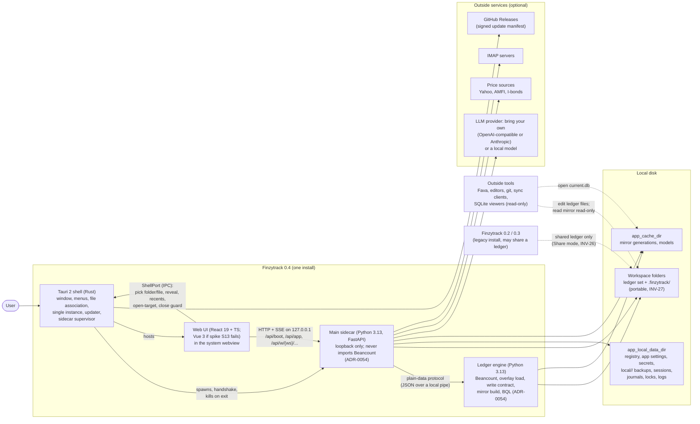

# Architecture of Finzytrack v0.4

> **Frontend framework (2026-10-25): Vue 3, per ADR-0053** (spike S13). Where this document describes the React target, read the Vue equivalents: hooks → composables, `.tsx` → `.vue`, TanStack Vue Query/Table/Virtual, shadcn-vue on Reka UI, `@xstate/vue`, `@ai-sdk/vue`, `eslint-plugin-vue` + `eslint-plugin-vuejs-accessibility`, `vue-tsc`; pins in ARCHITECTURE.md §10 (Vue fallback rows).

This file is the target system picture of the v0.4.0 rebuild: components, package map, API shape, flows, the stack pins and the repository layout.

- **Status:** current as of the owner decisions of 2026-10-24 (including the final review's decisions: ad-hoc-signed macOS without notarization, M1 split into M1a/M1b, replace by atomic swap, the write-intent journal, the workspace invariants INV-28–31). Migrated from the review's architecture overview (review:25).
- **It decides nothing new about the product.** Decisions live in `design/decisions/` (ADRs); this file points to them. Where it states an agent-level choice within the decided stack, that choice is recorded in ADR-0050.
- **Rules it follows:** the engineering principles in `design/ENGINEERING.md` (EP-nn) and the owner-owned invariants in `design/INVARIANTS.md` (INV-nn).
- **Frontend:** the frontend parts describe the React target, marked **React (ADR-0006, pending S13)**. If spike S13 keeps Vue, the structure stays the same (hooks → composables, `.tsx` → `.vue`) and the fallback pins in §10 apply.
- **Generated sections** (the package diagram, the API reference, the statechart diagrams) live in `design/generated/` and are never hand-edited.
- Private review evidence is cited as `review:<doc> §<section>`; finding IDs (`I4`, `L5-07`, `M-1`, …) are kept as they are.

**Decisions that shape this picture** (each detailed in its ADR):
- greenfield app on `next`, old app as differential oracle (ADR-0002, ADR-0014);
- write-safety contract, splicing, overlay load, no resident ledger, write-intent journal, atomic-swap replace (ADR-0008 to ADR-0013);
- the mirror as an atomically published cache; SQLite only (ADR-0015, ADR-0016);
- portable workspace folders, workspace-addressed API, lifecycle, legacy adoption (ADR-0017 to ADR-0021);
- Tauri 2 shell with a Python sidecar, identifier `com.finzytrack.desktop`, Apple-silicon macOS (ad-hoc signed), Windows x64, Linux x64 (ADR-0007);
- React frontend, pending S13 (ADR-0006);
- licence GPL-2.0-or-later for the owner's code, notices and licence checks (ADR-0042);
- agents run locally; CI runs deterministic gates only (ADR-0045);
- v0.2.2 table and function names keep working through 0.4.x (ADR-0048);
- Finzytrack AI mode deferred; bring-your-own providers and local models stay (ADR-0034, ADR-0043).

---

## 1. The system in one picture



Boundaries that matter:
- **The shell holds no business logic** (ADR-0007). It supplies paths, native dialogs and process control. Every path it returns is judged by the backend.
- **The web UI never touches the file system.** Tauri's `fs` plugin is not enabled. The UI's only route to disk is the backend API.
- **Two backend processes (ADR-0054):** the ledger engine holds Beancount (GPL-2.0-only) and does every ledger load and write and the mirror build; the main sidecar holds everything else and never imports Beancount. They talk only through the versioned plain-data protocol `contracts/engine-protocol.schema.json`.
- **The backend is the only writer** of the ledger set, the `.finzytrack/` tool state and the mirror. The mirror is a cache that outside tools may *read* (INV-05, review:00 §1b).
- **Outside services are reached only through backend ports** (§2.3). Each one is optional, and its absence is a typed "unavailable" error, never a crash (§6).

The same backend can later run in hosted mode under a hosted user root (ADR-0041). Nothing in this picture assumes desktop except the shell, which follows "don't foreclose, don't build" (ADR-0041).

---

## 2. Backend

### 2.0 Two processes (ADR-0054, 2026-10-25)

**This amendment overrides the single-process wording elsewhere in §2 and in §5, §10, §11 until those sections are rewritten in the first M1a slice.**

| Process | Holds | Licence of the combined program |
|---|---|---|
| **Ledger engine** (`engine/`, its own environment and lockfile) | `beancount`, `beanquery` and their own dependencies; our packages `ledger` (overlay load, `LoadPolicy`, `beancount_port`, grammar and tolerance, the write-safety contract and writer, journal, recovery) and the build half of `mirror` (row builders, DDL, generation publish); BQL execution | GPL-2.0-only (our code is GPL-2.0-or-later) |
| **Main sidecar** (`backend/`) | FastAPI and every other package of §2.2: workspaces, boot, recipes and SQL over the published mirror, importing readers, categorizer, prices, AI, logging; an `engine_client` port that implements the use cases' ledger interfaces over the protocol | GPLv3 (via "or later"); never imports `beancount` |

- **Protocol:** request/response JSON over a local pipe or loopback socket, schema in `contracts/engine-protocol.schema.json` (versioned, generated from the engine's message models, decoded on the main side like the HTTP API). It carries intents and plans, refusals with error keys, semantic diffs, located errors, query tables, ledger facts (Ledger Profile, account grammar pattern, tolerances) and mirror-generation ids. No Beancount objects, pickles, callbacks or shared memory. Entries never cross per request.
- **Reads** use the published mirror from the main sidecar (§9.1, unchanged). **Writes, BQL, reconciliation loads and Beancount-derived facts** go to the engine.
- **Supervision:** the main sidecar spawns the engine, with the parent-death watchdog of spike S1 and restart with backoff. The engine owns the heavy-load semaphore and keeps no resident ledger (INV-10).
- **Enforcement:** an architecture test per environment (no `beancount` import outside `engine/`; the main environment cannot import it; the engine imports nothing from `backend/`); two licence allowlists (engine: GPL-2.0-compatible plus Beancount's own reviewed dependencies; main: GPL-3.0-compatible); protocol contract tests on both sides.

### 2.1 Shape: vertical feature slices over a shared kernel, functional core and imperative shell

The backend is one Python package, `app`, in `backend/src/app/`. Two axes organize it:

1. **Kernel versus slices (EP-11).** A small set of shared packages (`domain`, `platform`, `ledger`, `mirror`, `workspaces`) is the kernel. Every user-facing capability lives in one **feature slice** (`accounts`, `transactions`, `importing`, `recipes`, `investments`, `prices`, `budgets`, `documents`, `settings`, `ai`). Slices depend on the kernel. They never depend on each other, except through a small set of declared edges (§2.4).
2. **Core versus shell, inside every package (EP-01).** A package's `core/` is pure: functions and frozen value types over plain data, with no I/O, no clock and no framework. The package's shell (`usecases.py`, `http.py`, the adapters) orchestrates the I/O through injected ports and calls the core. Core modules are *deep* (EP-02): a few public functions over a cohesive implementation, not a scatter of tiny helpers.

This is the review:L1 §1.2 layering (`api → usecases → domain`), corrected in three ways:
- **Vertical slices.** L1 had horizontal `usecases/` and `domain/` trees with one module per feature. For a tree built one vertical at a time (ADR-0002), co-locating a feature's core, use cases, HTTP edge and AI capabilities keeps each slice reviewable as one unit (`PROCESS.md` (area review)). The layering survives inside each slice, and import-linter enforces it.
- **`ledger/` carries no resident snapshot.** ADR-0011 supersedes review:L1 §1.4. The loader runs once per operation and its result is released.
- **`integrations/` dissolves into ports and adapters.** Pure parsing and request-building live in the slices' registries. The I/O adapters live in `platform/adapters/`.

### 2.2 Package map

The tree below is the target tree of the review (review:L1, review:backend-survival), corrected as above. review:99 called the boot package `app/lifecycle`; this document uses `app/boot`, as ADR-0002 and review:backend-survival §5.4 do.

```
backend/src/app/
  domain/        KERNEL, pure. Money/Amount, Commodity, AccountName and Tolerance as value types
                 (their only constructors live in ledger), dates/today(tz),
                 rounding policy, metadata vocabulary, PriceIndex,
                 the DomainError taxonomy, the shared tagged-union Result types
  platform/      KERNEL, mostly ports. Port protocols (Clock, Ids, Rng, FileSystem, Http, Imap,
                 Llm, SecretResolver, Locks, ProcessInfo), the heavy-load semaphore and the per-workspace
                 limiter, the registry base (self-describing catalogs), observability (log context,
                 @timed), the PlanStore, the error-code registry
    adapters/    the only place that does real I/O: real fs (atomic replace, fsync_dir), portalocker
                 locks (incl. legacy locks), httpx, imaplib+TLS, Pydantic AI gateway, .env resolver
  ledger/        KERNEL. Beancount wrapped, never re-implemented (EP-03, INV-02).
    core/        source_edit (Fava-ported splicing: locate, apply_edits, route_insert, replace_token),
                 semantic diff (canonical entry keys), error keys, IntendedChange, Edit/EditPlan types
    overlay.py   load(root, overlay, policy) -> LoadResult  (the D2 replica of _parse_recursive, pinned; ADR-0010)
    policy.py    LoadPolicy (desktop permissive; hosted body deferred, ADR-0041)
    contract.py  the write-safety contract as a pipeline of steps (ADR-0008), each fail-closed
    writer.py    the single commit path: locks -> fingerprint -> backup -> atomic write -> read-back
    journal.py   the write-intent journal for multi-file commits (ADR-0012)
    grammar.py   parse_account(text, profile) and Tolerance construction, via beancount_port (ADR-0024)
    beancount_port.py  the only module that imports beancount.*  (typed facade + stubs)
  mirror/        KERNEL. Projection of a LoadResult into SQLite.
    core/        row builders (ported from sqlite_exporter), DDL, r_* view definitions, fingerprint
    publish.py   generation build + atomic publish (symlink / Windows pointer file, ADR-0015), GC
    reader.py    typed reads returning domain DTOs
    query.py     QueryRunner: the one hardened runner for user SQL (L5-07), dsum, price_asof,
                 steps schema (ADR-0029)
  workspaces/    KERNEL. The workspace format and the open/switch machinery (ADR-0017 to ADR-0021).
    format/      manifest models, per-file markers, assess_workspace, assess_portability,
                 resolve_open_target, safe export/import plans (pure; extractable as one package)
    registry.py  the registry (registry key vs lineage id, dedupe by canonical root)
    containers.py  UserContainer / WorkspaceContainer (composition; ref-counted; never hold a ledger)
    legacy.py    legacy detection, classification, adoption plan, coexistence guard (ADR-0020)
  boot/          assess_app, app-level transitions, the lifecycle executor (plan -> consent ->
                 backup -> apply -> record), the migration framework, content packs, demo workspace
  content/       shipped, read-only content packs: widget library, seed dashboards, rule templates,
                 themes, demo scenario fragments + the deterministic demo/corpus generator (ADR-0022)

  accounts/      SLICE. Ledger Profile, account catalog, period balances (ADR-0049, L3-06),
                 open/close/update, move_postings/rename/merge/delete (ADR-0049), booking-method field
  transactions/  SLICE. Filter/list (exact account or subtree), single-entry edit/delete (write stage 4,
                 @@, typed metadata merge), bulk edit, account statement with running balances, undo
  importing/     SLICE. Import pipeline (ADR-0027): read -> adapt -> normalize -> resolve -> reconcile -> match ->
                 suggest; Draft sessions; matcher (bank and holdings reconciliation); categorizer;
                 RuleStore; commit via contract inserts. Adapter registry = importers + statement parsers
  recipes/       SLICE. Validator (strict, located issues), step DAG interpreter, memo, ledger step
                 measures, transforms, compute functions, viz registry + viz-input adapters, BQL steps,
                 ad-hoc query (Analyze)
  investments/   SLICE. Holdings/value as of a date from booking, simple gains, CDs, booking-method
                 previews and lot picker data, one-upload sync (on importing's matcher)
  prices/        SLICE. Price-source registry (pure request builders + parsers), cadence and staleness,
                 price writes through the contract (sidecar as member file)
  budgets/       SLICE. custom "budget" directives (contract inserts/replaces), budget_resolver (ported)
  documents/     SLICE. Document store, orphan scan (never ledger sources, M-2)
  settings/      SLICE. App and workspace settings stores (ConfigStore successor: no path fields, INV-27)
  ai/            SLICE. Capability registry consumer, capability profiles, conversation store,
                 proposal flow (plans bound to ws + conversation), LLM provider profiles (ModelCaps)

  api/           EDGE. App factory, envelope, error translation table, request-id middleware, LAN guard
                 and shell token, ws resolution dependency, route assembly, openapi export
  main.py        COMPOSITION ROOT + sidecar entry: CLI args, roots, build_user_container, uvicorn
```

Each slice has the same internal layout, so an agent finds things by convention:

```
<slice>/
  core/          pure: plans, edit producers, state tables, calculations   (no I/O imports)
  ports.py       optional: slice-specific port protocols (e.g. CategorizerModelStore)
  usecases.py    the slice's public interface; shell orchestration through ports
  schemas.py     Pydantic edge models (request/response); parse into core types, never leak into core
  http.py        FastAPI router: parse -> one use case -> envelope           (the only fastapi import)
  capabilities.py  AI capability declarations over use cases (data, no logic)
  registry.py    only where variation is real (EP-05): adapters, sources, functions, transforms, viz
```

### 2.3 Responsibilities, public interfaces and allowed dependencies

"Public interface" means what other packages may import. Everything else is private, and the import-linter contracts in §2.4 enforce it.

| Package | Responsibility | Public interface (ports / entry points) | May import |
|---|---|---|---|
| `domain` | Domain primitives and their rules; the error taxonomy | `Amount`, `Commodity`, `Currency` (a refinement, §2.6), `AccountName` and `Tolerance` (brands/value types; their only constructors live in `ledger.grammar`, ADR-0024), `today(tz, clock)`, `quantize_derived`, `PriceIndex`, `MetadataKey`, `DomainError` subclasses, `Result` unions | stdlib, `decimal`, `zoneinfo`, `dateutil` (nothing else) |
| `platform` | Ports, concurrency primitives, registries, observability, plans, error registry | Protocols: `Clock`, `Ids`, `Rng`, `FileSystem`, `Locks`, `Http`, `Imap`, `Llm`, `SecretResolver`; `HeavyLoadGate`, `WorkspaceLimiter`, `Registry[T]`, `PlanStore`, `log_context`, `timed`, `ErrorCode` | `domain`, stdlib; `platform.adapters` alone may import portalocker, httpx, pydantic_ai, imaplib, ssl |
| `ledger` | Read and write the ledger set through Beancount; the write-safety contract | `overlay.load`, `parse_files`, `grammar.parse_account(text, profile)`, `grammar.tolerance(...)` (the Beancount grammar and tolerance behind `beancount_port`; INV-02 unchanged), `LoadPolicy`, `Edit`, `EditPlan`, `IntendedChange`, `contract.prepare(plan) -> Prepared \| Refused`, `writer.commit(prepared, acks) -> Committed \| Refused`, `ErrorKey`, `CanonicalEntryKey` | `domain`, `platform` (ports only); `beancount_port` alone imports `beancount` |
| `mirror` | Build, publish and read the SQLite projection; hardened user SQL | `build_generation(load_result) -> Generation`, `publish(gen)`, `Reader` (typed reads), `QueryRunner.run_user_sql(UserSql, params)`, `ledger_version()` | `domain`, `platform`, `ledger` (LoadResult type only); stdlib `sqlite3` |
| `workspaces` | Workspace format, registry, open/switch, containers, legacy coexistence | `format.assess_workspace`, `format.assess_portability`, `format.resolve_open_target`, `Registry`, `open_workspace(key) -> Opened \| NotReady(phase)`, `WorkspaceContainer`, `UserContainer` | `domain`, `platform`, `ledger`, `mirror`; `format/` imports only `domain` + pydantic (extractable, ADR-0017) |
| `boot` | App-level assessment and lifecycle runs; migrations; content packs; demo | `assess_app(probe) -> AppPhase`, `LifecyclePlan`, `execute(plan, consent)`, `Migration` registry, `ContentPack` | kernel packages; `content` |
| `content` | Shipped read-only content and the demo/corpus generator | `packs.load(id, version)`, `demo.generate(anchor_date, size, fragments)` | `domain`, `ledger.core` (printer-free text builders) |
| feature slices | One capability each (§2.2) | `<slice>.usecases` functions, `<slice>.capabilities`, `<slice>.registry` | kernel packages; other slices only through the declared edges (§2.4) |
| `ai` | One assistant over the capabilities | `chat_stream(ws, conversation, message)`, `confirm(plan_id, preview_hash)` (shared with the UI) | kernel; every slice's `capabilities` module (read-only declarations) |
| `api` | HTTP edge | `create_app(container_factory) -> FastAPI`, `export_openapi() -> dict` | everything above; nothing imports `api` |
| `main` | Composition root | `build_user_container(roots, settings, adapters)`; the CLI | everything |

**Ports and their adapters (EP-07).** Every outside effect goes through one of these. Tests inject fakes, and the Hypothesis write model (§8.2) injects a crashing file system.

| Port | Real adapter | Test adapter | Notes |
|---|---|---|---|
| `FileSystem` | `platform.adapters.fs` (read, `atomic_replace` = temp + fsync + `os.replace` + `fsync_dir`, stat, list, `newline=""`) | in-memory FS with crash injection at every call | Confined: takes `WorkspacePath` / `AppPath` only (§2.6) |
| `Locks` | portalocker 3.x semantics (`flock` / `LockFileEx`), per canonical file plus legacy `.write.lock` (ADR-0020) | in-process fake with an interleaving scheduler | The primitive is pinned in ADR-0005 |
| Ledger store | `ledger.overlay` + `ledger.writer` over `FileSystem` and `Locks` | the same code over the fake FS | Not a separate port: it *is* the kernel; its I/O goes through `FileSystem` |
| Mirror | `mirror.publish` / `mirror.reader` over SQLite files in the cache dir | the same over a temp dir | Generation files behind a symlink or pointer file |
| `Clock` | `zoneinfo`-aware system clock | `FrozenClock` | `today(tz)` derives from it (INV-07) |
| `Ids`, `Rng` | uuid7 (`uuid-utils`), `secrets` | seeded sequences | Every id in the core is injected (EP-10) |
| `Http` | httpx with timeouts, used by price sources and the legacy-app probe | recorded-response replayer | Price sources build requests as data (EP-08) |
| `Imap` | imaplib with `ssl.create_default_context()` (M-4) | fake mailbox | — |
| `Llm` | Pydantic AI agents with per-server model profiles | OpenAI-compatible stub server (acceptance) and a FunctionModel (unit) | `ModelCaps` per model (L6-08, ADR-0034) |
| `SecretResolver` | per-workspace `secrets/<key>.env`; app `secrets/app.env` | dict | Rules see only their workspace's scope (ADR-0021) |
| Shell interface | backend side: CLI args (roots, port, shell token, `--app-root`, `--workspace`) and stdout handshake; frontend side: `ShellPort` (§5) | browser `ShellPort` | No other channel between shell and backend |

### 2.4 Dependency direction, enforced

import-linter (`backend/.importlinter`, T1) holds these contracts from the first commit, with no transitional exemptions (`PROCESS.md` (structural checks)):

1. **Layers (kernel):** `api` > (slices) > `workspaces` | `boot` > `mirror` > `ledger` > `platform` > `domain`. `boot` and `workspaces` are siblings.
2. **Per-slice layers**, for every slice: `http` > `usecases` > `core`, with `schemas` importable only by `http` and `usecases`.
3. **Purity (forbidden):** no `*.core` module and no `domain` module may import `fastapi`, `pydantic`, `sqlite3`, `httpx`, `portalocker`, `os`, `pathlib`, `subprocess`, `socket`, `time`, `random`, `secrets`, `uuid`, `beancount` or `app.platform.adapters`. Pydantic stays at the edges (EP-06). `ledger.core` may import `app.ledger.beancount_port`'s pure parser facade only.
4. **Single Beancount gateway and the load rule** (stated once here; ADR-0043 and ADR-0010 point to it): full loads (`load_file`, `load_string`, the `_parse_recursive` replica) are invoked only from `ledger/overlay.py` and the reconciliation job, both under the heavy-load semaphore. Parser-only calls (`parse_file`, `parse_string`) are invoked only via `beancount_port`. Only `beancount_port` imports `beancount`. The AST test checks call sites of the port's wrappers.
5. **Slice independence:** slices do not import each other, except these declared edges, each with an ADR reference in the contract file:
   - `investments → importing.usecases` (the holdings reconciliation reuses the matcher and the report shape, ADR-0032);
   - `ai → <slice>.capabilities` (declarations only);
   - `recipes → budgets.core`, `recipes → investments.core` (measures of the `ledger` step);
   - `importing → accounts.usecases` (anchor-account resolution; the Profile).
6. **Nothing imports `api` or `main`.**

A generated package diagram (from the contract file plus the actual import graph) goes to `design/generated/backend-packages.md` on every T1 run (EP-20).

### 2.5 Concurrency, memory and state (the explicit stateful parts)

The core is stateless. **These are all the stateful parts of the backend, and nothing else may hold state across requests** (EP-04, INV-10, INV-11). The globals-allowlist test (review:18 §2 inv. 2) reads this list from `platform/state_registry.py`, where each item declares its bound and its eviction.

| State | Lives in | Bound | Notes |
|---|---|---|---|
| Heavy-load semaphore | process (the only process-wide state, ADR-0041) | 1–2 slots, configurable | Priority goes to the workspace being opened (review:23 §3.7) |
| Per-workspace write limiter (`anyio.CapacityLimiter(1)`) + RLock depth | `UserContainer`, keyed by canonical root (review:23 §3.9) | one per root | ADR-0011 |
| Job queue (price fetch, rebuilds) | `UserContainer` | configurable | Jobs hold a container reference |
| Conversation store | `UserContainer`, keyed by (ws, thread) | TTL + LRU | ADR-0033 |
| `PlanStore` (previews and AI proposals) | `UserContainer`, keyed by ws | TTL + count; each plan holds texts and hashes, never entries | §4.2, §4.5 |
| Recipe memo | `WorkspaceContainer` | configurable bytes, LRU | Keyed on `ledger_version` + transitive step-input hash (ADR-0029) |
| Categorizer model handle | `WorkspaceContainer`; persisted per `ledger_version` in the cache dir | 1 per ws | L4-13 |
| Optional BQL entries cache | `WorkspaceContainer` | short TTL, off in hosted mode | ADR-0011 |
| Import sessions | disk, `local/<key>/import-sessions/` | N days | ADR-0027 |
| Workspace containers | `UserContainer`, ref-counted | at most 1 idle container kept warm on desktop | review:23 §3.8 |

**App-level files** (`workspaces.json`, `settings.yaml`, `.app.json`) are written under one app-level lock with atomic replace; a second process on the same app root is refused or serialized (review:F B-2.18).

Execution rule: every `async def` handler only `await`s. Sync work runs on a worker thread, behind the workspace limiter (writes) or the heavy-load gate (full loads), via `anyio.to_thread.run_sync`. An AST test enforces it (review:L1 §1.5).

### 2.6 Domain types (summary; the rules are EP-21 and EP-22)

| Concept | Python | TypeScript | Produced only by |
|---|---|---|---|
| Amount (number + commodity) | `@dataclass(frozen=True, slots=True) Amount(number: Decimal, commodity: Commodity)` | `{ number: Money; commodity: Commodity }` | `domain.parse_amount`, `beancount_port` conversion |
| Money number | `Decimal` (no float, INV-06) | `Money` (branded string over decimal.js, as today) | edge parsers and decoders |
| Commodity | `NewType("Commodity", str)` | branded `string` | Beancount currency grammar |
| Currency | `NewType("Currency", Commodity)`, a *role* | branded | **only** `profile.as_currency(c)` (ADR-0025: a role the Profile assigns, not a lexical class) |
| AccountName | `NewType("AccountName", str)` | branded `string` | `ledger.grammar.parse_account(text, profile)` (the Beancount grammar behind `beancount_port`, L3-04); `domain.AccountName` is a brand whose only constructor lives in `ledger`. `Tolerance` likewise (ADR-0024) |
| CivilDate | `datetime.date` (already distinct; no wrapper) | `Temporal.PlainDate` | `parse_date`, the clock |
| WorkspaceKey / LineageId | two `NewType`s over `str` / `UUID` | two brands | the registry / the manifest (ADR-0017: confusing them is the costly mistake) |
| TransactionId | `NewType`: the legacy `id`/`transaction_id` meta, else `k:` + the entry's first `import-key` element, else the fallback content hash + ordinal (INV-21 data contract). Mutating requests pair it with an `entry_hash` (canonical whole-entry hash); write responses return an old→new id map (ADR-0026) | brand | the mirror |
| CanonicalEntryKey, ErrorKey | `NewType`s over `str` | — | `ledger.core` (ADR-0008) |
| LedgerVersion | `@dataclass(frozen=True, order=True)` (generation, fingerprint hash) | brand + comparator | `mirror.ledger_version()` |
| PlanId, PreviewHash | `NewType`s | brands | `PlanStore` |
| WorkspacePath | frozen value: relative POSIX, normalized, non-escaping, validated on construction | brand | `WorkspacePath.parse(root, text)` |
| AppPath | frozen value under one of the app roots | — | `main` (from the shell's args) |
| UntrustedText vs markup | `UntrustedText` wrapper (payees, narrations, metadata values, attachments, email bodies, model output) | the same brand; markup only as `SafeHtml` from `renderMarkdown()` | edge parsers; `SafeHtml` only from markdown-it + DOMPurify |
| User query text | `UserSql`, `UserBql` NewTypes; internal SQL is `LiteralString` | brands in the recipe and Analyze editors | the recipe validator / the Analyze endpoint |

---

## 3. Frontend — React (ADR-0006, pending S13)

**Framework: React, conditional on spike S13 (owner, 2026-10-24; ADR-0006).** The target is a React + Vite single-page app (no Next.js, no server rendering): React 19 with the React Compiler, shadcn/ui on Radix, TanStack Query/Table/Form for React, `@ai-sdk/react`, `@xstate/react`, and the eslint-plugin-react-hooks strict rules (recommended-latest, including the compiler rules, as errors). The M0 spike S13 (review:27 M0) decides it: if React is measurably worse than an equivalent Vue prototype in WebKit by more than the spike brief's margin (default 20%) on scroll frame time, edit latency, initial render or memory, the frontend stays on Vue 3 with the same structure (hooks → composables, `.tsx` → `.vue`) and the fallback pins in §10. Everything below except the framework bindings is framework-neutral.

### 3.1 Structure — React (ADR-0006, pending S13)

```
frontend/src/
  app/              shell: main.tsx, App.tsx, router (/w/:ws/... routes, react-router declarative mode),
                    QueryClientProvider, providers, app-level machines (boot, workspace switch, updater), error host
  api/              the only module that talks HTTP
    generated/      openapi-typescript output (types only; never hand-edited)
    client.ts       openapi-fetch instance: envelope unwrap, AppError, AbortSignal, request id
    decode.gen.ts   generated decoders: wire brands -> domain types (Money check, PlainDate, ...)
    keys.gen.ts     generated query-key factories from x-ft-scope (['app'], ['ws', ws, 'config'|'ledger', ...])
    errors.gen.ts   generated ErrorCode union, presentation table, client-side messages
    sse.ts          typed reader for the non-chat event streams
    chat.ts         AI SDK transport for useChat (@ai-sdk/react; Vercel AI UI message stream, v7 protocol)
  domain/           pure kernel: money.ts, format.ts, dates.ts (Temporal), accounts.ts, commodities.ts,
                    metadata.ts, tolerance.ts, parse.ts, brands.ts, untrusted.ts (SafeHtml)
  platform/         clock.ts, ids.ts, storage.ts (scoped keys ft/v1/app|ws/...), logger.ts,
                    shell/ (ShellPort + tauri.ts + browser.ts)
  catalog/          shared catalog query hooks: Ledger Profile, accounts catalog, commodities
                    (components/app may read these, ADR-0035)
  components/
    ui/             vendored shadcn/ui on Radix (unedited copies, from the shadcn CLI)
    app/            domain primitives: AccountCombobox, CommodityCombobox, MoneyText/Cell/Input,
                    DateField/DateRangeField, ConfirmHost + useConfirm, DialogShell/SheetShell,
                    useUnsavedGuard, Field + useFieldErrors, QueryState/EmptyState/ErrorState,
                    PageHeader/PageTabs, IconButton, FileDropZone/ServerFilePicker, DataTable,
                    SafeMarkdown, useECharts (thin own hook over echarts; no wrapper library)
  features/<name>/  workspaces, boot, accounts, transactions, importing, dashboards, investments,
                    assistant, settings:
    index.ts        the feature's public surface (routes + anything another feature may use)
    queries.ts      TanStack Query hooks over api/ (keys from keys.gen.ts)
    machines/       XState machines for this feature's workflows (*.machine.ts) + their model tests
    hooks/          headless logic as custom hooks (useEditBuffer, useImportSession, useBudgetDrafts, ...);
                    forms use TanStack Form
    views/          thin route views, *.tsx (compose hooks + components; no business rule, INV-12)
    components/     feature-specific components (*.tsx)
  features/dashboards/viz/   the viz registry (the GUI-builder extension point; lint exemption, ADR-0035)
```

The rules come from ADR-0035, ADR-0036 (including the phone principle) and ADR-0037:
- **Server state lives in TanStack Query only** (ADR-0037). Keys are workspace-scoped (ADR-0037) and generated (§4.1), and are never hand-built.
- **Client state** lives in side-effect-free module stores keyed by workspace, read through `useSyncExternalStore`. There is no Redux, Zustand or Pinia.
- **Workflows with real states** use XState machines (§7). A hook owns a machine instance (`useMachine` / `useActorRef` + `useSelector` from `@xstate/react`) and exposes a small interface. Views never send raw machine events they don't own.
- **Views are thin.** A business rule lives in `domain/`, a hook or a machine, never only in JSX. This is the phone principle, and INV-12.
- **React Compiler on, hooks rules strict.** `babel-plugin-react-compiler` runs through `@vitejs/plugin-react`; eslint-plugin-react-hooks' recommended-latest rules (including the compiler diagnostics) are errors. No hand-written `useMemo`/`useCallback` unless a compiler bail-out is documented next to it.
- **eslint-plugin-boundaries** enforces the dependency direction: `app` → `features` → (`catalog`, `components/app`, `api`, `platform`) → `domain`. `components/ui` imports nothing app-specific. `components/app` may import `catalog` and `domain`. A feature imports another feature only through its `index.ts`, and only along edges listed in the ESLint config. `api/generated` is imported only by `api/`.

### 3.2 TanStack Query and the API binding — React (ADR-0006, pending S13)

- **`ws` comes from the route** and flows into the query key and the request together. The generated client takes `ws` as an explicit path parameter (ADR-0018). No interceptor reads a global "current workspace".
- `staleTime: Infinity` for ledger-derived data. Invalidation is driven by domain events: the response `meta.ledger_version` (monotonic) or `meta.writes_ledger`, the focus-time version check (`GET /api/w/{ws}/version`) and config writes. These rules come from ADR-0037.
- **Every `queryFn` consumes `signal`**, so a workspace switch aborts its queries. The server stops recipe runs between steps.
- Large results skip structural sharing (`structuralSharing: false`) and are shaped with `select` (the Vue fallback uses `shallowRef`). Recipe widgets are one query per widget (`['ws', ws, 'ledger', 'recipe-run', widgetHash, params]`), with a run token (I7).
- The transaction grid is TanStack Table + TanStack Virtual (54k rows), the shape S13 measures.

---

## 4. API shape

### 4.1 Contract and generation (schemas as the single source, EP-16)

**One contract file, generated offline.** `backend/scripts/export_openapi.py` imports `app.api.create_app` with a no-I/O container factory and writes `app.openapi()` to `contracts/openapi.json` (sorted keys, stable output). No server is started. This replaces today's "restart the backend, then `npm run generate-api`" step: **the root `CLAUDE.md` backend-then-frontend rule is retired on `next`.** A schema change and its client regeneration land in the same commit.
- **Pre-commit (T0):** if anything under `backend/src/app/**/schemas.py`, `http.py`, `platform/errors/` or `api/` is staged, the hook re-exports the spec and regenerates `frontend/src/api/{generated,*.gen.ts}`. It blocks the commit if either differs from the staged copies.
- **CI (T1):** the same regeneration from a clean checkout, then `git diff --exit-code`. A second job compares `contracts/openapi.json` with the previous release's spec through a breaking-change check (`oasdiff`, pinned binary) and fails on an unlabelled break (EP-14).
- Testing against a *running* backend is still required for acceptance flows. Agents start their own isolated backend on its own port and data dir (INV-24). They never restart the owner's backend.

**Codegen choice: `openapi-typescript` 7.13.0 + `openapi-fetch` 0.17.0** (types only, with a small runtime that has native `AbortSignal` and middleware). It replaces `openapi-typescript-codegen`, whose README states that the project is unmaintained and directs users to `@hey-api/openapi-ts` (checked on npm, 2026-10-24). `@hey-api/openapi-ts` 0.99.0 was evaluated and **not chosen**:
- Its generated TanStack Query hooks (React or Vue) build their own query keys (operation id + parameters). Our invalidation model needs keys grouped by *scope class* (`['ws', ws, 'ledger', …]` vs `['ws', ws, 'config', …]`, ADR-0037). With generated hooks we would either lose prefix invalidation or patch generated code, and generated code is never hand-edited (INV-19).
- It is still at 0.x with frequent breaking minor releases (0.97 → 0.99 between May and June 2026), and its runtime client is a larger dependency than openapi-fetch.
- openapi-typescript's `transform` hook covers the one thing we need from codegen: mapping our schema annotations to branded TS types.

Hand-written TanStack Query hooks live in `features/*/queries.ts`. They are thin (one `useQuery` per operation), and their keys come from **`keys.gen.ts`**, which a small generator (`frontend/scripts/gen-api-extras.mjs`) emits from the vendor extensions in the spec:
- `x-ft-scope: app | config | ledger` on every operation, so the route-scope test (INV-28) and the key factory read the same declaration;
- `x-ft-writes: ledger | config | none` on mutations, which drives invalidation.

**Domain types survive codegen (EP-21).** Pydantic edge types carry JSON-Schema annotations, for example `Annotated[Decimal, PlainSerializer(str), WithJsonSchema({"type": "string", "format": "decimal", "x-ft-type": "Money"})]`. The same applies to `AccountName`, `Commodity`, `CivilDate` (`format: date`), `WorkspaceKey`, `TransactionId`, `LedgerVersion`, `PlanId`, `UntrustedText` and `UserSql`.
- `openapi-typescript`'s `transform` maps each `x-ft-type` to its brand from `domain/brands.ts`.
- `decode.gen.ts` (same generator) walks each response schema and lifts wire values to domain values at the edge: it checks the `Money` string grammar, converts `CivilDate` strings to `Temporal.PlainDate`, and leaves `UntrustedText` branded so it can never reach raw HTML (only `SafeMarkdown` renders markup).
- The `api/client.ts` middleware applies the decoder of the operation it called. Feature code never sees a wire type.

**One envelope for every endpoint** (ADR-0037, ADR-0018). This removes today's recipe exception (`frontend/CLAUDE.md`: raw JSON for `/api/recipes/...`). That exception existed because AI tools read recipes through the HTTP layer; in the new design AI capabilities call use cases directly (ADR-0033), so it has no reason left.
- Recipe documents travel as `data: RecipeDocument`. Its schema is generated from `contracts/recipe.schema.json` with `additionalProperties` preserved, which keeps the lossless round-trip the GUI builder needs (ADR-0029).

```jsonc
// success
{ "data": <T>, "meta": { "request_id": "…", "workspace_id": "…", "ledger_version": "…", "config_version": "…" } }
// error (HTTP status from the error class, §6)
{ "error": { "code": "LEDGER_EXTERNALLY_CHANGED", "class": "conflict", "message": "…", "data_safe": true,
             "next_step": "…", "issues": [ { "path": "/postings/1/amount", "message": "…" } ],
             "retryable": true, "retry_after_ms": null, "details": { /* typed per code */ },
             "correlation_id": "…" },
  "meta": { "request_id": "…", "workspace_id": "…" } }
```

### 4.2 Routes

| Prefix | Scope | Examples |
|---|---|---|
| `/api/boot` | app | `GET` → `{app: {phase, version, plan?}, last_workspace?: {...}}` (ADR-0019); answers before ready |
| `/api/app/…` | app | settings, AI provider, update channel, `quiesce` (before an update), `client-log` (§6A.2), `report:preview` / `report:save` (§6A.4), `diagnostics` (§6.6), packs |
| `/api/workspaces/…` | app (registry) | list, `{key}/open`, `create:plan` / `create:apply`, `adopt:plan`, `import:plan`, forget, `legacy/probe` |
| `/api/w/{ws}/…` | workspace | `version`, `profile`, `accounts`, `accounts/balances?from&to`, `transactions?…&cursor`, `transactions/{id}:preview`, `import/sessions/{id}/…`, `recipes:run`, `dashboards/…`, `rules/…`, `prices/…`, `investments/holdings?as_of`, `documents/…`, `plans/{id}:confirm`, `chat` (SSE) |

- **Writes follow plans as data (EP-08).** A mutating capability exposes `…:preview`, which returns a `WritePlan {plan_id, preview_hash, diff, new_error_keys, warnings}` (INV-16), and the shared `POST /api/w/{ws}/plans/{plan_id}:confirm {preview_hash, acknowledged_error_keys}`. A non-destructive insert may combine the two in one call when nothing needs acknowledgement. **AI proposals are plans of the same type in the same `PlanStore`**, confirmed through the same endpoint (ADR-0033: the approval names a server-side id plus a preview hash), so the UI and the AI share one write model.
- Lists are cursor-paginated and filterable (the phone principle: "capabilities, not screens").
- Path-taking endpoints (open by path, Locate, the server file picker) require the shell token, and they are disabled when the backend is bound beyond loopback (ADR-0040).

### 4.3 Streams

- **Chat** (`POST /api/w/{ws}/chat`) speaks the **Vercel AI UI message stream protocol, v7**, produced by Pydantic AI's `VercelAIAdapter(sdk_version=7)`. The installed `pydantic-ai-slim` 2.55.0 source supports `Literal[5, 6, 7]`; checked 2026-10-24. Keeping the types in sync works in three parts:
  1. The protocol types are the `ai` package's own (`UIMessage`, `UIMessageChunk`). We do not regenerate them.
  2. Our custom parts (`data-proposal`, `data-plan-status`, `data-citation`) and the message metadata are Pydantic models exported into `contracts/openapi.json` `components.schemas` (via `x-ft-stream-parts`), so they reach TS through the normal codegen. They are declared to `useChat` as `UIMessage<ChatMetadata, ChatDataParts>`.
  3. A contract test records a backend stream from the stub-LLM run and parses it in vitest with the AI SDK's own stream reader, asserting the expected parts. `ai` / `@ai-sdk/react` (`@ai-sdk/vue` if S13 keeps Vue) and pydantic-ai's `sdk_version` are upgraded together in one dependency slice.
- **Other streams** (email fetch progress, mirror rebuild progress) are typed SSE event unions (Pydantic discriminated unions exported into the spec) read by `api/sse.ts`. They carry the envelope's `error` shape in their terminal error event.

---

## 5. Tauri shell boundary and sidecar

> **Amended by ADR-0054:** the shell spawns and supervises the **main sidecar** only; the main sidecar spawns and supervises the **ledger engine** (§2.0). Both are signed and covered by the orphan rules. Spike S1 also showed that a onedir tree ships as `bundle.resources`, not `externalBin`, and that the Linux updater handles AppImage, `.deb` and `.rpm`; this section is rewritten with the packaging ADR (Q21).

**Identifier and platforms (owner, 2026-10-24; ADR-0007):** the Tauri identifier is `com.finzytrack.desktop` (permanent; it fixes `app_local_data_dir` and how updates find the app), product name "Finzytrack". Builds: Apple-silicon macOS (ad-hoc signed, not notarized), Windows 10/11 x64 (unsigned; the SmartScreen warning is documented), Linux x64 (Ubuntu 22.04 or newer; the updater updates the AppImage only, verified in spike S1). Intel Macs are not built.

**Rust side** (`shell/src-tauri/`, Tauri 2.12):
- **Sidecar supervisor.** It spawns the PyInstaller **onedir** backend (faster start than onefile; every binary signed: ad-hoc on macOS until an Apple Developer ID exists) with arguments `--app-local-data … --app-cache … --port 0 --shell-token-env FT_SHELL_TOKEN [--workspace PATH]`. The backend binds a free loopback port and prints one handshake line (`FT_READY {"port":…, "version":…}`) on stdout. The shell then waits for `GET /api/boot`, opens the window and injects the port and token through an initialization script.
  - Exit: graceful `POST /api/app/quiesce`, then terminate.
  - Orphans: the shell kills the process group on POSIX and uses a Job Object on Windows.
  - Crash: restart with backoff; after three crashes the shell shows a "backend stopped" screen with diagnostics. This is the sidecar statechart in §7.
- **Plugins:** `dialog` (pick folder/file), `opener` (reveal), `single-instance` (forwards the path of a second launch), `updater`, `process` (relaunch), `log`. **No `fs` plugin, and no `shell:allow-execute` for the webview.** The Tauri capability file grants the webview only the dialog, opener, updater and process permissions it needs.
- File associations for `.beancount` and `.bean` at alternate rank (ADR-0007). OS recents come from the registry. Close requests are forwarded to the web UI's unsaved guard.
- **CSP** in `tauri.conf.json`: `default-src 'self'; script-src 'self' 'sha256-<pre-paint>'; connect-src 'self' http://127.0.0.1:*; img-src 'self' data:; object-src 'none'`. The same CSP is set as an HTTP header for browser and headless use (INV-09, ADR-0040).

**TypeScript side.** One `ShellPort` with a Tauri implementation and a browser implementation (ADR-0007): `pickFolder`, `pickFile`, `reveal`, `setRecents`, `onOpenTarget`, `onCloseRequested`, plus `checkForUpdate` / `installUpdate`. The `ShellPort` is the only module that imports `@tauri-apps/*`, which ESLint enforces.

**Headless mode** (`--headless --host … --port N`) keeps a stable port for browser and phone access, with the LAN guard (ADR-0040).

---

## 6. Error model

This replaces today's three backend channels (L1-05: HTTP errors raised from core, string-matched `ValueError`s, catch-all 500s) and the seven frontend error patterns. It reuses three things that work today: the error-code registry idea, `errorHandler.display()`'s routing by code, and ADR-0039's notification semantics. The engineering rule is EP-13.

### 6.1 Taxonomy

The taxonomy lives in `app.domain.errors`, and the code registry in `app.platform.errors.registry`, which is the **single source** for codes. Each code declares its class, HTTP status, a `retryable` flag, a default presentation, a plain-language message template, the data-safety statement and the next step, and a typed `details` model.

| Class (`DomainError` subclass) | HTTP | Typical codes | Default presentation (ADR-0039) |
|---|---|---|---|
| `Invalid`: validation, with located issues (JSON path / field) | 422 | `VALIDATION_FAILED`, `RECIPE_INVALID`, `ACCOUNT_NAME_INVALID`, `AMOUNT_UNPARSEABLE` | inline field errors (`Field` / `useFieldErrors`), else a toast |
| `NotFound` | 404 | `WORKSPACE_UNKNOWN`, `TRANSACTION_NOT_FOUND`, `PLAN_EXPIRED` | toast |
| `Conflict`: state moved underneath | 409 | `LEDGER_EXTERNALLY_CHANGED` (the contract's fingerprint check), `PREVIEW_STALE`, `WORKSPACE_NOT_READY {phase}`, `SYNC_CONFLICT_WRITES_BLOCKED`, `WRITE_IN_PROGRESS` | modal with reload / re-plan |
| `ContractRefused`: the write contract refused (semantic diff mismatch, a step failed closed, a new error not acknowledged) | 409 (needs acknowledgement) / 422 (refused) | `ACK_REQUIRED {error_keys}`, `WRITE_REFUSED_UNINTENDED_CHANGE`, `WRITE_REFUSED_CHECK_FAILED`, `ENCRYPTED_FILE_NOT_EDITABLE` | modal; always says "your ledger is unchanged" |
| `Forbidden`: permission and confinement (ADR-0040, ADR-0041) | 403 | `PATH_OUTSIDE_WORKSPACE`, `LOAD_POLICY_REFUSED`, `LAN_PATH_DISABLED`, `AI_DISABLED_IN_WORKSPACE`, `UNPROMOTED_MUTATOR_ON_REAL_LEDGER` | modal |
| `Unavailable`: a dependency is down or busy | 503 | `LLM_UNAVAILABLE`, `IMAP_UNAVAILABLE`, `PRICE_SOURCE_UNAVAILABLE`, `NETWORK_UNAVAILABLE`, `BUSY_HEAVY_LOAD`, `SECRET_MISSING` | toast with **Retry** (`retryable: true`, `retry_after_ms`) |
| `Internal`: a bug | 500 | `INTERNAL` | modal with the correlation id and **Copy diagnostics** |

**Expected outcomes are not errors.** "This open needs an upgrade", "this preview introduces two new errors" and "this row is a duplicate" are tagged-union results of the use case (EP-13). They become a `DomainError` only when the caller insists past them, for example confirming without the acknowledgement.

### 6.2 Translation once, at the edge

- Core and shell code raise `DomainError` subclasses built with registry codes. **No module below `api` knows an HTTP status.** `api/errors.py` holds the one class → status table and the one exception handler that builds the envelope's `error` object (§4.1) from the code's registry entry and the error's typed details.
- The registry is exported into the OpenAPI spec (an `ErrorCode` enum and a discriminated union of per-code `details` schemas). The generator then emits `errors.gen.ts`: the code union, the presentation table, and client-side messages for the client-only codes (`CLIENT_NETWORK`, `CLIENT_TIMEOUT`, `CLIENT_DECODE`, `CLIENT_ABORTED`).
- **No string matching anywhere.** Code compares codes, never messages. Lint and an AST test enforce this (EP-13).

### 6.3 No swallowing; fail closed

- `except Exception` (and bare `except`) is allowed in exactly three places: the API exception handler, the job runner and the sidecar's top-level loop. Each logs with the correlation id and converts to `INTERNAL`. Ruff `BLE001` / `S110` / `TRY` rules plus an AST allowlist test enforce this.
- The write contract never fails open (INV-22). Any exception inside a contract step becomes `WRITE_REFUSED_CHECK_FAILED`, and no byte reaches disk. There is a fault-injection test per step (ADR-0008).

### 6.4 One frontend path

- The `api/client.ts` middleware turns every non-2xx response, network failure and decode failure into one typed **`AppError`** (code, class, message, issues, retryable, correlation id, typed details). Nothing else reads response bodies.
- **One handler**, `presentError(error, context?)` in `app/errors/`, maps code → presentation using the generated table and ADR-0039's rules:
  - toast-class errors auto-dismiss and stay in history;
  - modal-class errors are sticky;
  - when `context.form` is given, located issues go to `useFieldErrors` (the `Field` primitive, ADR-0035), and the rest go to a toast;
  - `retryable` errors offer **Retry**, which re-runs the failed query or mutation.
- TanStack Query's global `QueryCache.onError` and `MutationCache.onError` call the handler unless a query opts into `meta.errors: 'state'`. Errors then render through `QueryState` / `ErrorState`.
- Statecharts have explicit error states (§7). A machine's error state shows the same presentation through `presentError`, so a workflow never invents its own error UI.
- **Banned by lint:** `console.error`/`console.warn` outside `platform/logger.ts`; reading `.body`, `.json()` or `.response` of errors outside `src/api`; empty `catch`; `throw` of non-Error values; floating promises.

### 6.5 Messages users see

Every registry entry has three short parts: **what happened**, **whether your data is safe**, and **what to do next**. For example: "Finzytrack did not save this change because the ledger file changed outside the app. Your ledger is unchanged. Reload and try again." A message may say "Your ledger is unchanged" only when the disk equals the pre-image; otherwise the `RECOVERING` message is shown (ADR-0012).
- The wording is plain English for non-native speakers: no idioms, no jargon (owner rule). Codes and correlation ids appear only in the details area.
- A message template is reviewed like UI copy, and the doc auditor checks new codes against the rule.

### 6.6 Logs and diagnostics

Every error envelope carries the `correlation_id` of its log lines. The error modal's **Copy diagnostics** copies a short redacted summary (versions, phases, the correlation id and its log lines). **Report a problem** (§6A.4) builds the full bundle. Both follow §6A.

### 6.7 Tests

- Every registry code has at least one test, tagged `@pytest.mark.error_code("CODE")`, that triggers it through the API. A T1 check fails when a code is unused or untested.
- The acceptance suite covers the user-visible behaviour of each class:
  - an inline field error;
  - a conflict modal with reload;
  - a retryable "unavailable" toast whose Retry succeeds against the stub;
  - an `INTERNAL` modal with working Copy diagnostics;
  - an `ACK_REQUIRED` flow.

---

## 6A. Logging and diagnostics

**Today (v0.3, checked in the legacy worktree):**
- a root logger with a text `RotatingFileHandler` at the cwd-relative `./logs/finzytrack.log`;
- 93 modules log unstructured f-strings with no correlation ids;
- some info-level lines contain financial data;
- `ai/diagnostics.py` writes a cwd-relative `ai_diagnostics.jsonl`;
- the frontend has 33 raw `console.*` calls and **no global error handler** (no `app.config.errorHandler`, `window.onerror` or `unhandledrejection`), so its errors never reach a file.

The target makes the log good enough to analyse a user's report and safe enough that the user can attach it. The rules are EP-15 (observability) and EP-26 (privacy-safe logging).

### 6A.1 One structured log per installation

- **Location:** `<app_local_data_dir>/logs/finzytrack.jsonl`, from the Tauri identifier paths that the shell passes to the sidecar (ADR-0017). In headless mode it goes under `--app-root`. It is never inside a workspace folder (INV-27, which also keeps it out of syncs and exports), and never relative to the cwd. A startup check refuses a log path outside the app dirs.
- **Format:** JSON lines. **Library: `structlog` 26.1.0 on top of stdlib `logging`.** structlog builds and processes the events (contextvars binding, the redaction processor, JSON rendering). stdlib `logging` supplies the handler (`RotatingFileHandler`) and also captures third-party libraries' records (uvicorn, httpx, Beancount warnings) through the same processor chain. A plain stdlib JSON formatter was considered: it has no contextvar binding or processor pipeline, and both would have to be hand-written.
- **Every line carries** `ts` (UTC, ms), `level`, `event` (a registered name, §6A.3), `session_id` (one per app launch; the shell generates it and passes it to the sidecar and the UI), `correlation_id` (= the request id, the same as in the error envelope, §6.1), `ws` (the registry key, when the event is workspace-scoped), `source` (`backend` / `ui` / `shell`), `feature` (the slice), `app_version`, and the event's own typed fields.
- **Rotation:** size-based. Defaults of 10 MB × 5 files are an **app setting** sized per deployment, not a development budget (`PROCESS.md` (thresholds)). Disk use is set by rotation. There is no byte budget per event.
- **The shell** logs through `tauri-plugin-log` to `logs/shell.jsonl` in the same directory and with the same line schema. It needs its own file because it must log before the sidecar starts (spawn and handshake failures) and after the sidecar exits. Report a problem bundles both files. This is the one exception to "one stream".

### 6A.2 The frontend logs into the same stream

- **`platform/logger.ts`** is the only frontend module allowed to call `console.*` (ESLint `no-console` everywhere else; error severity from the first commit).
  - It batches events, with a flush interval and a size cap, plus an immediate flush on `error` and on `pagehide`.
  - Batches go to `POST /api/app/client-log`, which tags them `source: ui` and writes them through the same backend redaction and handler.
  - While the backend is unreachable, events wait in a bounded in-memory ring and are replayed when the backend comes back. In development builds they also go to the console.
- **Tauri's log plugin, evaluated as the frontend's channel: not chosen.** It would put UI events in a second file outside the backend's typed redaction, and it doesn't exist in browser or headless mode. It is kept only for the shell's own lines (§6A.1).
- **Global handlers**, installed in `app/main.ts` before mount, route every uncaught error to the log **and** to the user through `presentError` (§6.4, ADR-0039: an `INTERNAL` modal with the correlation id, or a toast for a minor client fault):
  - a root React error boundary (`app.config.errorHandler` on the Vue fallback);
  - `window.onerror`;
  - `window.onunhandledrejection`;
  - TanStack Query's `QueryCache` / `MutationCache` `onError`;
  - an XState inspection hook that logs every machine reaching an error state and every event that reaches no transition.
- **Client errors get a correlation id too.** An `AppError` from the API carries the server's id. A client-only error gets a client-generated id, which the log endpoint keeps, so a user can quote the id from the dialog and the log line can be found.

### 6A.3 Privacy by construction

- **Events are declared, not ad hoc.** `platform/observability/events.py` is a self-describing registry (EP-05). It is the source for both sides, and generated into `errors.gen.ts`'s sibling `events.gen.ts`. Each event declares its name, its level class (§6A.5) and its typed fields. Field kinds are `id`, `count`, `duration_ms`, `bytes`, `enum`, `code` and `safe_text` (developer-written constants only).
- **The redaction processor is default-deny.** Any field value outside the declared safe kinds is redacted before it reaches a handler:
  - `Decimal`, `Amount`, `Money` → `<money>`;
  - any plain `str` → `<text len=N>`. This covers `AccountName`, `Commodity` and other `NewType`s, which are plain `str` at runtime, so a brand cannot leak just because it was erased;
  - `UntrustedText` (payees, narrations, metadata values, email bodies, model output) → `<untrusted len=N>`;
  - secrets → `<secret>`;
  - paths: those under the app dirs are made relative (`app:/logs/…`); every other path → `<path>`;
  - exception messages: replaced by the exception type and the registry error code. Tracebacks keep only code locations.

  A field is shown only when its event declares it with a safe kind. Redaction is the mechanism; there is no "remember not to log X" rule.
- **Policy:** no financial content at info level, or at any level outside debug mode. Event shapes, ids, counts, timings, error codes and phase names are fine.
- **Debug mode** is opt-in (Settings → Diagnostics), with a warning that explains what it records. It is time-limited (default 24 h; it switches itself off), and its lines are marked `debug: true`. It relaxes redaction only for declared `debug_detail` fields: account names, but never secrets, and never full file contents.
- **AI diagnostics** (prompts, tool calls, responses) are off by default. They are opt-in under the same rules, written to `logs/ai-diagnostics.jsonl` with the same TTL and the same redaction of secrets. This replaces the cwd-relative `ai_diagnostics.jsonl`.

### 6A.4 "Report a problem"

1. Help → **Report a problem** (also in the `INTERNAL` modal) calls `POST /api/app/report:preview`. The backend builds a **bundle plan** (EP-08) holding:
   - the recent log files (both streams; debug and AI-diagnostic lines only if the user ticks them);
   - app, shell, sidecar, Beancount and OS versions;
   - boot and workspace phases;
   - **workspace statistics only**: entry, account and file counts, ledger size buckets, booking methods in use, plugin names mapped to "built-in name / custom", feature flags, mirror generation age. **Never ledger content.**
2. A **final scrub pass** runs over every text line: email addresses, digit runs of 8 or more (account and card numbers, with a Luhn check for cards), IBAN, PAN (`[A-Z]{5}[0-9]{4}[A-Z]`), API-key shapes and home-directory paths are replaced. The privacy scanner's pattern set (the privacy gate in `PROCESS.md`) is reused.
3. The UI **shows exactly what is inside**: a file list plus a text viewer of each scrubbed file. The user may untick files.
4. On **Save…**, `ShellPort.pickSaveFile` → `POST /api/app/report:save {plan_id, path}` writes one zip. No separate script exists or is needed.

### 6A.5 Levels and volume

| Level | Event classes |
|---|---|
| `error` | a failed operation with an `INTERNAL` or unexpected code; a contract step that failed closed; a sidecar crash |
| `warning` | a refused write (`ContractRefused`, `Conflict`); a degraded dependency (`Unavailable`); a port call over its slow threshold; a reconciliation mismatch (D2 guardrail 3, ADR-0010); a migration rolled back |
| `info` | lifecycle: boot phases, workspace open/close and phase, a commit done (mutator, files touched, counts, `duration_ms`), import session state changes, plan confirmed or rejected, update steps, a mirror generation published |
| `debug` | port calls with timing (`port`, `op`, `duration_ms`); recipe step timings and memo hits; query plans; anything in debug mode |

### 6A.6 Tests

- A **redaction corpus** (`backend/tests/contract/test_log_redaction.py`): events carrying each sensitive type (Decimal, Amount, AccountName as `str`, UntrustedText, a secret, a path outside the app dirs, an exception whose message contains a payee) must come out redacted, at every level outside debug mode. Every registered event is emitted once with hostile field values.
- **Frontend uncaught error** (Playwright): a seeded component error and a rejected promise each produce a user-visible notification and a `source: ui` line in `finzytrack.jsonl` with the same correlation id.
- **Correlation id round trip:** a provoked API error shows its id in the UI, and exactly that id is found in the backend log line and in Report a problem's bundle.
- **Report-a-problem scrub:** a fixture log seeded with emails, account numbers, a PAN and an IBAN produces a bundle with none of them.
- An architecture test checks that no module calls `logging.getLogger(...).info(f"...")` or `print(...)`: only the registered-event logger is used (ruff `T20`, `G004`, plus an AST check).

---

## 7. Statecharts

Frontend workflows are **XState v5** machines with model-based tests: `@xstate/graph` generates shortest and simple paths, and every state and transition must be covered. Backend workflows are **pure transition functions over explicit tables**: `transition(state, event) -> (state, effects)`, where effects are data that the shell executes. An exhaustive (state × event) test checks that undefined pairs raise `IllegalTransition`, and Hypothesis random walks check the invariants. Diagrams are generated from both kinds into `design/generated/statecharts/` (EP-20). Where a workflow has a backend authority and a UI, **the backend table is the truth**, and the frontend machine only models UI states over it. The backend state comes back in API responses as a tagged union.

| Machine | Where | States (outline) | Events (outline) |
|---|---|---|---|
| **Boot** (app) | BE table `boot.core.app_phases`; FE `app/machines/boot` | BE: `RECOVERING`, `APP_CONFIG_INVALID`, `NEWER_APP_STATE`, `APP_UPGRADE_PENDING`, `NO_WORKSPACE`, `APP_READY` (ADR-0019). FE: `waitingForBackend` → `fetchingBoot` → {`welcome`, `welcomeWithProblem`, `appUpgrade`, `recovering`, `configInvalid`, `newerAppState`, `openingLast`} → `ready`; `backendLost` | `BOOT_RESULT(phase)`, `RETRY`, `CONSENT_UPGRADE`, `RESTORE_BACKUP`, `OPEN_LAST_OK/FAILED`, `SIDECAR_LOST` |
| **Workspace open / switch** | BE `workspaces.format.assess_workspace` + open table; FE `features/workspaces/machines/switch` | BE: `RECOVERING`, `WS_CONFIG_INVALID`, `LEDGER_UNAVAILABLE`, `NEWER_WORKSPACE`, `UPGRADE_PENDING`, `READY` (+`WARMING`), with sub-flags `syncConflict`, `secretsMissing`. FE: `idle` → `guardingLeave` → `settlingMutations` → `opening` → {`navigating`, `dialog.<phase>`} → `idle`; `cancelled` | `SWITCH(to)`, `LEAVE_OK/CANCEL`, `MUTATIONS_SETTLED/TIMEOUT`, `OPEN_RESULT(phase)`, `RETRY`, `LOCATE(path)`, `STAY`, `FORGET`, `UPGRADE`, `REBUILD_PUBLISHED` |
| **Import session** | BE `importing.core.session` (authoritative, persisted); FE `features/importing/machines/session` | BE: `created` → `read` → `reviewing` ↔ `revalidating` (ledger_version changed) → `committing` → {`committed`, `commitRefused`}; `discarded`, `expired`. FE: `selectingSource`, `mappingColumns`, `parsing`, `reviewing`, `confirming`, `committing`, `done`, `error` | `UPLOAD`, `MAPPING_SET`, `PARSED`, `EDIT_DRAFT`, `LEDGER_CHANGED`, `REVALIDATED`, `COMMIT`, `COMMIT_OK/REFUSED`, `DISCARD`, `EXPIRE` |
| **Edit buffer and save** (transactions grid, settings sections, rule and dashboard editors) | FE `features/transactions/machines/editBuffer` (generic over the item type) | `clean`, `dirty`, `saving` (with `dirtyWhileSaving` and per-op inverse patches), `conflict` (externally changed), `saveFailed`, `discarding` | `EDIT(op)`, `UNDO`, `REDO`, `SAVE`, `SAVE_OK(ids)`, `SAVE_FAILED(err)`, `CONFLICT`, `RELOAD`, `DISCARD`, `QUERY_CHANGE` (guarded: dirty → ask) |
| **AI proposal** | BE `ai.core.proposal` over the `PlanStore` plan; FE `features/assistant/machines/proposal` (the card) | BE: `drafted` → `previewed(hash)` → {`confirmed` → `committing` → {`committed` → `undone`?, `refused`}, `rejected`, `expired`, `stale`}. FE: `shown`, `confirming`, `committed`, `refused`, `stale`, `expired` | `PREVIEW`, `CONFIRM(hash)`, `REJECT`, `HASH_MISMATCH`, `TTL`, `COMMIT_OK/REFUSED`, `UNDO` |
| **Updater** | FE `app/machines/updater` over `ShellPort` | `idle` → `checking` → {`upToDate`, `available`} → `downloading` → `verifying` → `readyToInstall` → `quiescing` → `installing` → `relaunching`; `failed`; `postponed` | `CHECK`, `FOUND/NONE`, `DOWNLOAD`, `PROGRESS`, `VERIFIED/BAD_SIGNATURE`, `INSTALL`, `QUIESCED/BUSY`, `POSTPONE`, `ERROR` |
| **Sidecar** (added) | Rust supervisor (a small explicit enum, mirrored in TS for tests) | `spawning` → `handshaking` → `ready` → {`stopping`, `crashed` → `restarting` → `handshaking`, `gaveUp`} | `SPAWNED`, `READY_LINE`, `BOOT_OK`, `EXIT(code)`, `TIMEOUT`, `QUIT` |
| **Lifecycle run** (added: migrations, adoption, create) | BE `boot.core.run` | `planned` → `awaitingConsent` (gate class) → `backingUp` → `applying` → `recording` → `done`; `rolledBack`, `refused` | `CONSENT`, `DECLINE`, `BACKUP_OK/FAILED` (no backup → `refused`), `STEP_OK/FAILED`, `CRASH_RECOVERED` |

Model-based coverage is a T1 gate: for each FE machine, the generated paths must cover 100% of states and transitions, and the test run must execute every path.

---

## 8. Executable models of the write core

### 8.1 What exists where

| Model | Checks | Runs |
|---|---|---|
| D1 corpus + Hypothesis property tests (review:D1 §6) | apply/inverse, contract steps 2 and 6 per edit | T1 (small), T2 (full) |
| **Hypothesis `RuleBasedStateMachine`** (`backend/tests/models/test_write_core_model.py`) | the write core against a reference model under edits, external edits, crashes and restarts | T1 (bounded examples), T2 (long runs) |
| **TLA+ spec** (`formal/tla/WriteProtocol.tla`) | the concurrency and crash protocol under all interleavings | T1 (small config, under 2 min), T2 (larger config) |
| Statechart tables / XState models (§7) | lifecycle and workflow correctness | T1 |

### 8.2 The Hypothesis stateful model

- **System under test:** `ledger.contract` + `ledger.writer` + `mirror.publish` + `workspaces` open/recover, over the in-memory `FileSystem` with crash injection, a fake `Locks` and a `FrozenClock`.
- **Reference model:** per file, the expected bytes, and per ledger, the expected multiset of canonical entry keys; plus "last published generation corresponds to fingerprint F".
- **Rules:** `insert/replace/delete/move_postings` with random valid intents; `external_edit(file)` (bytes changed by an outside tool, with or without a lock); `legacy_write` (a full-file re-render that takes the legacy lock); `crash_at(k)` (the FS raises at the k-th call from now, then the process "restarts"); `restart_and_recover`; `read_mirror`.
- **Invariants after every step:**
  - each ledger file equals either the reference's old or new bytes, never partial;
  - no committed write is lost unless an external edit was reported (`LEDGER_EXTERNALLY_CHANGED`);
  - untargeted entries are unchanged;
  - the published mirror is always a complete generation;
  - after recovery, the mirror is either fresh for the current fingerprint or marked stale;
  - a refused write leaves the disk byte-identical;
  - backups exist for every replaced file.

### 8.3 TLA+ spec scope (`formal/tla/WriteProtocol.tla`)

**Modelled:**
- **Actors:** N v0.4 writers (requests behind the per-root limiter, possibly two processes: a second instance or a headless one); one legacy app holding `data/.write.lock` around parse → write → export; one lock-ignoring external editor; a SyncClient actor (replaces and conflict copies); recovery interleaving with a live writer; nested lifecycle run + write journal; mirror readers; crash/restart and power loss.
- **The write lock:** per-file locks acquired in canonical order, after every recorded legacy lock (ADR-0020), with timeouts.
- **The commit sequence:** fingerprint check under the locks → write-intent journal → per file: backup, temp, fsync, rename, fsync dir (children first, root last) → read-back → journal close → mirror build → generation publish.
- **Mirror publish:** generation build, pointer/symlink swap, reader pinning, GC of unpinned generations, the stale-WAL rule (never publish next to a leftover `-wal`).
- **The external-edit fingerprint:** stat + hash of the full extended fingerprint set under the lock (ADR-0015).
- **Crash at any step**, and recovery on the next open (`RECOVERING`).

**Properties:**
- `NoTornFile` and `NoPartialMultiFileCommitVisibleAfterRecovery` (a multi-file commit is all-or-nothing after recovery);
- `SerializedLockedWriters` (no two lock-respecting writers interleave inside a commit);
- `NoSilentLostUpdateLocked` (a lock-respecting writer's committed edit is never overwritten without a refusal);
- `ExternalEditNeverSilentlyLost` (swap-based replace, ADR-0013: an external save that lands before our replace is kept and reported; where swap is unavailable the documented window remains);
- `RecoveryNeverClobbersForeignBytes` (post-crash foreign edits: recovery acts only when every file matches the journal's pre or post hash);
- `RefusedImpliesUnchangedOrFlagged` (`ReplaceFails` with in-process rollback, ADR-0012);
- `BackupDurableBeforeReplace` and `JournalDurableBeforeFirstReplace` (a durability split with a `PowerLoss` action);
- `NoInstallWithOpenJournal`, `WritesUseFreshBaseline`, `SnapshotIsSomeCommittedState`;
- `ReadersSeeCompleteGeneration`;
- `BackupBeforeReplace`;
- liveness under fairness: `EveryRequestEventuallyCommitsOrIsRefused`.

**Not modelled:** Beancount semantics (that is the Hypothesis model and the corpus), file contents beyond version tags, and OS-specific rename atomicity beyond the stated assumptions (stated in the spec header: POSIX `rename` atomic; Windows `MoveFileEx` with replace; pointer file on Windows).

**Spec-to-code mapping.** Each TLA+ action names one code function, which carries a no-op `@tla_action("AcquireLocks")` marker (in `ledger.writer`, `ledger.journal`, `mirror.publish`, `workspaces` recovery). A T1 test parses the spec's `Next` disjunction and the markers, and fails if an action has no function or a marked function names no action. `formal/tla/MAPPING.md` is generated from the markers. **Optional, later:** the Hypothesis model logs its action traces, and a nightly job replays a sample through TLC as trace validation.

Toolchain: TLA+ tools `tla2tools.jar` **1.7.4** (latest stable; 1.8.0 was still a pre-release on 2026-10-24), Java 21 (Temurin LTS), pinned by checksum in `formal/tla/tools.lock`.

---

## 9. Key data flows

### 9.1 Read (dashboards, lists, balances)
1. The view's query hook calls `GET /api/w/{ws}/…`, with the key from `keys.gen.ts` and `signal`.
2. `api` resolves `{ws}` in the caller's registry to a `WorkspaceContainer`. An unknown key returns `WORKSPACE_UNKNOWN`; a not-ready one returns `WORKSPACE_NOT_READY {phase}` (INV-28).
3. The use case reads through `mirror.reader`, or `QueryRunner` for user SQL, on a worker thread. **No ledger load** (INV-10, ADR-0011).
4. The envelope carries `meta.ledger_version`. When a response shows a newer version, the client invalidates `['ws', ws, 'ledger']` once.
5. The focus-time version check (`GET …/version`, ADR-0037) catches edits made in Fava or an editor. A stale mirror sends the workspace to `WARMING`: reads continue from the previous generation, writes are refused, and the rebuild runs under the heavy-load gate (ADR-0015).

### 9.2 Write (the write-safety contract with the overlay load)
1. `POST …/<capability>:preview` → `<slice>.usecases.preview_x(ws, request)`.
2. **Plan (pure):** the shell finds the target spans through the mirror (file, line, `TransactionId`), refusing when the target's `entry_hash` differs from the request's (ADR-0026), reads only those files, and parses them with the parser only (`ledger.parse_files`). The slice core returns an `EditPlan {edits, intent: IntendedChange}`. A transaction edit merges the request against the parsed source entry and never takes a router-built `Transaction` (ADR-0009).
3. **`ledger.contract.prepare`:** `apply_edits` (pure, bottom-up, span hashes checked) → step 2 semantic diff of old vs new parser output for the edited files → step 3 **overlay load** `overlay.load(root, overlay=candidates, policy)` under the heavy-load gate → error keys compared with the baseline in the mirror's `ledger_errors`. The result is `Prepared` or `Refused`. The `WritePlan` (texts, hashes, fingerprint, new error keys; never entries) goes into the `PlanStore`, and the preview returns.
4. **Confirm:** `POST …/plans/{id}:confirm {preview_hash, acks}` → the workspace limiter → `writer.commit`:
   1. acquire the legacy locks, then the per-file locks;
   2. full extended fingerprint equal to the plan's; on mismatch, `LEDGER_EXTERNALLY_CHANGED` and re-plan, re-resolving every `TransactionId` through a fresh mirror, never through cached positions (ADR-0026);
   3. re-run step 3 on the candidate, which is the commit's one full load (ADR-0011);
   4. open the write-intent journal;
   5. per file: backup (fail-closed; the backup and its directory fsynced before the first replace), temp, fsync, **replace by atomic swap** then hash the displaced file against the planned pre-hash (ADR-0013), `fsync_dir`, with children first and the root last; a symlinked file is written at its `realpath`, file mode preserved;
   6. read-back byte equality; on a mismatch, restore from the journal and report it (ADR-0008, step 6). **Any exception after the first replace triggers in-process rollback from the journal**; if rollback fails the workspace enters `RECOVERING` (ADR-0012);
   7. close the journal;
   8. build the mirror generation from the load result still in memory, publish it, and release everything. The response carries the old→new `TransactionId` map; the undo journal stores canonical entry text, not ids (ADR-0026).
5. Off the critical path: the D2 guardrail-3 reconciliation (ADR-0010) (a real `load_file` through the `LoadPolicy`) runs in the background, or synchronously during the rollout stages.
6. Every step fails closed. An unpromoted mutator refuses to run on a ledger that isn't a copy (`UNPROMOTED_MUTATOR_ON_REAL_LEDGER`, ADR-0014).

### 9.3 Import → reconcile → commit
1. Upload the file (or paste, or an email fetch) → `importing.usecases.start_session`.
2. The adapter registry sniffs or uses the declared rule: tabular / OFX / email / LLM-reader / CAS / positions export. Each adapter is pure `bytes → Statement`.
3. Normalize (L3 parsers, written scale kept, every row bucketed, INV-14) → resolve the anchor account (`account_number`/`ofx-bank-id` on the `open` directive; ADR-0027, ADR-0026) → statement arithmetic (opening + Σ = closing validates the parse).
4. Match against the anchor account's mirror postings, whatever created them: versioned idempotency key, date window, references, one-to-one assignment → outcomes duplicate / transfer-counterpart / settle-pending → reconcile report (matched / missing / ledger-only / amount differs / residual, ADR-0028).
5. Suggest categories for open slots only (L4-01), with a batch-predicted, cached model.
6. The session is persisted to `local/<key>/import-sessions/`. Review edits patch the session.
7. Commit → re-match against the current `ledger_version` (idempotent, INV-14) → domain builders, which write entry meta only from the ADR-0026 contract (`import-key` on every anchor posting, plus `txn-date`/`original`/`statement-amount`/`memo` when they apply; never client-supplied meta) → insert edits (plus a `balance` assertion dated closing + 1, under the auto-accept conditions of ADR-0028) → the §9.2 contract → the session is deleted.

The investment "one upload, one confirm" sync is the same pipeline, run with the holdings matcher (ADR-0032).

### 9.4 Recipe run
1. `POST /api/w/{ws}/recipes:run {recipe | ref, widget?, params}` → the strict validator returns located issues (L5-03) → the step DAG is planned (pure).
2. Each step is looked up in the memo, keyed on `ledger_version` + transitive input hash. Missing steps execute:
   - `ledger` measures (kernel + mirror);
   - `sql` (QueryRunner: hardened, with `dsum`, `price_asof` and the in-memory `steps` schema);
   - compute functions and transforms (registries, pure);
   - `bql` (one transient load per run under the heavy-load gate; statements allowlisted).
3. The viz-input adapters shape the result in decimal. The response returns frames with column metadata (ADR-0029). The run checks for cancellation between steps.

### 9.5 AI proposal
1. `POST /api/w/{ws}/chat` (AI SDK v7 stream) → `ai.usecases.chat_stream`. The capability profile picks a small tool set; `list_capabilities` / `load_guide` expand it (ADR-0033).
2. Read capabilities call use cases and return data. Content from attachments, emails and payees is `UntrustedText`, and a session that has read it cannot auto-apply anything.
3. A write capability calls the slice's `preview_*`, which creates a plan in the `PlanStore` bound to (ws, conversation, preview hash). The stream emits a `data-proposal` part, and the card shows the diff.
4. The user confirms → `POST …/plans/{id}:confirm` (**not** through the chat message array, which the client controls): the preview is recomputed, the hash compared, the plan used once, and the server's stored change committed (ADR-0033). An undo plan is offered.

### 9.6 Workspace open / switch
Per review:23 §3.3, driven by the switch machine (§7):
1. The leave guard runs; pending mutations settle.
2. `POST /api/workspaces/{B}/open` → recovery (journals) → a cheap probe → `assess_workspace` (pure).
3. On `READY`/`WARMING` only, the registry records the open (INV-29). Opening never writes the folder (INV-30).
4. The frontend navigates to `/w/B/…`. Nothing needs invalidating, because the keys change.

### 9.7 Boot and upgrade
1. The shell spawns the sidecar with the roots and port 0 → handshake → `boot.assess_app(probe)`.
2. Open journals are recovered per ADR-0012 (the inner write journal first, then the lifecycle run record). App-level artifacts migrate eagerly (lossless steps automatically, with undo; gate-class steps with consent, ADR-0019).
3. `GET /api/boot` answers with the phase. The last workspace is assessed lazily.
4. A newer app state or a newer workspace is refused, with "restore backup of run X" (ADR-0019, INV-17).
5. **Version-independent restore format**: `runs/<id>/RESTORE.json` + plain file copies, frozen so any later version can restore it; test "install N, upgrade to N+1, reinstall N, restore". A save that upgrades a file's format writes a pinned backup.

### 9.8 Update
1. The updater machine checks the signed GitHub Releases manifest (stable channel; the beta channel is deferred to after v0.4.0, owner, 2026-10-24; ADR-0043).
2. Download and signature verification → `POST /api/app/quiesce` (refuses new writes, waits for in-flight commits and open journals) → install → relaunch. **Install never proceeds while a write journal is open**.
3. The new version boots through §9.7. **An update never runs migrations silently** (ADR-0007). Rollback means installing the previous version and using "restore pre-upgrade backup"; nothing downgrades automatically.

---

### 9.9 Tool-state writes
Saves of rules, dashboards, themes and settings carry an expected content hash (from the read the editor started from), checked under a per-file lock, then written by atomic replace with a backup. A mismatch returns a conflict, which the edit buffer's `conflict` state shows.

---

## 10. Stack and toolchain pins

**Rule (EP-24):** exact pins in lockfiles; a release must be **at least 14 days old** when adopted; upgrades are their own slices. The tools enforce the age rule themselves:
- `uv` with `[tool.uv] exclude-newer = "14 days"` (uv accepts friendly durations, per its settings reference, checked 2026-10-24);
- pnpm with `minimumReleaseAge: 20160` (minutes) in `pnpm-workspace.yaml`.

The versions below are the newest stable releases published on or before **2026-10-10**, checked against PyPI, npm, crates.io, python.org, nodejs.org and endoflife.date on 2026-10-24. The lockfiles decide transitive versions.

**Runtimes and tools**

| Item | Pin | Why |
|---|---|---|
| Python | **3.13.16** (2026-09-30); 3.14 + Beancount 3.2.3 **after v0.4.0** | **Beancount 3.2.0 ships no cp314 wheel** (only cp39–cp313; 3.2.3 adds cp314). The overlay load (ADR-0010) pins 3.2.0, and the legacy oracle runs 3.2.0 on 3.13, so oracle comparisons have no version noise. 3.15.0 came out 2026-10-09, too new. Move to 3.14 with Beancount 3.2.3 in the first slice after v0.4.0 (ADR-0004) |
| Package manager (Python) | **uv 0.13.0** | lock, venvs, Python install, `exclude-newer` |
| Node.js | **24.21.0 LTS "Krypton"** (2026-09-07) | Node 26 is not LTS yet (26.11.1 on 2026-10-07; LTS expected late October) |
| Package manager (JS) | **pnpm 12.12.0** | strict `node_modules` (no phantom dependencies, which helps the boundary rules); `minimumReleaseAge`. Legacy used npm |
| Rust | **1.99.0** (2026-10-01), via `rust-toolchain.toml` | Tauri 2.12 |
| Tauri | **tauri 2.12.3, tauri-build 2.7.2, @tauri-apps/cli 2.12.2, @tauri-apps/api 2.12.3** | ADR-0007 (3.0 is alpha, excluded) |
| Tauri plugins | dialog 2.8.2, opener 2.7.1, updater 2.13.3, single-instance 2.5.3 (crate), process 2.4.0, shell 2.5.0 (sidecar spawn, Rust side only), log 2.10.1 | crates and JS packages at matching versions |
| Java (TLC) | Temurin 21 LTS | TLA+ tools 1.7.4 |
| PyInstaller | **6.22.3** | sidecar build; the review:backend-survival §3.3 items port |

**Backend libraries**

| Library | Pin | Notes |
|---|---|---|
| beancount | **3.2.0** (ADR-0004; 3.2.3 exists) | wrapped by `ledger.beancount_port` |
| beanquery | 0.2.0 | BQL steps, statement allowlist (L11-07) |
| fastapi | 0.143.0 | Starlette is resolved by the lock |
| uvicorn | 0.54.0 | |
| pydantic | 2.14.0 | edges only (EP-06) |
| pydantic-ai-slim[openai,anthropic] | 2.55.0 | Vercel adapter `sdk_version=7`; requires pydantic ≥2.12, anthropic ≥1.12.1, openai ≥3.26 |
| anthropic | 1.13.0 | **2.3.0 is the latest but under 14 days old**; the lock checks compatibility with pydantic-ai |
| openai | 3.27.0 | |
| anyio | 4.15.1 | limiter, `to_thread` |
| portalocker | **3.2.0 (pinned on purpose; 4.4.0 exists)** | ADR-0005: Share workspaces (ADR-0020) require the same lock primitive and byte range as the legacy apps, which use 3.2.0. Upgrading needs an ADR and the interleaving test |
| structlog | 26.1.0 | EP-15 |
| uuid-utils | 0.17.1 | uuid7 ids (the 1.x line is under 14 days old) |
| python-dateutil | 2.9.0.post0 | 3.0.0 is under 14 days old |
| tzdata | 2026.5 | Windows `zoneinfo` |
| casparser | 1.4.1 | CAS adapter (ports) |
| ofxtools | 1.0.1 | OFX parsing moves to the backend (ADR-0027); 1.1.x is under 14 days old |
| openpyxl / xlrd | 3.1.5 / 2.0.2 | tabular reader (XLS semantics characterized first, review:12 M5) |
| pdfplumber | 0.11.10 | LLM-reader text extraction |
| scikit-learn | 1.9.1 | categorizer (with numpy 2.5.x and scipy 1.18.1 via the lock) |
| rapidfuzz | 3.14.6 | matcher text similarity |
| ruamel.yaml | 0.19.1 | round-trip YAML for settings and rules |
| jsonschema | 4.26.0 | recipe-schema validation, if the validator keeps a JSON-Schema stage |
| httpx | 0.28.1 | Http port |

**Backend dev and verification tools**

| Tool | Pin | Use |
|---|---|---|
| pyright | 1.1.414 | **the single type gate, in strict mode** (ADR-0050: `LiteralString` support and speed). mypy is not run |
| ruff | 0.17.0 | format + lint, incl. `TID251` banned APIs, `DTZ`, `BLE`, `S`, `TRY` |
| import-linter | 2.15 | §2.4 contracts |
| pytest | 9.1.1 | with pytest-xdist 3.8.0 and coverage 7.16.2 |
| hypothesis | 6.168.4 | properties + `RuleBasedStateMachine` |
| syrupy | 6.1.1 | golden snapshots (subject to the golden change rule in `PROCESS.md`) |
| mutmut | 3.8.0 | T2 mutation testing |
| deptry | 0.25.1 | unused or undeclared dependencies |
| detect-secrets | 1.5.0 | part of the T0 privacy scanner |
| oasdiff (Go binary) | pinned by checksum | API breaking-change check |

**Frontend libraries — React (ADR-0006, pending S13)** — newest stable published on or before 2026-10-10, checked on registry.npmjs.org on 2026-10-24.

| Library | Pin | Notes |
|---|---|---|
| react / react-dom | 19.3.0 | 19.3.1 (2026-10-14) is under 14 days old; @types/react / @types/react-dom 19.3.0 |
| babel-plugin-react-compiler | 1.0.0 | the React Compiler, via `@vitejs/plugin-react` (its peer, with @rolldown/plugin-babel 0.2.4) |
| react-router | 8.4.0 | declarative mode only, SPA (ADR-0050 item 10); `/w/:ws/…` routes |
| @tanstack/react-query | 5.104.1 | ADR-0037 |
| @tanstack/react-table | 9.2.8 | ADR-0035 (v9 for the grid) |
| @tanstack/react-virtual | 3.14.14 | |
| @tanstack/react-form | 1.33.5 | forms with `useFieldErrors` (the `Field` primitive, ADR-0035) |
| radix-ui | 1.7.0 | via the shadcn 4.21.4 CLI (vendored shadcn/ui, unedited copies) |
| tailwindcss + @tailwindcss/vite | 4.3.3 | |
| lucide-react | 1.55.0 | ADR-0035 |
| sonner | 2.0.8 | toasts outside inert regions |
| xstate / @xstate/react / @xstate/graph | 5.33.2 / 6.1.0 / 3.0.4 | §7 |
| temporal-polyfill | 1.0.5 | ADR-0023 |
| decimal.js | 10.6.0 | behind `Money` |
| echarts | 6.1.0 | behind the own `useECharts` hook (ADR-0050 item 11) |
| markdown-it / dompurify | 14.3.2 / 3.4.16 | html off + sanitize; markdown-it 15 is under 14 days old |
| ai / @ai-sdk/react | 7.0.137 / 4.0.140 | AI SDK v7, matched to pydantic-ai `sdk_version=7`; @ai-sdk/react 4.0.140 depends on ai 7.0.137 exactly |
| openapi-typescript / openapi-fetch | 7.13.0 / 0.17.0 | §4.1 |
| zod | 4.6.4 | parsing non-API edges only: localStorage, route params, shell messages (EP-06) |

**Frontend dev and verification tools**

| Tool | Pin | Notes |
|---|---|---|
| typescript | **6.0.3** | `tsc --noEmit` is the type gate. **TS 7.0.2 is excluded:** typescript-eslint 8.71.1 declares `typescript >=4.8.4 <6.1.0` |
| vite / @vitejs/plugin-react | 8.3.4 / 6.1.2 | |
| vitest | 5.0.3 | with happy-dom 20.14.6, @testing-library/react 16.3.3, @testing-library/user-event 14.6.7 |
| eslint | 10.12.0 | + typescript-eslint 8.71.1, eslint-plugin-react-hooks 7.1.1 (recommended-latest incl. compiler rules, as errors), eslint-plugin-boundaries 7.2.0, eslint-plugin-jsx-a11y 6.10.2 |
| prettier | 3.9.10 | |
| @playwright/test / @axe-core/playwright | 1.64.0 / 4.13.0 | Chromium and WebKit (S13 measures in WebKit) |
| fast-check | 4.10.2 | FE property tests (parsers, money, format) |
| jscpd | 5.4.1 | duplicate detection (also run on Python) |
| knip | 6.41.0 | unused files and exports |
| @stryker-mutator/core | 10.0.0 | T2 mutation on `src/domain` |
| json-schema-to-typescript | 16.0.0 | recipe schema → TS |

**Fallback if S13 fails (stay on Vue).** The earlier Vue pins stay valid as the fallback stack: vue 3.5.43, vue-router 5.4.0, @tanstack/vue-query 5.104.1, @tanstack/vue-table 9.2.8, @tanstack/vue-virtual 3.13.40, reka-ui 2.11.0 via shadcn-vue 2.8.2, @lucide/vue 1.55.0, vue-sonner 2.0.9, @xstate/vue 5.0.1, vue-echarts 8.3.2, ai / @ai-sdk/vue 7.0.136 / 4.0.136; dev: vue-tsc 3.3.13, @vitejs/plugin-vue 6.0.10, @vue/test-utils 2.5.1, eslint-plugin-vue 10.11.1, eslint-plugin-vuejs-accessibility 2.6.1. The framework-neutral rows above are shared.

**Licence checks (T1) (owner, 2026-10-24; ADR-0042).** A `THIRD_PARTY_NOTICES` file at the repo root is generated from the lockfiles, and T1 fails on a dependency whose licence is not on the allowlist: pip-licenses 5.5.5 (Python), license-checker-rseidelsohn 5.0.1 (JS), cargo-deny 0.20.2 + cargo-about 0.9.2 (Rust). The owner's own code is declared GPL-2.0-or-later; Beancount is GPL-2.0-only, and the bundle question goes to legal advice before v0.4.0.

---

## 11. Repository layout on `next`

```
/
  README.md  LICENSE  CLAUDE.md                 CLAUDE.md = pointers into design/ + a few working rules
  THIRD_PARTY_NOTICES                           generated from the lockfiles; licence check in T1 (§10; ADR-0042)
  design/                                       tracked (ADR-0001): README, PROCESS, INVARIANTS, ENGINEERING.md,
                                                ARCHITECTURE.md (this file), capabilities, decisions/, specs/,
                                                journal/, backlog.md, glossary.md, generated/
  contracts/                                    the cross-package contracts, all committed:
    openapi.json                                  generated (offline export); never hand-edited
    recipe.schema.json                            SOURCE of the recipe format (moved from frontend/src/types)
    workspace-manifest.schema.json  app-manifest.schema.json   generated from the Pydantic models
    error-codes.json                              generated from the registry (also inside openapi.json)
    mirror-ddl.sql  mirror-views.md               generated snapshot of the DDL + r_* views (with column comments)
  backend/
    pyproject.toml  uv.lock  .importlinter  pyrightconfig.json  ruff.toml
    src/app/…                                   §2.2
    typings/beancount/                          local strict stubs for the Beancount surface we use
    tests/  unit/ (mirrors src) · properties/ · models/ (RuleBasedStateMachine) · contract/ (API,
            error codes, streams) · corpus/ (D1, D2 equivalence) · goldens/ · architecture/ (AST bans,
            globals, route scope, tla mapping)
    scripts/                                    backend-internal tools (cwd = backend/): export_openapi.py,
                                                gen_domain_vectors.py, corpus generators wrapper
  frontend/
    package.json  pnpm-lock.yaml  pnpm-workspace.yaml  tsconfig.json  eslint.config.ts  vite.config.ts
    src/…                                       §3.1 (*.tsx; *.vue only if S13 keeps Vue)
    tests/  unit/ · machines/ (model-based) · contract/ (stream fixtures)
    e2e/                                        Playwright acceptance flows + exploratory charters
    scripts/                                    frontend build tooling (.mjs): gen-api-extras, gen-recipe-types
  shell/
    src-tauri/  Cargo.toml  Cargo.lock  tauri.conf.json  capabilities/  src/main.rs  src/sidecar.rs  icons/
    sidecar/    finzytrack-backend.spec (PyInstaller) + build.py (ported from desktop/)
  formal/
    tla/        WriteProtocol.tla  WriteProtocol.cfg  WriteProtocol_small.cfg  MAPPING.md (generated)  tools.lock
  corpora/                                      shared repo assets: nasty ledgers, XSS/SQL/path attack-input corpora,
                                                anonymized exports (owner-reviewed, privacy gate), old-workspace fixtures
  scripts/                                      repo-wide tools (run from root): check_invariants.py, check_capabilities.py,
                                                privacy_scan.py, concept_counters.py, gen_diagrams.py, oracle/ (the
                                                differential-oracle harness launching the legacy worktree on
                                                ledger COPIES only; it refuses the owner's live
                                                v0.3 data folder; owner, 2026-10-24)
  .githooks/pre-commit                          T0
  .github/workflows/  ci.yml (T1)  nightly.yml (T2)  packaged.yml (3-OS build + smoke)  release.yml
                                                deterministic gates only: no AI, no agent runs (owner, 2026-10-24)
  .claude/  agents/ (implementer, verifier, doc-auditor, drift-auditor, red teams, reflection)  skills/ (orient, slice)
                                                run locally in Claude Code on the owner's machine, never on GitHub
  .gitignore                                    keeps data, backend/config/, dev-docs/ permanently
```

**Repo hygiene** (owner, 2026-10-24; ADR-0002): the owner moved the live `backend/config`, `backend/data` and the private review archive out of the checkout before `next` was created; the guards stay anyway. `.gitignore` keeps `data`, `backend/config/` and `dev-docs/` permanently. The T-local real-ledger copies (`.local-corpus`) live **outside the repo**, at a path given by an environment variable. Agent settings deny `git clean -x/-X` and reads of real-data paths, including the owner's live data folder.

**Agents and CI** (owner, 2026-10-24; ADR-0045): every agent run happens locally in Claude Code on the owner's machine; the agent commits directly to `next` and pushes, without pull requests. CI (GitHub Actions) runs deterministic gates only. No doc or workflow assumes paid CI AI, a paid external review API or GitHub-hosted agent runs.

The three-`scripts/` rule of today's root `CLAUDE.md` survives: backend-internal tools, frontend build tooling and repo-wide tools stay separate. `desktop/` becomes `shell/`.

**`CLAUDE.md` files.** At `next` setup, every `CLAUDE.md` (root, backend, frontend) is rewritten to a short set of pointers into `design/` plus a few working rules (`PROCESS.md`). From then on, the doc auditor's no-drift rule (`PROCESS.md`) covers them like any other doc. Several of today's rules change or disappear:
- "restart the backend and regenerate the API" (§4.1);
- the Tailwind Plus class-string rules (ADR-0035: components, not class strings);
- the module-singleton composables (ADR-0037); `frontend/CLAUDE.md` is rewritten for React (or Vue, if S13 fails) at `next` setup anyway;
- the hand-written SSE rule (ADR-0034);
- the raw-JSON recipe exception (§4.1).

---

## 12. Decided design → implementing packages

| Decision | Implemented in |
|---|---|
| State placement, memory-frugal design, mirror readable by outside tools, reuse of libraries (review:00 §1b; ADR-0011, ADR-0015, ADR-0017) | `platform/state_registry`, `mirror/publish`, `workspaces/format` (layout), the §10 library choices |
| Integrity fixes by construction (review:10 I2–I11) | `ledger` (I2, I3, I9, I10, I11), `mirror/publish` (I4), `importing` (I5: legacy hashes tolerated, never matched), `workspaces` (I6), frontend `features/dashboards` + `api` (I7, I8) |
| Write serialization and memory (ADR-0011) | `platform` limiter and heavy-load gate, `platform/state_registry` |
| Envelope, ledger version, notifications, server state (ADR-0037, ADR-0038, ADR-0039) | `api` envelope, frontend `app/errors`, TanStack Query setup |
| Account move/merge/delete, catalog and period balances (ADR-0049) | `accounts` |
| Write-safety contract, splicing, overlay load, journal, swap, promotion (ADR-0008 to ADR-0014) | `ledger/core/source_edit`, `ledger/contract`, `ledger/writer`, `ledger/overlay`, `ledger/policy`, `ledger/journal`, each slice's `core` edit producers; promotion flags in `ledger/contract`; `scripts/oracle/` |
| Mirror and query engine (ADR-0015, ADR-0016) | `mirror/core`, `mirror/publish`, `mirror/reader`, `mirror/query` |
| Kernel: money, dates, formatting, Beancount oracle, Profile, finance semantics (ADR-0023, ADR-0024, ADR-0025) | `domain/`, `ledger/grammar`, `accounts` (Profile), `mirror/query` (`dsum`, `price_asof`), frontend `src/domain/`, `catalog/` |
| Ledger metadata contract (ADR-0026) | `importing/core` (entry builders), `mirror/core` (TransactionId, metadata JSON), `boot` (optional cleanup migration) |
| Import, categorization, reconciliation (ADR-0027, ADR-0028) | `importing/` (adapters, normalize, matcher, reconcile, categorizer, Draft, `RuleStore`), `accounts` (bank ids on `open`), frontend `features/importing` |
| Dashboards as recipes, budgets (ADR-0029) | `recipes/`, `budgets/`, `mirror/query`, `content/` (widget library), frontend `features/dashboards` (+ `viz/` registry) |
| Investments, prices, booking methods, broker sync (ADR-0030, ADR-0031, ADR-0032) | `investments/`, `prices/`, `importing` (holdings reconciliation, positions adapters), frontend `features/investments` |
| AI assistant and stack (ADR-0033, ADR-0034) | `ai/`, `<slice>/capabilities.py`, `platform/PlanStore`, `platform/adapters` LLM, frontend `features/assistant`, `api/chat.ts`, `components/app/SafeMarkdown` |
| UI layers, frontend structure, phone principle (ADR-0035, ADR-0036) | frontend `components/ui`, `components/app`, theme tokens + pre-paint script, ESLint rules, `features/*` (hooks, machines) |
| Lifecycle, content packs, migrations, demo (ADR-0019, ADR-0022) | `boot/`, `content/` (demo fragments, `SOURCE_DATE_EPOCH` anchor), `workspaces/format` (manifests), frontend `app/machines/boot` |
| Workspaces and legacy adoption (ADR-0017, ADR-0018, ADR-0020, ADR-0021) | `workspaces/` (format, registry, containers, legacy: detects a v0.2/v0.3 install at the known roots **and** at a folder the user picks), `api` (`/api/w/{ws}`), `mirror` (extended fingerprint, persisted `ledger_version`), frontend `features/workspaces`, `platform/storage.ts`, `ShellPort` |
| Security foundations and hosted seams (ADR-0040, ADR-0041) | `ledger/policy`, `platform` (`SecretResolver`, state registry), `mirror/query` (hardening), `recipes` (BQL allowlist), `api` (LAN guard), `tests/architecture` (isolation matrix) |
| Tauri shell (ADR-0007) | `shell/` |
| Process, gates, capability map (ADR-0001, ADR-0044, ADR-0045) | `.githooks`, `.github/workflows`, `scripts/check_*`, `.claude/`, `design/` |
| Ported legacy code (review:backend-survival §2.2) | `mirror/core` (row builders, DDL), `budgets/core` (budget resolver), `importing/registry` (CAS, email extractors), `prices/registry` (Yahoo cleaning, AMFI, I-bonds), `platform/adapters/fs` (atomic backup), `boot` (provenance, v1→v2 converters), `shell/sidecar` (spec) |

---

## 13. Choices this document makes

The agent-level choices within the decided stack (vertical slices with per-slice core/shell; `integrations/` dissolved; `app/boot`; pyright strict as the only type gate; openapi-typescript + openapi-fetch with generated keys; pnpm; one `PlanStore` and confirm endpoint; `contracts/` at the root; TypeScript 6.0.3; react-router declarative mode; a thin own `useECharts` hook) are recorded in **ADR-0050**. Each is reversible by a later ADR. The framework itself is an owner decision (ADR-0006).

## 14. Resolved items and open questions

Resolved (were questions in the review's architecture draft):
1. Invariant ID collision → ADR-0003 (INV-28–31).
2. Python and Beancount versions → ADR-0004.
3. portalocker stays at 3.2.0 → ADR-0005.
4. Multi-file commits not crash-atomic → the write-intent journal, ADR-0012.
5. Lock-ignoring external editors → accepted with detection by atomic swap, ADR-0013.
6. Two loads for two-phase writes (preview, then confirm) → accepted, ADR-0011.
7. `Currency` is a refinement of `Commodity` assigned by the Profile (a role, not a lexical class) → ADR-0025, §2.6.
8. The workspace id is two types, `WorkspaceKey` (machine-local) and `LineageId` (travels with the folder) → ADR-0017, §2.6.
9. v0.2.2 names keep working → ADR-0048.
10. Finzytrack AI mode is out of v0.4.0; the `Llm` port needs no cloud adapter → ADR-0034, ADR-0043.
11. The owner keeps using v0.3.0 until v0.4.0; the oracle uses copies only → ADR-0002, ADR-0014.

Open:
- **`lots`:** under ADR-0048 the v0.2.2 `lots` table keeps working; the owner is asked to re-confirm (ADR-0048).
- **Documented mirror columns** `postings.transaction_content_hash` and `postings.source_account`/`source_account_type`: DECIDED (owner, 2026-10-25), ADR-0055: kept through 0.4.x, both computed by the mirror.
- **Frontend framework:** ADR-0006 is Proposed until S13 reports.
