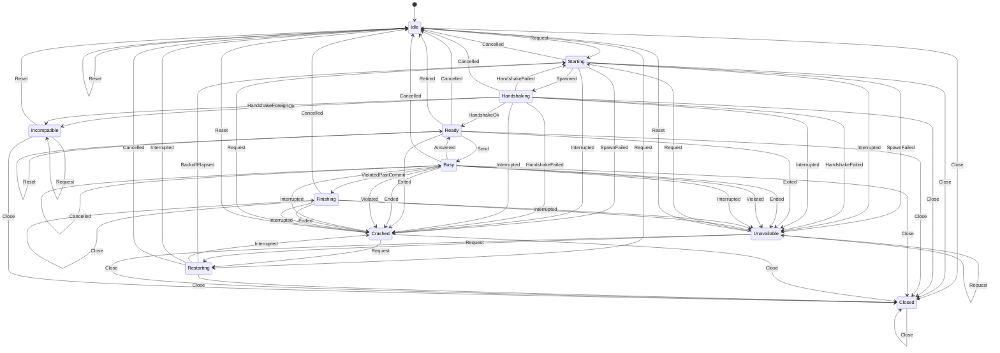

<!-- GENERATED by backend/scripts/gen_statecharts.py from backend/src/app/platform/engine_supervision.py. Do not edit. -->

# Engine supervision statechart

The ledger engine's lifecycle as the main sidecar supervises it: `app.platform.engine_supervision.transition` over `ROWS`, driven by `app.platform.adapters.engine_client.EngineClient` (ARCHITECTURE.md §2.0, §7). A pair that is not listed raises `IllegalTransition`. Resting states (Idle, Ready, Crashed, Unavailable, Incompatible, Closed) are where a request or a reset can find the client; the others pass within one call. Our own ends (`Cancelled`, `Retired`, `Close`) may come from another thread at any time and are never stops (engine-jobs spec §5.3).

## States

| State | Meaning |
|---|---|
| `Idle` | No engine: none was started yet, a reset forgot the stops, or we ended the last one (its stops kept). The next request starts one, after the backoff still due. |
| `Starting` | The engine process is being created. |
| `Handshaking` | The process runs and the handshake is out; `bytecode`: the engine was started with the bytecode directory. |
| `Ready` | The engine runs, answered the handshake in our protocol, and waits for a request. |
| `Busy` | One request is in flight. |
| `Finishing` | A reply broke the protocol after the commit point (`detail`): the engine's input is closed and its output read and discarded until it ends; the stop is counted then (§5.3). |
| `Crashed` | The engine stopped (`last` says how) and the bound is not reached: the next request restarts it. |
| `Restarting` | Waiting out the backoff before a restart (`last`: the last engine's stop, None when we ended it). |
| `Unavailable` | `max_crashes` stops in the window: requests are refused until the window lets one go, or a reset. |
| `Incompatible` | The engine speaks another protocol: refused, and never started again until a reset. |
| `Closed` | The client was closed; final. |

## Events

| Event | Meaning |
|---|---|
| `Request` | A caller needs a running engine (`start`, `ping`, `call`); `now` is the monotonic time. |
| `Spawned` | The engine process exists, with its pipes; `bytecode`: it was started with the bytecode directory. |
| `SpawnFailed` | The process could not be created (an `OSError`, or no pipes). |
| `HandshakeOk` | A valid handshake reply; `info.protocol` may still be another protocol. |
| `HandshakeForeign` | The handshake reply is another protocol's (another `v`, or a `protocol.version_mismatch` refusal). |
| `HandshakeFailed` | No valid handshake in our protocol: end of stream we did not cause, an invalid reply, or another refusal. |
| `BackoffElapsed` | The backoff pause is over. |
| `Send` | The caller's request is written to the engine. |
| `Answered` | A valid reply to the request in flight: a result or a refusal. The engine is fine. |
| `Ended` | The engine's output ended (it exited) or its input broke while the request was in flight, and we did not end it; in `Finishing`, the end awaited after a violation past the commit point. |
| `Violated` | The reply is not a valid message for this request, before its commit point. |
| `ViolatedPastCommit` | The reply broke the protocol after `proceed` was sent: the engine may be in the middle of a replace. |
| `Exited` | The engine was found exited between requests (noticed at the next request). |
| `Interrupted` | An exception in the client itself during a start, a backoff or a wait (it goes on to the caller). |
| `Cancelled` | We ended the engine with this reason (the user's Cancel, or Quit anyway), recorded before the signal: no stop (§5.3). Observed by the call it ended, or of an idle engine. `past_commit`: the request in flight was past its commit point (`proceed` was sent), where only Quit anyway ends it (§4). |
| `Retired` | We ended an idle engine after a job that ran user code (§5.1): no stop. |
| `Reset` | The user's "try again": forget the stops and an incompatible verdict. |
| `Close` | Stop the engine for good (`close()`): at rest, or observed by the call in flight that it ended. |

## Diagram

## Transitions

| From | Event | To | Effects | Note |
|---|---|---|---|---|
| `Idle` | `Request` | `Starting`, `Restarting` | `Spawn`, `Pause` | lazy start; backoff of kept stops |
| `Idle` | `Reset` | `Idle` | none |  |
| `Idle` | `Close` | `Closed` | `Log` |  |
| `Starting` | `Spawned` | `Handshaking` | `Handshake` |  |
| `Starting` | `SpawnFailed` | `Crashed`, `Unavailable` | `Log`, `Fail` | a stop; start_failed |
| `Starting` | `Interrupted` | `Crashed`, `Unavailable` | `End`, `Log` | a stop; the exception goes on |
| `Starting` | `Cancelled` | `Idle` | `End`, `Log`, `Fail` | no stop; nothing was spawned |
| `Starting` | `Close` | `Closed` | `End`, `Log`, `Fail` |  |
| `Handshaking` | `HandshakeOk` | `Ready`, `Incompatible` | `Log`, `End`, `Fail` | another number: incompatible |
| `Handshaking` | `HandshakeForeign` | `Incompatible` | `End`, `Log`, `Fail` | no stop |
| `Handshaking` | `HandshakeFailed` | `Crashed`, `Unavailable`, `Starting` | `End`, `Log`, `Fail`, `DiscardBytecode`, `Spawn` | a stop; start_failed; with the bytecode directory: discard it, start once without it, no stop |
| `Handshaking` | `Interrupted` | `Crashed`, `Unavailable` | `End`, `Log` | a stop; the exception goes on |
| `Handshaking` | `Cancelled` | `Idle` | `End`, `Log`, `Fail` | no stop: a start that never completes |
| `Handshaking` | `Close` | `Closed` | `End`, `Log`, `Fail` |  |
| `Ready` | `Request` | `Ready` | none |  |
| `Ready` | `Send` | `Busy` | none | the only way into Busy: never resent |
| `Ready` | `Exited` | `Crashed`, `Unavailable` | `End`, `Log` | a stop (crashed); the request goes on |
| `Ready` | `Cancelled` | `Idle` | `End`, `Log` | no stop |
| `Ready` | `Retired` | `Idle` | `End`, `Log` | no stop: after a job that ran user code |
| `Ready` | `Reset` | `Ready` | none | stops forgotten; the engine keeps running |
| `Ready` | `Close` | `Closed` | `End`, `Log` |  |
| `Busy` | `Answered` | `Ready` | none | a result or a refusal |
| `Busy` | `Ended` | `Crashed`, `Unavailable` | `End`, `Log`, `Fail` | a stop; crashed |
| `Busy` | `Violated` | `Crashed`, `Unavailable` | `End`, `Log`, `Fail` | a stop; protocol_violation |
| `Busy` | `ViolatedPastCommit` | `Finishing` | `CloseInput` | nothing signalled |
| `Busy` | `Interrupted` | `Crashed`, `Unavailable` | `End`, `Log` | a stop (crashed); the exception goes on |
| `Busy` | `Cancelled` | `Idle`, `Busy` | `End`, `Log`, `Fail` | no stop; past the commit point a Cancel changes nothing |
| `Busy` | `Close` | `Closed` | `End`, `Log`, `Fail` |  |
| `Finishing` | `Ended` | `Crashed`, `Unavailable` | `End`, `Log`, `Fail` | a stop at the exit; protocol_violation |
| `Finishing` | `Interrupted` | `Crashed`, `Unavailable` | `End`, `Log` | a stop (crashed); the exception goes on |
| `Finishing` | `Cancelled` | `Idle`, `Finishing` | `End`, `Log`, `Fail` | Quit anyway ends it; a Cancel changes nothing |
| `Finishing` | `Close` | `Finishing` | none | past the commit point: waits for the exit |
| `Crashed` | `Request` | `Starting`, `Restarting` | `Spawn`, `Pause` | backoff if still due |
| `Crashed` | `Reset` | `Idle` | none |  |
| `Crashed` | `Close` | `Closed` | `Log` |  |
| `Restarting` | `BackoffElapsed` | `Starting` | `Spawn` |  |
| `Restarting` | `Interrupted` | `Crashed`, `Idle` | none | no stop: nothing was started |
| `Restarting` | `Cancelled` | `Idle` | `Log`, `Fail` | no stop: nothing was started |
| `Restarting` | `Close` | `Closed` | `Log`, `Fail` |  |
| `Unavailable` | `Request` | `Unavailable`, `Starting`, `Restarting` | `Fail`, `Spawn`, `Pause` | refused while the bound holds in the window |
| `Unavailable` | `Reset` | `Idle` | none |  |
| `Unavailable` | `Close` | `Closed` | `Log` |  |
| `Incompatible` | `Request` | `Incompatible` | `Fail` | never retried |
| `Incompatible` | `Reset` | `Idle` | none |  |
| `Incompatible` | `Close` | `Closed` | `Log` |  |
| `Closed` | `Request` | `Closed` | `Fail` | final |
| `Closed` | `Reset` | `Closed` | none |  |
| `Closed` | `Close` | `Closed` | none |  |
