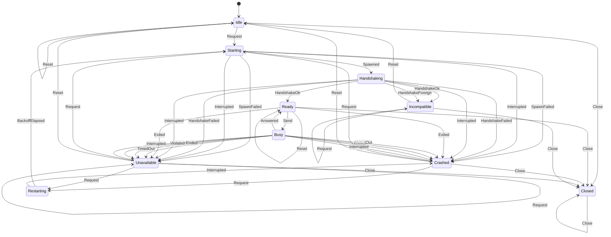

<!-- GENERATED by backend/scripts/gen_statecharts.py from backend/src/app/platform/engine_supervision.py. Do not edit. -->

# Engine supervision statechart

The ledger engine's lifecycle as the main sidecar supervises it: `app.platform.engine_supervision.transition` over `ROWS`, driven by `app.platform.adapters.engine_client.EngineClient` (ARCHITECTURE.md §2.0, §7). A pair that is not listed raises `IllegalTransition`. Resting states (Idle, Ready, Crashed, Unavailable, Incompatible, Closed) are where a public call can find the client; the others pass within one call.

## States

| State | Meaning |
|---|---|
| `Idle` | No engine and no counted stop: none was started yet, or a reset forgot them. The next request starts one. |
| `Starting` | The engine process is being created. |
| `Handshaking` | The process runs and the handshake is out. |
| `Ready` | The engine runs, answered the handshake in our protocol, and waits for a request. |
| `Busy` | One request is in flight. |
| `Crashed` | The engine stopped (`last` says how) and the bound is not reached: the next request restarts it. |
| `Restarting` | Waiting out the backoff before a restart. |
| `Unavailable` | `max_crashes` stops in the window: requests are refused until the window lets one go, or a reset. |
| `Incompatible` | The engine speaks another protocol: refused, and never started again until a reset. |
| `Closed` | The client was closed; final. |

## Events

| Event | Meaning |
|---|---|
| `Request` | A caller needs a running engine (`start`, `ping`, `call`); `now` is the monotonic time. |
| `Spawned` | The engine process exists, with its pipes. |
| `SpawnFailed` | The process could not be created (an `OSError`, or no pipes). |
| `HandshakeOk` | A valid handshake reply; `info.protocol` may still be another protocol. |
| `HandshakeForeign` | The handshake reply is another protocol's (another `v`, or a `protocol.version_mismatch` refusal). |
| `HandshakeFailed` | No valid handshake in our protocol: a timeout, end of stream, an invalid reply, or another refusal. |
| `BackoffElapsed` | The backoff pause is over. |
| `Send` | The caller's request is written to the engine. |
| `Answered` | A valid reply to the request in flight: a result or a refusal. The engine is fine. |
| `TimedOut` | No reply within the caller's timeout. |
| `Ended` | The engine's output ended (it exited) or its input broke while the request was in flight. |
| `Violated` | The reply is not a valid reply to this request. |
| `Exited` | The engine was found exited between requests (noticed at the next request). |
| `Interrupted` | An exception in the client itself during a start, a backoff or a wait (it goes on to the caller). |
| `Reset` | The user's "try again": forget the stops and an incompatible verdict. |
| `Close` | Stop the engine for good. |

## Diagram

## Transitions

| From | Event | To | Effects | Note |
|---|---|---|---|---|
| `Idle` | `Request` | `Starting` | `Spawn` | lazy start |
| `Idle` | `Reset` | `Idle` | none |  |
| `Idle` | `Close` | `Closed` | `Log` |  |
| `Starting` | `Spawned` | `Handshaking` | `Handshake` |  |
| `Starting` | `SpawnFailed` | `Crashed`, `Unavailable` | `Log`, `Fail` | a stop; start_failed |
| `Starting` | `Interrupted` | `Crashed`, `Unavailable` | `Kill`, `Log` | a stop; the exception goes on |
| `Handshaking` | `HandshakeOk` | `Ready`, `Incompatible` | `Log`, `Shutdown`, `Fail` | another number: incompatible |
| `Handshaking` | `HandshakeForeign` | `Incompatible` | `Shutdown`, `Log`, `Fail` | no stop |
| `Handshaking` | `HandshakeFailed` | `Crashed`, `Unavailable` | `Kill`, `Log`, `Fail` | a stop; start_failed |
| `Handshaking` | `Interrupted` | `Crashed`, `Unavailable` | `Kill`, `Log` | a stop; the exception goes on |
| `Ready` | `Request` | `Ready` | none |  |
| `Ready` | `Send` | `Busy` | none | the only way into Busy: never resent |
| `Ready` | `Exited` | `Crashed`, `Unavailable` | `Kill`, `Log` | a stop (crashed); the request goes on |
| `Ready` | `Reset` | `Ready` | none | stops forgotten; the engine keeps running |
| `Ready` | `Close` | `Closed` | `Shutdown`, `Log` |  |
| `Busy` | `Answered` | `Ready` | none | a result or a refusal |
| `Busy` | `TimedOut` | `Crashed`, `Unavailable` | `Kill`, `Log`, `Fail` | a stop; timeout |
| `Busy` | `Ended` | `Crashed`, `Unavailable` | `Kill`, `Log`, `Fail` | a stop; crashed |
| `Busy` | `Violated` | `Crashed`, `Unavailable` | `Kill`, `Log`, `Fail` | a stop; protocol_violation |
| `Busy` | `Interrupted` | `Crashed`, `Unavailable` | `Kill`, `Log` | a stop (crashed); the exception goes on |
| `Crashed` | `Request` | `Starting`, `Restarting` | `Spawn`, `Pause` | backoff if still due |
| `Crashed` | `Reset` | `Idle` | none |  |
| `Crashed` | `Close` | `Closed` | `Log` |  |
| `Restarting` | `BackoffElapsed` | `Starting` | `Spawn` |  |
| `Restarting` | `Interrupted` | `Crashed` | none | no stop: nothing was started |
| `Unavailable` | `Request` | `Unavailable`, `Starting`, `Restarting` | `Fail`, `Spawn`, `Pause` | refused while the bound holds in the window |
| `Unavailable` | `Reset` | `Idle` | none |  |
| `Unavailable` | `Close` | `Closed` | `Log` |  |
| `Incompatible` | `Request` | `Incompatible` | `Fail` | never retried |
| `Incompatible` | `Reset` | `Idle` | none |  |
| `Incompatible` | `Close` | `Closed` | `Log` |  |
| `Closed` | `Request` | `Closed` | `Fail` | final |
| `Closed` | `Reset` | `Closed` | none |  |
| `Closed` | `Close` | `Closed` | none |  |
