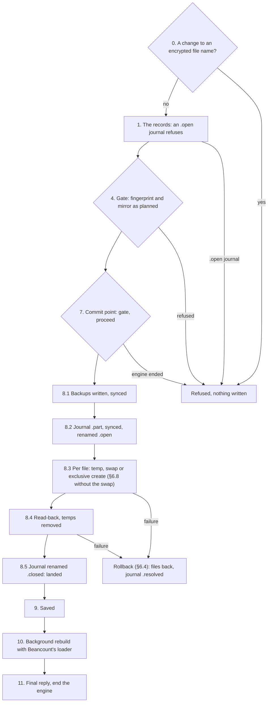
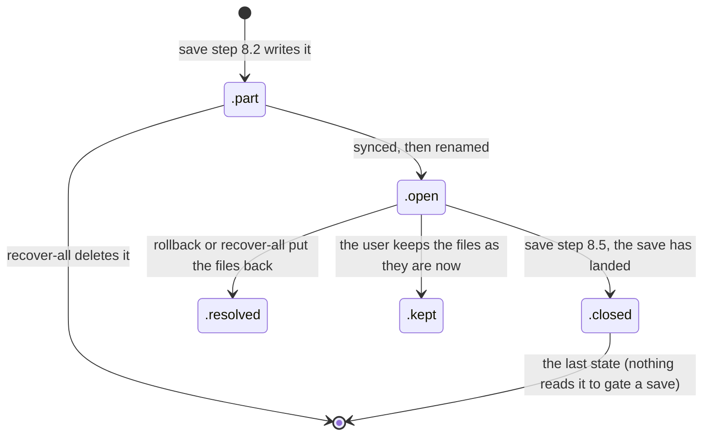

# Engine jobs and saves: one engine, one job at a time

## Orientation
- **What this is:** the rules for how the main sidecar runs ledger work on the ledger engine: one engine doing one job at a time (ADR-0064), how a save becomes durable, how Cancel, a crash, a quit and a workspace switch end each job, and how interrupted saves are recovered. Rules only: why is in the ADRs below, when and how in the journals (S0053 to S0073).
- **Where the code is:** the queue's pure table `app.platform.engine_jobs.queue`, its shell `app.platform.engine_jobs.scheduler`, the job texts `app.platform.engine_jobs.text`; supervision `app.platform.engine_supervision`, driven by `app.platform.adapters.engine_client.EngineClient`, the process group `app.platform.adapters.engine_group`; the save `ledger_engine.ledger.save` (durable order `ledger_engine.ledger.writer.durable_commit`, paths `ledger_engine.ledger.paths`, the record `ledger_engine.ledger.core.journal`, the file-system port `ledger_engine.fs.port` and its macOS adapter `ledger_engine.fs.darwin`) with the sidecar's `app.platform.engine_jobs.save` and `save_text`; the restore `ledger_engine.ledger.restore`; recover-all `ledger_engine.ledger.recover_all` with the sidecar's `app.platform.engine_jobs.recovery` and `recovery_text`; the rebuild `ledger_engine.ledger.rebuild` with `app.platform.engine_jobs.rebuild`; the history trim `ledger_engine.ledger.history` (its choice `ledger_engine.ledger.core.history`). Checked over the in-memory fake `engine/tests/fakes/memfs.py` and the durability model of §13.
- **Not built yet:** the switch and the open that consumes the recovery report, create and copy (BL-0153, BL-0154); the reads and the open (BL-0152 part 2); the preview (BL-0106); the publish to the screens (BL-0113); the decision log's lines (§12, BL-0154); recover-all's tries replayed through the engine (BL-0164).
- **Decisions it applies:** ADR-0064 (this design), ADR-0067 (integrity blocks, accounting advises), ADR-0068 (step-back simplifications), ADR-0008 (write-safety contract), ADR-0010 (overlay load), ADR-0011 (no resident ledger), ADR-0012 (journal and recovery, as amended by ADR-0063), ADR-0013 (atomic swap), ADR-0015 (mirror publish), ADR-0054 (engine process), ADR-0062 (single instance; legacy-lock detection), ADR-0063 (one open workspace; the switch; recover-all before open).
- **Invariants:** INV-01 and INV-22 (every write passes the contract and fails closed), INV-10 (no resident ledger; bounded caches), INV-11 (the queue hangs off `UserContainer`), INV-20 (performance absolutes), INV-28 (`WORKSPACE_NOT_OPEN`), INV-29, INV-30 (recovery is the one write on open), INV-31 (only the open workspace runs jobs), INV-32 (recover every unfinished save before any workspace opens).
- **Sources:** each rule, or cluster of rules, names its source in brackets: an invariant or an ADR.
- **Traps:** a job that writes (save, create, copy) is never ended by us past its commit point, except by "Quit anyway" (§4). Nothing after a save gates the next one: the rebuild that follows it writes no ledger byte and pauses nothing. `-I` must not be used to start the engine: it ignores `PYTHONHASHSEED` (§5.1). A file a save creates gets the same `path_key` before and after it exists (§6.3). One group signal is not enough on macOS: it misses a member forked while it is delivered, and `killpg(pgid, 0)` answers `EPERM` both for a group whose only member is the held zombie leader and while a member is still exiting with its files open; the drain signals until the group's listing shows no live member (§5.2). A recover-all that is cancelled never lets a workspace open over a journal it did not try (§8). No ledger work of a new start runs until every engine of the earlier session has ended (the engine lock, §5.1).
- **Main tests:** §14. The model obligations: §13.

## 1. Terms

- **Job:** one unit of engine work, for the open workspace or app-scoped (for no workspace). States: `queued → running → ended(outcome)`.
- **Waited-for job:** a user request is waiting for its result (an HTTP request in flight, the open, the switch, the boot). **Background job:** nobody waits: the rebuild after a save, and a save the app started itself (prices). [ADR-0064]
- **Runs user code:** the job loads the ledger with plugins (`insert_pythonpath`, plugin modules): open, rebuild, preview, BQL, and the load check of a `create` or `copy`. Parse-only work (planning, facts from options), the save (it does no load) and recovery run none.
- **Commit point:** for a save, the moment it asks to start its first durable write (§6.1 step 7): before it, the save has written nothing. For a `create` or `copy`, the moment it asks to write the workspace manifest, its last write (§8.2). After the commit point the job finishes or is resolved from disk.
- **Closed record:** the file a save's journal becomes when the save has landed (§6.5). It says "saved", is the record's last state and pauses nothing. [ADR-0067]
- **`canonical_path` and `path_key`:** §6.3.
- **Fingerprint:** ADR-0008 step 4's full extended fingerprint with a SHA-256 per file, keyed by `path_key`: every loaded file and glob match, each glob's match list, the absent paths the ledger names, the documents-root listings, and the source files of plugins imported from outside the engine's own packages (BL-0124).
- **Reopen:** a switch from the open workspace to itself (§9.1): it closes the workspace, recovers every journal, and opens it again.
- **The rebuild after a save:** a background `rebuild` with Beancount's own loader, queued after every landed save; it shows Beancount's result and gates nothing (§6.7). [ADR-0068 D1]

## 2. Jobs

| Job | Does | Who waits | User code | Cancel (§4) |
|---|---|---|---|---|
| `open` | the open's mirror build when the fingerprint differs from the published generation (ADR-0015), and the ledger facts the open needs | waited-for (switch, boot) | yes | yes; the open stops and offers Retry (and Back after a switch) |
| `rebuild` | a mirror build after the focus check saw an outside change (waited-for), and after every landed save (background, §6.7) | waited-for after the focus check (writes are refused while the mirror is stale, ADR-0015); background after a save | yes | yes; the workspace stays `WARMING` on the old generation, with **Update now** to queue it again; a background one is not run, and the next save or focus check queues another |
| `preview` | plan, then the contract's step-3 overlay load (ARCHITECTURE §9.2 steps 1-3) | waited-for | yes | yes; nothing to undo |
| `save` | a confirmed plan: §6.1 | waited-for; background when the app started it (prices) | no (its engine is still retired after it, §6.1 step 11) | before the commit point: yes; after: no, it finishes |
| `bql` | a BQL query over one transient load (ADR-0011) | waited-for | yes | yes |
| `recover_all` | §8, while no workspace is open | waited-for (start, switch, Reopen) | no | yes, per journal: the journal it is on counts as blocking, and recovery goes on with the next one (§8) |
| `create`, `copy` | app-scoped: create or adopt a workspace, a test copy, "New workspace from settings of…" (ADR-0063 decision 1); they write the new folder directly and its manifest last (§8.2) | waited-for | yes (the copy's "loads the same" check, the create's seeding) | before their commit point (the manifest write): yes, leaving a folder that is not a workspace; after: they finish |

- Price fetching itself is network work in the sidecar, outside the queue; only its save is a job. [ADR-0054 decision 1]
- Every job is idempotent at its start: a `rebuild` whose fingerprint equals the published generation does nothing (with the publish, BL-0113); the rebuild after a save loads the disk as it is when it runs. So the queue never merges jobs; it only caps how many of a kind may wait (§3). [ADR-0064]
- Any work that reads or writes ledger files on behalf of a job (copy reads included) runs inside that job, so it never overlaps a save. [ADR-0012]
- Outside the queue, the sidecar's cheap probe, `assess_workspace` and the focus check read files without writing them; a file that moves under them is caught by the job that follows (§7, the gate). [ADR-0063 decision 1 step 2; ADR-0037]

## 3. The queue

- **One queue, one scheduler thread and one engine per `UserContainer`** (on desktop, one per app; in hosted mode, per user container). The queue is in the sidecar; its decisions are a pure table `queue.transition(policy, state, event) -> (state, effects)` (§12). [INV-11; ADR-0064]
- **The ordering rule:** when the engine is free, the scheduler starts the oldest queued waited-for job; if there is none, the oldest background job. A running job is never interrupted to start another; it ends by finishing, by Cancel (§4), by a crash, or by "Quit anyway". [ADR-0064 decision 2]
- **During a switch, a Reopen and the boot,** from the moment the current workspace has closed (at boot, from the start) until the switch or boot has ended or shows its failed or blocked screen, only its own jobs start (`recover_all`, then the target's `open`). Other jobs, app-scoped ones included, wait behind them. A screen that waits for the user holds no job. [ADR-0063 decision 2; INV-31]
- **A job for a workspace that is not open is never queued:** its request gets `WORKSPACE_NOT_OPEN`. [INV-28, INV-31]
- **Bound:** at most `max_queued` jobs (a setting, generous by default). A request beyond it gets `ENGINE_QUEUE_FULL` and is not queued. At most one queued background save and one queued background `rebuild` per workspace: a newer save's rebuild finds the queued one (`AlreadyQueued`), which loads the disk when it runs and so shows both saves. [INV-10]
- **A background save plans when it runs, and a second one joins it:** a save the app starts itself (the price update) makes its plan when its job starts. A second request for the same workspace while one is queued joins the queued job when the queued work can take its changes (`scheduler.JoinableWork.joined`); both requesters then get that job's outcome. A work that cannot take them (a fixed plan, `save.submit_save`) refuses the second request with its own `ENGINE_QUEUE_FULL`. A request is never answered with another job's ticket or outcome unless its own changes were in that job. The price planner's join is BL-0177. [ADR-0068 D8; INV-01]
- **Memory:** one engine runs one load at a time, so peak memory is one load's peak plus the sidecar. There is no admission or memory check. [ADR-0064; ADR-0011]

## 4. Cancel

Cancel is the user's way to stop waiting, and the only way a slow job ends early. **A Cancel only ever ends your own job**: a waiting user's Cancel removes their own queued job and never ends a job running ahead of it. A read whose requester has gone (a closed tab) still ends. [ADR-0064 decision 3; ADR-0068 D7]

| The job is | Cancel does | The user sees |
|---|---|---|
| queued | removes it; nothing ran | nothing more, or "Cancelled." |
| queued behind another running job | removes it; the running job goes on (below) | "Your request is cancelled. The earlier ledger work cannot be stopped from here; if it never finishes, quit and reopen Finzytrack.", unless the job ahead is a read, an open or a recover-all its own requester waits for |
| running, not a writing job, or a writing job before its commit point | ends the engine (§5.2); the outcome is `cancelled`, not a stop | for a save: "Your request is cancelled." (`JOB_CANCELLED`; nothing was written, but no re-hash runs, so "Your ledger is unchanged." is not said) |
| a writing job past its commit point | nothing: the job finishes | "Finishing your change…", then its outcome |
| `recover_all` | before it has listed the journals: ends it and marks nothing; the switch or boot ends on its cancelled screen (§8.1). After the listing: ends the engine; the journal being recovered counts as blocking, and recovery goes on with the next journal in a new engine (§8) | the open goes on when every journal is recovered or blocking; workspaces and copies using a blocking journal's files get `RECOVERY_BLOCKED` with Retry and "Keep the files as they are now" |

- **The commit point is decided in one table step,** the same for a save, a `create` and a `copy`. The engine sends `gate` and waits. In one step the scheduler either ends the engine (a Cancel is pending: outcome `cancelled`, disk unchanged) or marks the job past the commit point and sends `proceed`. A Cancel that arrives after that step is answered "too late" and changes nothing. [INV-01; ADR-0064 decision 3; ADR-0063 decision 1 step 4]
- **A job someone else runs:** when a waiting user presses Cancel on a queued job, only their own request is cancelled and the running job goes on, whatever it is: a background rebuild or save, a read or an open whose requester has gone, a confirmed save, `create` or `copy`, or work past its commit point. The waiting job shows "Waiting for: <label>…", then "Still working…" with Cancel, never quit advice on a timer, since the job ahead may only be slow. The answer is "Cancelled." only when no job runs, or the job ahead is a read, an open or a recover-all that its own requester still waits for (theirs to cancel); otherwise, behind background work or a confirmed save, `create` or `copy` included, it is §11's "cannot be stopped from here". Quit anyway (§9.3) then ends the running job; a save's journal covers it. [ADR-0063 decision 1: every wait has an exit; ADR-0068 D7]
- **Shown on the timer:** an engine we signalled that has not ended (stuck in the kernel), and the engine lock still held while the sidecar waits for it (at start, an engine of an earlier session, §5.1; before a fresh engine, a plugin child that inherited it and left the engine's group, §15). After the display delay they show §11's advice "Finzytrack cannot stop the earlier ledger work. …" (§5.2).
- **A client that goes away** (a tab closed, a request aborted) cancels its queued or running preview, rebuild or BQL. It never cancels a save: confirming is the user's decision, and closing is not a cancel. [ADR-0063 decision 1 step 3]
- **"Quit anyway"** (§9.3) is the one case where we end a writing job past its commit point; the journal makes a save safe and the next start recovers it; a `create` or `copy` cut during its manifest write leaves no manifest, or a complete one. [ADR-0063 decision 1 step 4]

## 5. The engine process

### 5.1 One engine at a time, fresh after user code

- **At most one engine process exists at any moment** (per user container, §3), and it runs at most one job. A new engine is spawned when a job needs one, only after the previous one is reaped and its process group has no live member (§5.2), and the sidecar has waited for the engine lock (below). A quit waits for the drain at most the display delay (§9.3); past it, the next start waits instead. [ADR-0064 decision 1]
- **The engine lock:** one lock file, `app_local_data/locks/engine.lock`, never deleted. Every engine, after its handshake and before any ledger work, takes it with a whole-file `flock`, waiting, and holds it for its whole life. A plugin child made by a plain `fork` shares it; the drain ends every such member of the engine's group before the reap (§5.2). The sidecar waits for it before every fresh engine, since a process can hold it outside the drain's reach: a plugin child that inherited it and left the group (`setsid`), or one that survived an engine that ended its own group (§5.2, §15). **At start, before its first engine, the sidecar takes the lock itself, waiting, and releases it at once** (each engine must hold it on its own, so that an engine of a crashed session keeps holding it). An engine of the earlier session (left by a crash, by Quit anyway or by a quit; its watchdog or our signal ends it, normally within 0.25 s) still holds it, so the new session's first ledger work waits until that engine has ended; whatever it did is a save cut at a later step, which recovery handles (§8.1). While the sidecar waits, jobs stay queued (the boot's own job can be cancelled, §9.2), with the advice of §5.2. A failed wait never lets an engine start. [ADR-0064's engine-lock amendment; ADR-0068 D3]
- **An engine that ran user code is ended after its job**, after its final reply; the next job gets a fresh engine, so nothing a plugin left behind (threads, patches to Beancount, memory) reaches the next job. An engine that ran only parse-only work or recovery may serve the next job. [ADR-0064; INV-10]
- **Spawn:** flags `-s -S -B -P -X pycache_prefix=<bytecode directory>`, never `-I`: `-I` implies `-E`, which ignores `PYTHONHASHSEED`. Environment: the parent's, minus `FT_*` and every `PYTHON*` variable, plus `PYTHONHASHSEED=0`; plugins keep `PATH`, `HOME`, `LANG` and `TZ`. The packaged bootstrap adds only the engine's site-packages (ARCHITECTURE §2.0); the development form runs the same bootstrap with the virtual environment's site-packages. A load of the same bytes gives the same result in every engine, whatever the set order. [ADR-0054 decision 5; INV-30 (`-B`: no `__pycache__` in a user's folder)]
- **Bytecode directory:** private to the engine build, in app-local data (`app_local_data/engine/bytecode/<build>/`, never inside the packaged install), filled once per build with the bytecode of the engine's interpreter library, site-packages and code, read-only afterwards. A user's plugin is compiled from its source on every load and never cached. **If an engine fails to start** while using the directory (a damaged `.pyc` under `pycache_prefix` raises instead of falling back to the source), the directory is deleted and the engine is started once without it; the next fill rebuilds it. A start that fails again is an ordinary `start_failed`. [ADR-0008's speed targets]

### 5.2 Ending an engine

- **The reason is recorded before the signal**, and a recorded reason wins over the exit status: `cancel`, `retire` (after a job that ran user code), `quit_anyway`, `close`. [S0040: only real failures count as stops]
- **Each engine leads its own process group** (POSIX; a Job Object nested in the shell's, with kill-on-close, on Windows). Our end signals the whole group until it has no live member, so a plugin's child processes go too and none outlives its engine's drain; a child that left the group (`setsid`) is out of its reach, and at a quit the drain is cut if it has not ended within the display delay (§9.3 step 4, §15). [ADR-0012 Q29/Q30 as narrowed by ADR-0068 D3]
- **The engine ends its own group when its parent is gone:** on POSIX the parent-death watchdog (usually within 0.25 s) and the end-of-input exit signal the whole group (`killpg(0, SIGKILL)`, the engine included); on Windows the Job Object's kill-on-close does it when the sidecar's handle closes. Its group is not the sidecar's, so a group signal the shell sends to the sidecar does not reach it. A plugin's C code that holds Python's interpreter lock can delay the watchdog; the end-of-input exit then covers it, and the next start waits for it at the engine lock (§5.1). This end is one signal with no drain after it when the sidecar is gone (the engine is in the group it signals), so on macOS a member forked in that instant can survive it (§15). [ADR-0012 Q30; ADR-0063 Consequences]
- **The drain: hold the leader, signal the group until it has no live member, reap, never signal after the reap:** wait for the leader with `waitid(P_PID, pid, WEXITED | WNOWAIT)` so it stays an unreaped zombie and its group id cannot be reused; signal the group (`SIGKILL`: this also ends the members of an engine that died by itself) and list its members, again and again (pauses from 5 ms, doubling up to 0.25 s), until it has **no live member**; then `wait4(pid)` for the status, `ru_maxrss` and CPU. After the reap no signal is sent to that group: its id may already belong to another program. One signal is not enough: on macOS it misses a member forked while it is delivered, and a survivor holding the engine lock would block all ledger work until a restart (S0073's reviews; restored in S0075). [review 4 M5; ADR-0068 note of 2026-11-01, withdrawing D7's "the `libproc` listing goes"]
- **"No live member", per OS** (so that no member still holds a file, and with it a `flock` lock): macOS: no process but the held leader is listed in the group (libproc `proc_listpids(PROC_PGRP_ONLY)`), not counting a listed member whose status reads zombie (`sysctl(KERN_PROC_PID)`, `p_stat == SZOMB`; its files are closed); a failed listing, or a member whose status cannot be read, counts as live. A member still exiting is listed and not yet a zombie, so it counts: its files may still be open. Not `killpg(pgid, 0)`'s answer: it answers `EPERM` both for the held zombie leader alone and while a SIGKILLed member is still exiting with its files open (S0057: the lock was still held at that answer in 36 of 40 runs). Not `proc_pidinfo(PROC_PIDTBSDINFO)`: it fails with `ESRCH` for a zombie (S0075). Linux: no process in `/proc` has that group id in a state other than `Z`. [review 5 M3; BL-0158]
- **CPU of a job** is the engine's own plus its reaped children's, read with `RUSAGE_CHILDREN` in the leader before it exits (Linux `cutime`/`cstime`; Windows the Job Object total), and logged with the job (§12). A plugin child the engine never waited for is not counted, so on POSIX it is a lower bound. It decides nothing. [INV-20; BL-0082]
- **A process that cannot be ended** (stuck in the kernel on a dead disk or share) keeps what it holds until it ends: an engine, or a member of its group, keeps the engine slot (the drain waits for it) and any engine lock it holds; no new engine works meanwhile, so no other job runs, recover-all included. **Whenever the slot is held by an engine we have already signalled that has not ended** (after a Cancel, a retire, or the end of a job whose requester is gone), or the sidecar waits for the engine lock, the app shows §11's advice after the display delay of §5.4, whether or not a job is waiting: in the waiting job's place, otherwise as a notice that stays until the process ends. It does not guess the cause. A running job the waiting user merely cannot end (§4) gets no such text on a timer. Quitting waits for it no longer than the display delay (§9.3). On the next start the stuck process still holds the engine lock, so no ledger work runs until it ends, with the same advice (§5.1). [ADR-0063 decision 1: every wait has an exit]

### 5.3 Crash and bounded restart

- **A crash is noticed by the engine's exit**: the reader sees the output end (`Ended`), or the reap sees the exit. Nothing polls or times the engine. [ADR-0064 decision 4]
- **Each engine has its own number** for its whole life: every spawn takes a new one, and an engine that serves the next job after parse-only work (§5.1) keeps it. The shell reports a death by that number. A report about the engine in the slot ends it as `crashed`, even when a job was started on it after it died and before the report arrived (that job is lost like any crashed job); a report about an earlier engine, already ended and drained, changes nothing.
- **How an engine ended:**

| Observation | Outcome | Counted as a stop (S0040 bound) |
|---|---|---|
| final reply, then our `retire` or `close` | `answered` | no |
| ended by us with `cancel` or `quit_anyway` | `cancelled` | no |
| a signal or exit we did not cause; SIGKILL (often the OS, for memory) is `killed_by_system` | `crashed` | yes |
| a reply that breaks the protocol before the commit point | `violation` | yes |
| any end other than `answered`, `cancelled` or `incompatible` during an uncounted request (every try of the rebuild after a save, §6.7) | as above | no |
| a reply that breaks the protocol after the commit point | close the engine's input, read and discard every further byte, wait for the exit, resolve from disk (§6.6) | yes, at the exit |
| the start fails (spawn, or a refused handshake) | `start_failed` | yes |
| another protocol version | `incompatible` | no; never retried |

- **Bounded restart** (S0040): the next job starts a new engine after 0.5 s, 2 s, then 8 s by recent stops; three stops in 300 s make the engine `Unavailable` until the oldest leaves the window, or **Try again**.
- **The crashed job is not run again by itself.** A read job ends with `ENGINE_STOPPED` and Try again; a save's outcome is resolved from disk (§6.6); the rebuild after a save is lost. Queued jobs stay queued and run on the next engine. [S0035: a request is never resent]
- **After a protocol violation past the commit point** the engine may be in the middle of a replace, so it is not ended: the sidecar closes its input at once, so the engine finishes the request in hand and exits at the end of its input, and discards the output so the pipe never blocks it. Meanwhile the user sees "Finishing your change…"; if the engine never exits, Quit anyway (§9.3) and the switch's Stay remain. [INV-01]

### 5.4 No time limits; "Still working…"

- **No engine job has a time limit.** A slow job and a hung one look the same from outside; ending either is the user's decision. [ADR-0064 decision 5]
- **What the user sees:** at once, the job's phase with Cancel where §4 allows it ("Starting the ledger engine…", "Reading your ledger…", "Checking your change…", "Saving…", "Updating your views…"); when it is queued, "Waiting for: <the running job's phase>". After a display delay (a UI constant, default 2 s) the text becomes "Still working…" with the same actions. The delay only changes the text; it ends nothing.
- The engine reports its phase in progress messages on the protocol; a phase change is shown, never judged. [ADR-0039]

### 5.5 The client and the engine

What the client and the engine do for the rules above (failure-modes rows E2, E3, E5 and E7 follow them):
- `EngineClient.call` takes no timeout; the statechart and the client have no time limit on a request or a handshake. `Cancelled` (our end with reason `cancel` or `quit_anyway`, not a stop) and `Retired` are outcomes. A start that never completes is ended by the waiting job's Cancel (`EngineClient.end`, from any thread).
- `close()` runs after the quiesce (§9.3): it signals the engine's group once without waiting for a call in flight, then waits for the drain of every engine that is ending (the one it signalled, one that had already exited or been ended, a previous one still draining) for at most the display delay. An engine it did not signal (a job past its commit point, §4) is not waited for.
- The engine is spawned as the leader of its own process group (`start_new_session`), and its parent-death watchdog and end-of-input exit signal that whole group when it leads one (§5.2).
- The engine command is `-s -S -B -P` with the environment and the bytecode directory of §5.1 (`EngineCommand.for_packaged` and the development form, the same bootstrap).
- The protocol (version 2) has progress messages, `gate`/`proceed`, `committed` (§6.1) and a `decision` object in replies (§12). A writer thread sends each request, so Cancel can end an engine in the middle of a large request.
- The scheduler waits for the engine lock (§5.1) before every fresh engine (a reuse needs none), with the advice after the display delay; a failed wait never lets an engine start.
- The engine is spawned when a job needs one, not at boot; at start the first job is the boot's `recover_all`, so an engine still starts early.
- The texts of what the user sees are `app.platform.engine_jobs.text`; the UI that shows them is BL-0092.

## 6. The save

### 6.1 Steps

Steps 0-11 run in one fresh engine (§5.1), with Python's garbage collector paused for the job (ADR-0008 amendment). The save does no Beancount load and runs no plugin, and takes no lock but the engine lock; steps 2, 3, 5 and 6 keep their numbers so that code and tests that cite them still point here. [ADR-0068 D1, D3, D4]

0. **Never an encrypted file:** a change whose name, or the canonical name it resolves to (a link), ends `.gpg` or `.asc` (any case; `overlay.ENCRYPTED_SUFFIXES`) is refused `encrypted_file`, unchanged, before step 1; a link to such a file swapped in after the gate stops the writer before its first effect (`changed`). The sidecar maps it to `INTERNAL` until the preview refuses it first (BL-0106). [ADR-0059; INV-22]
1. **The records** (`ledger.save.records`): an `.open` journal of this workspace (re-read from disk, matched as §6.5 says) refuses the save with `WRITES_PAUSED {unfinished_save}`, nothing written. No other record gates a save; a closed record never does. [ADR-0012 F-6; ADR-0067 decision 3]
2. **No legacy lock:** the save tries none; only Copy tries the legacy app's lock (§8.2). A legacy app pointed at a v0.4 workspace anyway (unsupported) is an outside editor, caught by step 4 and step 8.3's displaced check. [ADR-0062 decision 2 as narrowed by ADR-0068 D4]
3. **No ledger lock; every path resolved:** the engine lock (§5.1) is the guard: no other engine of ours runs, and the engine's save op refuses to run without holding it (`engine.no_engine_lock`). Every path of the ledger set and every file the save writes is resolved first; one that cannot be (a folder that denies looking names up in it) ends the save "not saved", naming the file, with the re-hash. [ADR-0068 D3]
4. **Gate:** the disk's fingerprint equals the plan's; the published mirror's equals the plan's; this workspace has no `.open` journal (matched as §6.5 says), re-read from disk. Refusals: a moved fingerprint → `LEDGER_EXTERNALLY_CHANGED` (re-plan through a fresh mirror, ADR-0026); a stale mirror → `WORKSPACE_NOT_READY {WARMING}`; a `.open` journal, a journal folder that cannot be listed or an `.open` journal that cannot be read → `WRITES_PAUSED {unfinished_save}` (fail closed). The plan's fingerprint is `ledger_set.as_before` of the preview's `Loaded.fingerprint`: the bytes the preview parsed, with each file the save writes at its pre state, so an edit made and reverted during the preview's load is still refused here. The mirror check compares the plan's mirror digest with the plan's fingerprint, both sent with the plan, until the published generation is read at the gate (BL-0113, BL-0125). [ADR-0008 step 4; ADR-0012]
5. **No load:** the preview (BL-0106) loaded the candidate before the confirm, on the fingerprint the plan carries, and listed its new errors; step 4 checks the disk still has that fingerprint, so the preview's result is the prediction. A preview that cannot run refuses before any save is queued. [ADR-0067 decision 2; ADR-0068 D1; INV-22]
6. **Nothing between the gate and the commit point:** step 4 is the last check; an outside save after it is met by step 8.3's displaced check. [ADR-0013]
7. **Commit point:** the engine sends `gate`; §4's table step answers `proceed` or ends the engine.
8. **Durable order** (every sync is `durable_sync`, §6.2). First, every folder from the app's machine-local folder down to the journal and backups folders has its parent synced, whether it was made now or was already there. Before its first effect the save refuses, writing nothing, a target it cannot write safely: a replaced file that is not a regular file, is locked, has a second hard link, may not be moved away or whose extended attributes cannot be read; a folder it writes or makes a folder in that does not let us add or remove entries (`access(2)`: write and search, `_RMFILE_OK`), or that carries any **ACL deny entry, whoever it names**, except one that new entries do not inherit (no `file_inherit`, `directory_inherit` or `only_inherit`) and that denies only what protects the folder itself (`delete`, `writeextattr`, `writeattr`, `writesecurity`, `chown`: macOS's own kind; whether the folder got the entry from its parent does not matter). The journal and backups folders pass the same **folder rule** first (the refusal names the folder). [ADR-0013 amendments of 2026-10-30]
   1. backups written, each file synced, and their directory synced; before its backup is read, each file the save replaces is itself synced (`F_FULLFSYNC` on a read-only descriptor), so what an editor wrote into it without a sync is durable before the swap displaces it;
   2. the journal written as `local/<key>/journal/<session>-<job>.part` and synced, renamed `.open`, then its directory synced, so an `.open` journal is never torn. It names every file the save replaces or creates by `canonical_path` and `path_key`, with pre and post hashes, backup and temp names, the directories it creates, and every field of the future closed record (engine build, workspace registry key and lineage id; journal format 4, no prediction of a load's result);
   3. per file, children first and the root last: the new bytes written beside it under the **staging name** `.<name>.ft-<session>-<job>.new` and synced, renamed exclusively to the temp name `.<name>.ft-<session>-<job>.tmp` (an entry already there is never replaced: the save stops), and the directory synced, so the temp's name is durable before the replace; then a **replace by atomic swap** (ADR-0013), or for a file the save creates an **exclusive create** (`RENAME_EXCL` / `RENAME_NOREPLACE`) that fails if a file appeared; what the swap displaced checked (§6.4: an outside save goes to its kept name); the file's mode preserved, and a symlinked file written at its real path (ADR-0008 step 5); the directory synced. A directory the save creates is made here and its parent synced. **On a volume without the swap** the replace and the exclusive create are §6.8's;
   4. read-back: every written file equals its post bytes; then our temp files (they now hold the displaced pre bytes, which the backups also hold) are removed and their directories synced, so a crash after the close leaves nothing of ours in the folder;
   5. **journal close:** a rename of `.open` into `.closed` (the handle closed first, for Windows), then its directory synced. **The save has landed exactly when the closed record is durable.**
   [ADR-0008 step 5; ADR-0012 fsync order and F-4. Model mutants: `no_backup_sync`, `no_journal_sync`, `no_temp_fsync`, `report_before_close_sync`, `plain_create`, `temps_after_close`, `direct_open`]
9. **"Saved":** the engine sends `committed` (the save has landed). Then, in the same engine and before its final reply, the **history trim** of §6.5 runs for this workspace key; nothing it meets changes the outcome. The sidecar answers the user's request from the final reply: **saved**. So the trim is inside the user's wait: 7 to 11 ms per save in steady state on APFS (one save to trim, six keys), longer for a first trim over a backlog (84 saves in 33 ms). [ADR-0064 decision 7; §6.5]
10. **Rebuild:** after the save has landed, and after a save whose outcome was read from disk as saved (§6.6), the sidecar queues a background `rebuild` with Beancount's own loader (§6.7; `save.submit_save`). It gates nothing and tells no one "saved" or "not saved". Its publish to the screens is BL-0113 (`Saved.published` stays false until then). [ADR-0015; ADR-0068 D1]
11. **End:** send the final reply and end the engine (`retire`: the save runs no user code, but the sidecar keeps the safe default). Nothing else is queued but step 10's rebuild. [§5.1]

Every refusal of steps 0-4 writes nothing, and says "unchanged" only after the files the save would write were hashed again (§11).

The order of the steps (a picture of this list; the list decides):

### 6.2 `durable_sync`

macOS `fcntl(F_FULLFSYNC)` (it falls back to `fsync` only where the volume refuses it, logged once per volume); Linux `fsync`; Windows `FlushFileBuffers`, and `MOVEFILE_WRITE_THROUGH` on renames. About 4.5 ms per sync on the owner's Mac, about 11-12 syncs for a one-file save, 3-4 more per further file; a directory sync with nothing to flush costs nothing. [ADR-0064 decision 8: `fsync` on macOS does not reach the platter]

### 6.3 Paths

- `ledger_engine.ledger.paths.canonical_path` and `path_key` (values and folding in `ledger_engine.ledger.core.paths`) resolve through `FileSystem.resolve`. The path guard is `ledger_engine.ledger.writer`'s handle check, one descriptor per folder; it compares a folder's path now with the recorded one as the volume compares names (`ledger_engine.fs.port.same_path`): after NFD; case stays exact (a case-only rename counts as moved: fails closed).
- **A file's canonical path is its folder's canonical path joined with the entry's stored name**, read from the folder's listing, and the object found is checked by `(st_dev, st_ino)` to be the one the path named; never `F_GETPATH` on the file itself, which for a file with several hard links answers whichever name was looked up last. A dangling link counts as absent: its own name is the first missing component, and a save that would create a file there refuses before writing anything. Every swap checks that the displaced entry is that same object, holding the pre bytes.
- **Hard links:** a ledger file the save would replace that has more than one hard link refuses the save before anything is written, naming the file. Reads are not affected. [ADR-0013 amendment of 2026-10-29]
- **`canonical_path(p)`:** the absolute path with every symlink resolved and each existing component in the volume's stored spelling (macOS `F_GETPATH` on a descriptor opened with `O_EVTONLY`, so a cloud placeholder is not downloaded; Windows `GetFinalPathNameByHandleW(FILE_NAME_NORMALIZED)`; Linux `realpath`). It is used to open files and in messages.
- **`path_key(p)`:** the canonical spelling of the deepest existing ancestor, joined with the remaining components as written, then every component folded by its volume's rule: macOS NFD always, plus `str.casefold()` when the volume is case-insensitive (`pathconf(_PC_CASE_SENSITIVE)` = 0); Windows ordinal upper-case unless the directory is case-sensitive; Linux none, except in a case-folding directory or on a folding mount (vfat, exfat, cifs `nocase`, ntfs3). **The key of a path does not depend on whether the file exists:** an absent `Prices.beancount` and the same file after a save created it, under any spelling the volume treats as equal, have one key. Where Python's folding differs from a volume's, two names can only fold into one key, never split. It is the identity of every fingerprint entry, journal match (`RECOVERY_BLOCKED`) and registry deduplication. [ADR-0063 decision 2]
- **Path guard for writes:** the save writes exactly the canonical paths its journal names, and recovery writes a recorded path only while it still resolves to that canonical path; otherwise the save rolls back, and the journal counts as unrecoverable. The check and the write go through one descriptor of the parent directory (`renameatx_np` on macOS, `renameat2` on Linux), so the directory cannot be swapped for a link between them; Windows is BL-0087. [ADR-0063 decision 2; INV-32; model mutant `no_path_guard`]

### 6.4 Rollback inside the engine

- **Any failure after the first replace** (an exception, a full disk, a read-back mismatch, a path that moved) rolls back at once from the journal, as recovery does (§8.1 steps 2-4; `durable_commit` runs `ledger_engine.ledger.restore.restore` on its own record from the `.open` rename on): **first the checks of step 2, the temp rule included**, then files restored and synced, then the journal renamed `.resolved {not_saved}`. Only the folders the save made may be removed. After a failed close a `.closed` record is renamed back to `.open` and synced before any file is restored, so no power loss shows "saved" over restored files. If the rollback fails (an I/O error included), the journal stays `.open`: this workspace's engine jobs are refused with `WRITES_PAUSED {unfinished_save}` and the user is offered **Reopen** (§6.6); the workspace does not enter `RECOVERING`. [ADR-0012 in-process rollback and its 2026-10-27 amendment; ADR-0063 decision 2]
- **Every swap hashes what it displaced, in the save, the rollback and recovery alike, and nothing is ever swapped back.** What a swap displaced is **ours** when it is a regular file byte-identical to bytes we already hold: the pre bytes (the backup holds them) or the post bytes we wrote; deleting it loses nothing. With a second hard link the save stops (the rollback puts the pre bytes back). **Anything else is an outside save**: it is renamed at once, exclusively, to the file's **kept name** beside it, `<name>.kept-<session>-<job>` (then `-2`, `-3` and on if taken; a hash stands in for a name past 255 bytes), the folder is synced, and the save or the try stops. Whatever now stands at the file stays: in a save, Finzytrack's version, with the editor's beside it as the kept copy. The same holds at clean-up: a temp about to be removed that holds outside bytes is renamed to its kept name instead. Nothing of ours ever deletes a kept name; a journal stops while a kept copy of it exists beside any of its files (§8.1 step 2: `kept_copy`), and once the user has deleted it, the next try can resolve. [ADR-0013 amendment of 2026-10-29; model mutant `no_displaced_check`]
- **The temp rule:** every write of ours, the save's and the restore's, goes first to a **staging name** (`.<name>.ft-<session>-<job>.new`, a restore's `.<name>.ft-restore-<session>-<job>.new`), is synced, and is renamed exclusively to its temp name (`.<name>.ft-<session>-<job>.tmp`, a restore's `.<name>.ft-restore-<session>-<job>.tmp`), the rename synced before any swap. No swap ever touches a staging name, so **a regular file at a staging name is our own write and is deleted whatever it holds** (a write cut off at any point, or torn by a power loss in any shape, blocks nothing). A temp name only ever holds our synced bytes or the object a swap displaced, into which a program that held the file open may have written: there, **equal to the pre or the post bytes is ours; anything else is an outside save, whatever the file beside it holds** (an empty file and a prefix included): it is moved to its kept name and the journal stops (`kept_copy`). Anything that is not a regular file at any of these names is not ours either. [ADR-0012 and ADR-0064 amendments of 2026-10-30; model mutants `no_temp_check`, `old_temp_rule`]
- **A file the save creates is never removed by an undo.** When the rollback or recovery finds nothing at a path the save was creating, our names beside it are removed by the temp rule and the journal resolves. When anything stands there (a file of any kind, whatever it holds, our own post bytes included), it is never removed, renamed or moved: the other files are undone, every folder the journal names is synced, our names beside the path are removed by the temp rule, and the journal stops (`created_path_taken`, §11) until the user deletes the file and presses Retry, or keeps the files as they are now. A folder another program made where the save makes one (its `mkdir` answered `EEXIST`) is never removed by the rollback. [ADR-0012 amendment of 2026-10-30]
- **A read error while undoing** (the file, a name of ours, the backup, what a swap displaced; a `stat`, a listing or a folder's open that answers an error counts the same, "no such entry" keeping its meaning) ends that try `failed` with nothing moved; the outcome names the file and the error (§11). At the save's own swap check, a read error is an I/O error: the save fails and rolls back, and nothing goes to a kept name. [ADR-0012 amendment of 2026-10-30]
- A full disk before the journal is durable is not a rollback: nothing was replaced; "not saved, unchanged".
- **A failure after the `.open` journal is durable and before the first replace** (a full disk while writing a temp) follows the rollback path: every file is at pre; the save's temps are deleted, the journal is renamed `.resolved {not_saved}` and its directory synced, and the user reads "Your change was not saved." ("Your ledger is unchanged." by §11's rule).

### 6.5 Records on disk

All live in `local/<key>/journal/`, never in the workspace folder (INV-27, INV-30). One save, one name `<session>-<job>`: §6.6 tells a dead save's outcome by that name alone, so no two saves may share it. The sidecar makes the job part new and random for every save it runs (a request sent twice is two saves with two names); the engine refuses, before step 1 and writing nothing, a plan whose name already has an entry of any suffix or a backups folder in this key. **A workspace's records** are those in any `local/*/journal/` whose registry key or lineage id is the workspace's (each record carries both, §6.1 step 8.2), so forgetting a folder and adding it again under a new key cannot skip an unfinished save. The match by `path_key` only is pending the owner (§16). [ADR-0012; ADR-0063]

| Suffix | Means | Who reads it |
|---|---|---|
| `.part` | a journal being written; no replace has happened | recover-all removes it |
| `.open` | the save may be half-applied | recover-all (§8); the gate (refuses); every load of this workspace (refuses, §7) |
| `.closed` | saved (the last state: nothing renames it) | the outcome check (§6.6); history |
| `.resolved` | recovery or rollback put the files back: not saved | the outcome check; history |
| `.kept` | the user chose "Keep the files as they are now"; written only after the files the journal names were synced (§8.1) | history only |

- **Every rename between these states is followed by a sync of the journal directory** before anything acts on the new state or shows it (§6.1 step 8, §8.1).
- **The gate is the files, never memory:** every `.open` check lists the directory again; the scheduler's view is a cache. [ADR-0012]
- **Journal format 4:** an `.open` journal of an older format is unreadable and blocks on the recovery screen; an older `.closed` one is read by its name alone (§6.6). [ADR-0068 D1]
- **No other suffix is a record:** a file of another suffix in a journal folder is never read, gated on or renamed, so it cannot block. The history trim deletes the files the S0066-S0067 development builds left (their three suffixes are named in ADR-0067) like history, and leaves every other one. [ADR-0067]
- **The history trim:** the last 16 history records of each kind are kept per workspace; older ones are deleted. It runs after every landed save, in the save's engine (§6.1 step 9; `ledger_engine.ledger.history`), so history never grows past 16 per kind. [owner, 2026-10-31: "We must prevent the history records from piling up."; BL-0169]
  - **Per workspace** is per key folder: it reads and deletes only in `local/<key>/journal/` and `local/<key>/backups/` of the save's key, never anywhere else (INV-27, INV-30).
  - **A save's history** is its journal entries `<tag>.<suffix>` and its backups folder `<tag>` (`<tag>` = `<session>-<job>`, compared case-folded). Records are not read: the backups folder belongs to the record of its name.
  - **Kinds**, each keeping its newest 16 on its own: `.closed`, `.resolved`, `.kept`; the files of the S0066-S0067 development builds (ADR-0067); a backups folder with no journal entry (a save that stopped before its journal). **Order:** the save that just landed is the newest. The others go by their date (a record's modification time, which a rename keeps; for development-build files the newest one's; for a backups folder alone, its own), ties by name. But every entry was written before the record of the save that just landed, so an entry dated later than that record has a wrong date (the clock ran ahead, or was set back since). Such entries count as older than every entry dated at or before it, in their own date order. Example: 16 records were written while the clock ran 10 years ahead; the clock is then put right. Each new save pushes out the oldest of those 16, and the saves made since all stay.
  - **Never touched:** the save that just landed; every name with an `.open` or `.part` entry in **any** key's journal folder, with its backups folder; a name with an entry of a suffix not listed here, two record states, an entry that is not a regular file (a backups entry that is not a folder), or an entry whose `stat` fails; every name that is not a save's (`notes.txt`); kept copies and every ledger file (they are not in these folders).
  - **Fails closed, never fails the save:** a folder that cannot be listed (any key's journal folder included) or that is not a real folder at its own path (a link) stops the whole trim. An error on one save leaves the rest of its history for the next trim. Per save, its backups files go, then the folder, and its folder handles are released before the next save (open descriptors stay bounded however long the backlog); `backups/` is synced once, then the journal entries go (not synced). A crash or power loss mid-trim leaves only history missing, and at worst a record without its backups folder, which the next trim deletes.

### 6.6 The outcome after an engine death in the session

When a save's engine ends without its final reply, the queue keeps the save, and the job reads its outcome in a fresh engine that runs no user code (`save_outcome`): the job's journal directory is first `durable_sync`ed, then the outcome is decided from disk by a pure function (§12; `app.platform.engine_jobs.save.save_outcome`) of the records and file hashes, so it is never told from a record a power loss could still take back:
- the job's record is `.closed` → **saved** (its background rebuild is queued, §6.7);
- `.resolved` → **not saved**, files put back;
- `.open` → **unfinished**: this workspace's engine jobs are refused with `WRITES_PAUSED {unfinished_save}`, reads continue from the published mirror (it never held the half-applied state), and the user reads §11's Reopen text with **Reopen**, which runs the switch path to the same workspace, where recover-all restores the files or shows the `RECOVERY_BLOCKED` screen with both versions (§8.1, §9.1). When a file the save was creating stands there now, the text names it and promises no undo;
- no record → **not saved**; the targets are hashed again, and "Your ledger is unchanged" is said only if they equal the pre hashes; otherwise "…and a file was changed by another program". [ADR-0012 F-2]

A refusal from the engine after its `gate` and a final reply of the wrong shape are read from disk the same way; a refusal before the `gate` is `INTERNAL` (it wrote nothing). When no engine can be had for that read (the stop bound, a failed lock wait), the answer is `CHANGE_OUTCOME_UNKNOWN` if the engine had sent its `gate`, else `ENGINE_STOPPED`. The sidecar never reads a journal or a ledger file itself.

There is no recovery inside a running session: a restarted engine refuses writes and the user reopens. [ADR-0012 Q30; INV-31]

### 6.7 After the save: the rebuild

After every landed save, and after a save whose outcome was read from disk as saved (§6.6), the sidecar queues a background **rebuild** (`app.platform.engine_jobs.rebuild`, the engine's `rebuild` op, `ledger_engine.ledger.rebuild.run`): Beancount's own loader without the pickle cache (`beancount_port.real_load`, BL-0118; it never decrypts a file), so the screens show Beancount's own result, its errors included. Nothing compares it with the preview, logs a difference or shows a notice. The rebuild gates no save, writes nothing and tells no one "saved" or "not saved". [ADR-0068 D1]
- **Its steps, in the engine:** the ledger set named by the saved plan's fingerprint is observed, Beancount loads its root, the set is observed again. Equal observations, and no file, documents root or `document` file used outside the set: `loaded`, with the result's counts. Otherwise `moved`, with the set observed after the load widened by what the load used outside it. The op needs the engine lock.
- **Its tries, in the sidecar:** a `moved` answer tries again with that fingerprint in a fresh engine, at most 3 tries in a row (§7); then it ends `changing`. An engine death, a refusal (an encrypted file met, an I/O error) or a broken reply ends it too. Every end is logged as `rebuild.loaded` or `rebuild.not_loaded`, counts only (INV-23).
- **Every try is sent uncounted** (`counted=False`): its engine's death ends the job like a read's and is no stop toward the bound of §5.3, so a plugin that crashes in every load never makes the engine `Unavailable`.
- **At most one waits per workspace** (§3).
- **Its publish** to the screens, with a short "Checking…" until it ends, is BL-0113 (`TODO(BL-0113)` at `ledger_engine.ledger.rebuild.run`); until then the result is logged only. A quit or crash before it runs loses nothing: the next open builds the mirror from the disk.

### 6.8 Volumes without the swap (best effort)

On a folder whose volume has no atomic swap (exFAT, FAT, network shares, HFS+; `ledger_engine.ledger.handles.write_mode`, chosen per folder before any effect), saving is a **best-effort mode**. [ADR-0068 D2]
- The save keeps the journal, the synced backup of every file it replaces, and the read-back (§6.1 step 8). Each file's new bytes are written and synced at its staging name, then a **plain rename** puts them over the file, and the folder is synced. A file the save creates is put at its path by the exclusive rename where the volume has it (HFS+), else by a plain rename (`handles.move`). There is no swap, no temp name and no displaced-file check; one check stays: just before its new bytes are written, the file must still be the entry the gate saw (`writer._check_replaced`), so an editor that saved by renaming a new file over it after the commit point stops the save (`changed`) and keeps its bytes.
- **What this mode accepts:** another program saving the same file at the very moment of our save (a write into the same entry, or a rename while our new bytes are written) can lose its change; the backup holds the bytes before our save, not the other program's. A power loss in the middle of a replace on a drive without a file-system journal (exFAT, FAT) can leave the file missing; recovery puts it back from its backup.
- Recovery and the undo (§6.4, §8.1) put the backup's bytes back the same way: written and synced at the restore staging name, then a plain rename over the file (a missing file: the exclusive rename where the volume has it), the folder synced; no ownership check. A replaced file that is absent there is **missing** and is put back when its backup holds the old version; an empty file is judged like any other content (it holds neither version: the try stops for the user). Keep keeps the files as they are now, a missing one included; the stop screen and Keep's confirmation name each replaced file found missing (§11). An outside entry met at a name of ours is moved to the first free kept name (§6.4): by the exclusive rename where the volume has it (HFS+), else by a check that the kept name is free, then a plain rename (`handles.keep`), so two entries kept in one try never replace each other.
- When a workspace whose ledger is on such a folder opens, a notice says so once (§11; its words are `app.platform.engine_jobs.save_text.BEST_EFFORT_DRIVE`; the open's call and screen are BL-0166).
- Regular disks keep the swap and everything above (ADR-0013): APFS (`RENAME_SWAP`), ext4, btrfs and xfs (`renameat2` with `RENAME_EXCHANGE`), NTFS (`ReplaceFileW`).
- The model assumes the swap (§13); this mode is checked by the fake's crash, power-loss and I/O-error sweeps in both no-swap modes (`engine/tests/ledger/test_writer_best_effort.py`) and, opt-in, on real exFAT, FAT and HFS+ disk images (`engine/tests/fs/test_darwin.py`).

## 7. Loads that read the ledger

`open`, `rebuild`, `preview`, `bql` read the files without locks and record the fingerprint of the bytes they read. Before returning a result or publishing (for a publish, just before it), the job re-computes the fingerprint and checks that this workspace has no `.open` journal. With one job at a time no save of ours runs beside a load; the check after the load catches an outside program. [ADR-0064 decision 9; ADR-0068 D3]
- A moved fingerprint discards the result and runs the job again, at most 3 times in a row; then `LEDGER_CHANGING`: "Another program keeps changing your ledger. Finzytrack will update when it stops." with Try again. [ADR-0015; ADR-0013]
- A `.open` journal refuses the job with `WRITES_PAUSED {unfinished_save}` (§6.6). [ADR-0012 F-6]
- Generation ids, the pointer swap and GC are ADR-0015's.

## 8. Recovery and recover-all-before-open

### 8.1 Journals

**When:** at start before the first open, at every switch and Reopen after the current workspace has closed, while no workspace is open. It is the switch's (or boot's) `recover_all` job. [INV-32; ADR-0063 decision 2; INV-31]

**What:** every `local/*/journal/*.open`, found by listing `local/` after a `durable_sync` of each journal directory, whichever workspace it belongs to and whether or not its registry row still exists. A `.part` journal is deleted (it names nothing that needs undoing and never blocks; one whose removal fails is left). The listing (`ledger_engine.ledger.recover_all.list_journals`) and each try run inside an engine that holds the engine lock and has run no user code; the engine refuses these ops otherwise (`engine.no_engine_lock`). A journal folder that cannot be synced, opened or listed blocks every open. A record that is not a regular file, or that does not decode strictly (torn, foreign, newer, or of another name), is not tried: it blocks as `stopped` (`unreadable`). An error while reading it (its `stat` or its read; a record listed but gone) ends the try `failed`, naming the record, so the next try reads it again; an error before the journal folder is open names that folder. Before a record is read or renamed, the journal folder passes the save's folder rule (§6.1 step 8), else the try stops with `permission` naming that folder and writes nothing. Each `.open` journal is tried on its own (`ledger_engine.ledger.restore.recover_journal`):
1. **No locks:** every engine of an earlier session has ended before recover-all starts (the engine lock, §5.1), so nothing of ours changes a journal between the listing and its try. [ADR-0068 D3]
2. **Check every file it names:** the path guard (§6.3); the file holds its pre or post bytes, or on a volume without the swap is missing with its backup good (§6.8) (pre "absent" for a created file; anything at a created path is `taken`, found by a `stat` alone and never touched, §6.4); every name of ours beside it passes the temp rule (§6.4); a backup needed for a restore holds the pre bytes (ADR-0012 F-1); each name of ours step 3 would remove may be removed (its deletion allowed, no lock flag); every folder step 3 would write in passes the save's folder checks of §6.1 step 8 (an ACL entry may have appeared since the save), and a folder the save made that would be removed has no lock flag; else `permission`, nothing written, and once the entry is removed Retry works. A file to restore with a second hard link, a lock flag, unreadable extended attributes or a permission that would block the swap, a folder the save made that could not be removed, and a leftover restore temp that is not a file or sits in a folder that does not allow its removal stop the journal (`stopped`) before anything is written. A **kept copy** of the journal beside any of its files stops it (`kept_copy`, §6.4); a temp holding an outside save beside a file at post is first renamed to its kept name. An error a check answers (a read or a `stat` of the file, a name of ours or the backup, a folder's listing or open; "no such entry" keeps its meaning) ends that try `failed` with nothing written, naming the file, the entry that failed when it is not the file, and the error, so the next try reads it again. Any other failure, or a file that cannot be reached: the journal stays and counts as unrecoverable;
3. **Restore:** every folder the journal names is synced first; then, root first (ADR-0012 F-5), a file holding post bytes gets its pre bytes back from its backup the way a save writes (§6.1 step 8.3): written under the restore staging name and synced, renamed exclusively to the restore temp, the directory synced, so its data and its entry are durable before the swap; then swapped into place and the directory synced before what the swap displaced is removed, each swap checking what it displaced (§6.4). The save's temps and staging files and our restore temps and restore staging files are deleted only by the temp rule, each checked again right before its removal; a replaced file's save temp only after that file's pre bytes are back. Then every folder the journal names is synced. If anything stands at a created path, the try stops here (`created_path_taken`): the other files durably at pre, the journal `.open`; a created path that is empty again after this step is checked once more from step 2 and may resolve. Otherwise each directory the save created is removed if it is empty, deepest first, and their parents synced. An I/O error during a restore stops the journal: it stays `.open`, with each file whole at pre or post, and blocks (reason `failed`);
4. **only then** rename the journal `.resolved {not_saved}` and sync its directory. A recovery cut before this step runs again from the start and finds the files already at pre: it is idempotent. [model mutant `resolve_before_restores_synced`]

The restore temp's `<job>` is the save's job, so every try names it from the record alone. `.resolved` carries no reason, since `not_saved` is the only one.

A journal's life, from §6.1 step 8, §6.4, §6.5 and this section (every rename is followed by a sync of the journal directory, §6.5):

**Every journal ends recovered or blocking; none is skipped.** [INV-32]
- **Cancel before recover-all has listed the journals** marks nothing: the switch or boot ends on its cancelled screen ("Switch cancelled." / "Opening cancelled.", §9.1, §9.2), and Retry runs recover-all again. A recover-all that ends before its listing for any reason (Cancel, no engine for it, a refusal) has listed nothing, and every open is then blocked until a Retry lists.
- **Cancel** during a journal ends the engine; that journal counts as blocking (reason `cancelled`), and recovery goes on with the next journal in a new engine. If the engine is stuck in the kernel, Cancel cannot end it and no new engine can start: the user is told to quit and reopen Finzytrack (§5.2).
- **An engine crash** during a journal makes that journal blocking (reason `failed`) and counts as a stop (§5.3); recovery goes on with the next journal after the backoff. A crash before the listing lists again in a fresh engine.
- **When the engine cannot run** (`Unavailable` after the stop bound, `Incompatible`), every journal not yet tried counts as blocking (reason `not_tried`). Workspaces and copies that use none of their files open normally, reading their published mirrors (failure-modes E6).
- The open of the target starts only after every journal has been recovered or marked blocking. Retry runs `recover_all` again for every journal still `.open`, then the open by the same path, on every screen that offers it: cancelled, failed and blocked (§9.1 step 6, §9.2). [ADR-0063's amendment "Back always recovers first"]

**Afterwards,** at the end of every recover-all (the boot's, a Retry's, a switch's) (`app.platform.engine_jobs.recovery`: `Report`, `blocking_for`):
- a one-line notice names each workspace whose save was undone ("Finzytrack undid an interrupted save in *Personal*.");
- a blocking journal blocks every open of a workspace whose ledger set uses a file it names by `path_key`, its own workspace included and its folder opened by Locate or "Open folder…" (matched by the registry key and lineage id the journal records, §6.5), and every copy that would read such a file: `RECOVERY_BLOCKED {path, workspace, reason}` with Retry, Stay or Back, and "Keep the files as they are now". A journal whose file list cannot be read blocks every open and every copy. Forget keeps journals;
- **Keep** writes nothing to the ledger files: it first `durable_sync`s every file and folder the journal names, so "now" is what a power loss keeps, then renames the journal `.kept`, syncs its directory, and is logged. A kept copy stays where it is: the Keep confirmation and the blocked screen say that it must be deleted or moved before the ledger is used, and offer **Delete the kept copy** once the user has looked at it (`recover_all.delete_kept`: only a kept copy the journal derives, exact up to NFD, `journal.derives_kept_name`, and only while its bytes equal those the screen showed; the screen is BL-0092). For reasons `cancelled`, `failed` and `not_tried`, Keep's confirmation says that Finzytrack has not tried, or not finished, undoing the save and that Retry may still undo it.
[INV-32; ADR-0063 decision 2; model mutant `crash_unmarked`; a cancelled or untried journal's reason: `backend/tests/platform/test_recover_all.py`]

### 8.2 Create and copy

A `create` or `copy` (§2) writes a folder that is not a workspace yet. A folder is a workspace only once it holds the `.finzytrack/` manifest (ADR-0017), so the job writes the manifest **last**; a crash, a failure or a Cancel before that leaves a folder the user can delete, never a half-made workspace. [ADR-0008; ADR-0063 decision 1]
1. **The target** must not exist, or must be an empty folder; a non-empty target is refused before anything is written: "This folder is not empty. Choose an empty folder or a new name."
2. **Plan and check without writing:** the copy reads its sources and is refused with `RECOVERY_BLOCKED` if **any `.open` journal** names one, blocking or the open workspace's own in-session one; the legacy-lock try and the Copy re-check of ADR-0062; every file of the new folder passes the write-safety contract's checks. [INV-32; model mutant `copy_checks_blocking_only`]
3. **Write the files directly into the target**, each file created exclusively (`O_CREAT | O_EXCL`) and each directory made with a `mkdir` that fails if it exists (the target folder itself is exempt when the user chose an existing empty folder); each file synced, then each directory synced. **Only a collision with a name the job writes stops it**, before its commit point, leaving the other file as it is. Other names that appear meanwhile (a `.DS_Store`, a sync client's own file) are left alone. A foreign write over a file the job has already written is caught by the read-back (step 4); one after the read-back is an ordinary outside edit of the new workspace. [model mutants `plain_file_write`, `no_readback`]
4. **Read back** every file: it must equal its intended bytes (ADR-0008 step 6).
5. **The "loads the same" check** (a copy) or the seeding's load gate (a create) runs on the files in the target, so relative paths (`include`, `option "documents"`, plugin paths) resolve where they will live.
6. **Commit point:** the same `gate`/`proceed` step as a save (§4).
7. **The manifest last:** `.finzytrack/` is written as `.finzytrack.ft-<job>`, every file in it synced, renamed to `.finzytrack` with an exclusive rename, and the parent directory synced. If that rename fails because a `.finzytrack` appeared meanwhile, the job removes its own `.finzytrack.ft-<job>`, registers nothing, and stops with "Not created. Another program put a Finzytrack workspace file into <folder> at the same moment. Check the folder before you use it."; the job's ledger files stay, and the foreign `.finzytrack` is left as it is.
8. **Register** the new workspace (INV-29: after `assess_workspace` says `READY`).
- **A failure or Cancel at steps 2-6** ends the job with "Not created." and, when files were written, "The folder <name> holds an unfinished copy and is not a workspace." It adds "You can delete it." only when the folder, listed when the job stops, holds nothing but the job's own files; otherwise "It also holds files Finzytrack did not write; check them before you delete anything." Nothing is recorded and nothing needs recovering.
- **A crash between steps 7 and 8** leaves a complete workspace that is not in the list; "Open folder…" opens it like any workspace folder.
[model mutants `manifest_first`, `no_refuse_nonempty`, `no_readback`]

## 9. The switch, Reopen, quit and boot

### 9.1 The switch (and Reopen)

ADR-0063 decision 1's steps, with this spec's jobs:
1. The leave guard (frontend), then the target is assessed read-only; a target that needs the user shows its screen with Stay, and nothing changes.
2. **Quiesce the current workspace A:** the open-workspace record gets `switching`, so new requests naming A get `WORKSPACE_NOT_OPEN {switching}` (INV-28). Queued jobs of A that lose nothing are dropped: previews, rebuilds (the background rebuild after a save too: the next open builds the mirror from the disk), BQL, background saves (prices fetch again later); their requests get `WORKSPACE_NOT_OPEN {switching}`. Queued **confirmed** saves of A stay and run. The running job: a save past its commit point finishes, and a confirmed save before it finishes too; a background save before its commit point and a read (preview, rebuild, BQL) are ended (a `cancel`, not a stop). An app-scoped `create` or `copy` is not A's job and runs on: before its commit point the user may cancel it, after it it finishes. [ADR-0063 decision 1 step 3]
3. The user reads "Just a moment… switching workspaces."; while A's saves finish, "Finishing your change before switching…". **Stay** cancels the switch until A has closed; A stays open and its dropped jobs are gone. A save past its commit point is never ended by the switch. **After A has closed, the switch's own queued job is the user's to cancel:** while its `recover_all` or the target's `open` is still queued behind other work, Cancel removes that queued job and the switch ends on its failed screen, "Switch cancelled.", with **Retry** and **Back to <previous workspace>** (step 6). The work ahead goes on (§4). [ADR-0063 decision 1]
4. **A closes** when none of its jobs is queued or running: its container, caches and handles are released (INV-31); its folder is not written (INV-30).
5. `recover_all` (§8) runs while no workspace is open; app-scoped jobs wait (§3).
6. **The target opens** by the normal path: assessment again on the recovered files, the `open` job if the fingerprint differs, "last opened" recorded only on `READY`/`WARMING` (INV-29); nothing after a save is queued at an open. A failure after A closed offers **Back to A**, which is Retry with A as the target: `recover_all` runs again (step 5), then A opens as in this step, after a cancelled, a failed and a blocked switch alike. **Retry** is the same with the switch's target, so a journal that has become recoverable since (a disk reconnected) is undone before the open. [ADR-0063 decision 1 step 6 and its amendment "Back always recovers first"; INV-32]

At no moment do two workspaces accept requests or run jobs. **Reopen** is this switch with A as its own target. [INV-31; ADR-0063]

### 9.2 Boot

The app-instance lock (ADR-0062), then `recover_all`, then the open of the last workspace (or the one asked for). **The boot ends** when that open succeeds, fails, or is blocked (`RECOVERY_BLOCKED`), or at once when there is no workspace to open; app-scoped requests wait only until then (§3). A boot whose open failed or was blocked shows that screen with **Retry** (`recover_all` again, then the open, §9.1 step 6), **Open another workspace** (the workspace list, from which an open is an ordinary switch with no current workspace) and, when blocked, "Keep the files as they are now" (§8.1), after which the boot's open is tried again. While the boot's own `recover_all` or `open` is still queued behind other work, Cancel removes it and the boot ends on its failed screen, "Opening cancelled.", with Retry and Open another workspace. There is no Stay or Back at boot: if opening another workspace from that list fails too, its screen again offers Retry and Open another workspace. [INV-32; ADR-0062 decision 3; ADR-0063 decision 1]

### 9.3 Quit

Quit anyway writes nothing for the next start: it ends the engine, and the next start's recover-all finds what it left, as after a crash. [ADR-0068 D7]
1. The window's unsaved guard (failure-modes W7).
2. The same quiesce as §9.1 step 2, for the open workspace (if one is open), with no target. Creates and copies are app-scoped and confirmed, so whether or not a workspace is open, a queued or running `create` or `copy` is kept and finishes, like a confirmed save, and counts as "Finishing".
3. While saves finish: "Finishing your last change…" with **Quit anyway**. Its confirmation names what is lost: "Quit now? The change being saved may be undone the next time Finzytrack starts. N more changes waiting to be saved will not be saved. Your ledger stays safe." Quit anyway removes queued saves, creates and copies (nothing written) and ends a running job, before or after its commit point. The next start's recover-all recovers a save it cut (§8.1); a `create` or `copy` it cut leaves no manifest, or a complete one (§8.2). A quit during a switch's or the boot's `recover_all` asks instead "Quit now? Finzytrack will finish undoing interrupted saves the next time it starts." and ends it the same way; the next start runs it again.
4. `close()` signals the engine's group once, then **waits for its drain, for at most the display delay** (§5.4's UI constant, 2 s), and the sidecar exits. Normally the drain ends within milliseconds, and its later signals reach a plugin child forked during the first one. A drain that has not ended by then is waiting for a process that may never end (an engine or member stuck on a dead disk), so a stuck process cannot hold the quit: the sidecar exits and the drain ends with it (§15). Its locks, the engine lock included, go when that process finally ends; until then the next start waits for it before any ledger work and shows the advice (§5.1). [ADR-0063 decision 1 step 4 and its amendment of 2026-11-07]

An OS logout or shutdown that ends the engine past its commit point is a crash; the engine does not delay SIGTERM, and its parent-death watchdog ends its group even in the middle of a save (§5.2), since the journal makes every cut safe. An installer never runs while a `.open` journal exists (ADR-0012). [failure-modes M7, S7]

## 10. What survives a crash at each step

"Engine" means only the engine died (the session goes on); "app" means the sidecar died too (the engine follows within 0.25 s on POSIX, at once on Windows) or the computer restarted; "power" is a power loss, after which only synced steps count.

| The save had reached | Ledger files | Record | Engine death in session | App crash or power loss, then the next start |
|---|---|---|---|---|
| before the commit point (planning, gate) | unchanged | none | "Not saved. Your ledger is unchanged." (after re-hashing) | nothing to recover |
| backups written | unchanged | none | as above; backups are kept like any backup | nothing to recover |
| journal being written (`.part`), not yet `.open` | unchanged | `.part`, possibly torn by a power loss | as above | recover-all deletes the `.part`; nothing blocks |
| journal durable, no replace yet | unchanged | `.open` | "Could not finish your change", **Reopen**; recovery finds every file at pre | recover-all resolves it, notice |
| some files replaced | each file whole: pre or post | `.open` | as above; recovery restores pre | as above. After a power loss a replace whose directory was not yet synced is simply pre |
| all replaced and read back, close not yet durable | post | `.open` | as above: **not saved**, put back. The user was never told "saved" | as above |
| close durable (`committed`) | post | `.closed` | **saved**; the background rebuild queued (§6.7) | saved |
| published | post | `.closed` | saved; the background rebuild queued | as above |
| in the history trim (§6.5), after `committed`, before the final reply (the user still waits) | post | `.closed` | saved (read from disk: the trim never touches this save's record) | saved; older history partly deleted, never an `.open` journal or its backups |

| A `create` or `copy` had reached | Target folder | Engine death in session | App crash or power loss |
|---|---|---|---|
| before writing (target checked, sources read) | untouched | "Not created." | nothing to recover |
| files written, read back, checked; no manifest | files without `.finzytrack/`: not a workspace | "Not created", and the folder can be deleted | the folder stays, not a workspace; nothing recovers it |
| manifest renamed into place, not registered | a complete workspace | the job registers it | not in the list; "Open folder…" opens it |

An engine that outlives its app has finished or died before the next start does any ledger work (the engine lock, §5.1), so the next start sees its save as cut at a later row. A crash during a recovery or a rollback leaves the journal `.open` with each file at pre or post, so the next recover-all finishes it; when the save had already placed a file it creates, that next recover-all leaves the file, undoes the rest and blocks with the created-path row of §11; a crash or Cancel of `recover_all` on one journal leaves that journal blocking and the others are still tried (§8.1). A crash with an outside save in flight leaves foreign bytes in the file, a temp or a kept copy: the journal stops and the user sees both versions (§6.4). In every row the reported outcome matches the disk after the next start: "saved" is sent only after the close is durable, and the outcome check (§6.6) and the next start (§8.1) read records only after syncing their directory.

## 11. Messages and codes

New codes join the registry of ARCHITECTURE §6.1; the existing ones keep their meaning. **"Your ledger is unchanged" is said only after the targets were hashed again and equal their pre bytes** (ADR-0008, ADR-0012 F-2), whatever the path: Cancel, refusal or engine death; otherwise the message says which file changed.

| Situation | Message (plain text the user reads) | Actions | Code or result |
|---|---|---|---|
| a job queued or running | its phase (§5.4), then "Still working…" | Cancel where §4 allows | — |
| save cancelled before its commit point | "Your request is cancelled." (no re-hash runs, so not "unchanged") | — | `JOB_CANCELLED` |
| rebuild cancelled | "Your views may be out of date." | Update now | `JOB_CANCELLED` |
| Cancel after the commit point | "Finishing your change…", then "Your change is saved." | — | result `saved` |
| save landed | (the edit shows as saved) | — | result `saved` |
| a read job's engine stopped | "The ledger engine stopped while working on this. Your ledger files are safe." | Try again, Copy diagnostics | `ENGINE_STOPPED {crashed}` |
| stopped by the system | failure-modes E4's text | Try again, Copy diagnostics | `ENGINE_STOPPED {killed_by_system}` |
| bound reached | failure-modes E1's text | Try again, Copy diagnostics | `ENGINE_UNAVAILABLE` |
| a save's engine stopped, outcome found | "Your change was saved." / "Your change was not saved. Your ledger is unchanged." / "Your change was not saved, and <file> was changed by another program." / "Your change was not saved. Finzytrack could not check whether your ledger changed." (the re-hash could not be done) | — / — / Review | result / `CHANGE_NOT_SAVED {engine_stopped}` |
| a save's engine stopped past its gate and no engine could read the outcome (the stop bound, a failed lock wait, an unreadable journal folder), or a `create` or `copy` cut past its commit point (until BL-0153) | "The ledger engine stopped while it was saving your change, so Finzytrack does not know yet whether it was saved." Next step: "Do not make the change again until you have checked whether it is in your ledger." | — (no Retry: the change may have landed) | `CHANGE_OUTCOME_UNKNOWN` |
| unfinished save in this session | "Finzytrack could not finish your change. Reopen the workspace so Finzytrack can check your files and undo the unfinished change." After the undo stopped at a file the save was creating (`created_path_taken`): "Finzytrack could not finish your change. Reopen the workspace so Finzytrack can check your files. It will ask you about <file>, which it was creating." (no undo promised; `recovery_text.reopen_after_created`) | Reopen | `WRITES_PAUSED {unfinished_save, file}` |
| a save has landed, its rebuild still running (§6.7; the text with the publish, BL-0113) | "Checking…" until the rebuild with Beancount's loader ends; then the screens show its result, Beancount's errors included | — | the save is saved; nothing is compared |
| ledger moved since the preview | "Your ledger changed after this preview, so Finzytrack did not save your change. Review it again." (it may be Finzytrack's own price update, so it does not blame another program). Reads keep working and the workspace does not enter `RECOVERING` | Review | `LEDGER_EXTERNALLY_CHANGED` |
| outside save during the commit | Before the first replace (a file not at its plan's bytes when its backup is read): the "ledger moved" text. At a swap (the outside save is moved to its kept name and the undo stops while it exists, so the journal stays `.open`): the unfinished save's Reopen text above, and Reopen's blocked screen shows both versions (the kept-copy row) | Review / Reopen | `LEDGER_EXTERNALLY_CHANGED` / `WRITES_PAUSED {unfinished_save}` |
| the ledger keeps changing | "Another program keeps changing your ledger. Finzytrack will update when it stops." | Try again | `LEDGER_CHANGING` |
| legacy app saving (Copy only, §8.2) | "The old Finzytrack app is saving. Quit the old Finzytrack first, then try again." (ADR-0062) | Try again | `LEGACY_APP_SAVING` (added with Copy, BL-0026) |
| queue full | "Finzytrack is busy with other ledger work. Please try again in a moment." | Try again | `ENGINE_QUEUE_FULL` |
| a job waits behind work the waiting user cannot end (§4) | "Waiting for: <label>…", then "Still working…" | Cancel | — |
| the waiting user presses Cancel there | "Your request is cancelled. The earlier ledger work cannot be stopped from here; if it never finishes, quit and reopen Finzytrack." | Quit anyway | `JOB_CANCELLED` |
| the slot is held by a signalled process that has not ended, or the sidecar waits for the engine lock (§5.1), after the display delay (whether or not a job waits) | "Finzytrack cannot stop the earlier ledger work. Quit and reopen Finzytrack." (in the waiting job's place, or as a notice) | Quit anyway, Copy diagnostics | — |
| relaunch while a leftover sidecar still holds the app-instance lock | "Finzytrack is still closing from last time. Try again in a moment." | Try again | — |
| boot could not open its workspace | that workspace's screen (failed or blocked) | Retry, Open another workspace, and Keep the files as they are now when blocked | the open's code |
| switch or boot cancelled while its own job was queued | "Switch cancelled." / "Opening cancelled." | Retry, Back to <previous workspace> (switch) or Open another workspace (boot) | `JOB_CANCELLED` |
| switching | "Just a moment… switching workspaces." / "Finishing your change before switching…" | Stay (until A has closed) | — |
| recovery done | "Finzytrack undid an interrupted save in *Personal*." | — | notice |
| blocking journal: could not be undone | ADR-0063's text | Retry, Stay or Back, Keep the files as they are now | `RECOVERY_BLOCKED {path, workspace, reason: stopped}` |
| a ledger file missing on a drive without the swap (§6.8) | recovery puts it back from its backup; the other rows apply. When a try stops with a replaced file absent, the stop screen adds "<file> is missing now. Finzytrack has its old version in its backup." and Keep's confirmation adds "<file> is missing now and will stay missing. Its old version is only in Finzytrack's backup." The backup clause is said only when the engine read that file's backup again and it holds the old version (`recover_try`'s inspection, `backup_good`); otherwise only "<file> is missing now." / "…and will stay missing." Several files: "<file> and <file> are", "their old versions" (`recovery_text._missing`). A `failed`, `cancelled` or `not_tried` try carries no inspection, so its Keep confirmation names no missing file (BL-0189) | — | — |
| blocking journal: a kept copy (another program wrote the file while Finzytrack was saving it or undoing an unfinished save; §6.4) | "Another program changed <file> while Finzytrack was <undoing an unfinished change \| saving or undoing a change> in <workspace>. Finzytrack kept the other program's version as <kept copy>. Compare the two files. To undo Finzytrack's unfinished change, delete the kept copy and press Retry. To keep the files as they are now, choose Keep the files as they are now, then delete or move the kept copy before you use the ledger." "undoing an unfinished change" when this try moved the outside save to its kept name; "saving or undoing a change" for a copy the try found when it started (which made it is not on disk). <kept copy> is its real name (it can end in `-2` or start with a code instead of the file's name), several joined by "and", or "a file next to <file> whose name contains .kept-" when none can be named | Retry, Stay or Back, Keep the files as they are now, Show both, Delete the kept copy (after Show both) | `RECOVERY_BLOCKED {path, workspace, reason: stopped}` (cause `kept_copy`) |
| blocking journal: something stands at a path the save was creating (§6.4) | "Finzytrack was creating <file> when the save was interrupted. It cannot tell whether this file holds that unfinished change or another program's file, so it left it alone. Look at it; if you don't want it, delete it and press Retry, or choose Keep the files as they are now." | Show it, Delete it (after Show it), Retry, Stay or Back, Keep the files as they are now | `RECOVERY_BLOCKED {path, workspace, reason: stopped}` (cause `created_path_taken`) |
| blocking journal: recovery cancelled, failed, or not tried because the engine is not working | "accounts.beancount has an unfinished save from *Personal* that Finzytrack has not undone yet." For `failed` with a file and an error, the screen also names that file, the entry that failed when it is not the file (a hidden file of ours, the backup, a folder, the journal record), and what the system answered (`recovery_text.blocked_screen`, with the read-only-drive text for `EROFS` and the ACL way out for `EACCES`/`EPERM`) | Retry, Stay or Back, Keep the files as they are now | `RECOVERY_BLOCKED {path, workspace, reason: cancelled \| failed \| not_tried}` (for `failed`: the file and the error number when known) |
| a ledger file has a second hard link | "Finzytrack did not save your change. <file> has a second name on disk (a hard link). Remove the extra link, or replace the file with a copy, then try again." | Try again | `CHANGE_NOT_SAVED {hard_linked}` |
| a ledger file is locked (`uchg`) | "Finzytrack did not save your change. <file> is locked. Unlock it (Finder: Get Info), then try again." | Try again | `CHANGE_NOT_SAVED {locked}` |
| the system would not allow the save (a read-only ledger folder, an ACL that denies deleting the file or entries of its folder, or the file's extended attributes cannot be read) | "Finzytrack did not save your change. Your Mac does not allow changes to <file>. Check its permissions (Finder: Get Info), then try again." | Try again | `CHANGE_NOT_SAVED {permission}` (the app's journal or backups folder: the folder is named instead of a file) |
| a folder the save writes in, or the app's journal or backups folder, carries an ACL entry that blocks it (§6.1 step 8) | "Finzytrack did not save your change. The folder <folder> has a permission entry (ACL) that stops Finzytrack from saving safely: <entry>. Remove that entry, then try again." The outcome carries the folder (`entry`) and the entry in `chmod`'s words without its subject (`detail`, for example `deny delete_child,directory_inherit`; "an ACL we may not read" when the system will not show it); the same during an undo, as a `stopped` journal that Retry undoes once the entry is gone (`recovery_text`, `save_text`) | Try again (Retry for an undo) | `CHANGE_NOT_SAVED {permission, folder, acl_entry}`; an undo: `RECOVERY_BLOCKED {path, workspace, reason: stopped}` (cause `permission`) |
| a workspace whose ledger is on a drive without the swap is opened (exFAT, FAT, HFS+, network shares; §6.8; `save_text.BEST_EFFORT_DRIVE`; the open's call and screen: BL-0166) | "This drive (for example a USB stick or network share) can't replace files in one safe step. Finzytrack still keeps a backup of every save, but if another program edits the same file at the very moment you save, its change can be lost. For full protection, keep your ledger on your computer's own disk." | Show me how (the user docs' page), Don't show again for this ledger | notice (detection: `handles.write_mode`) |
| a ledger path is not a regular file (a folder, a FIFO) | "Finzytrack did not save your change. <file> is not a normal file." | Review | `CHANGE_NOT_SAVED {not_a_file}` |
| create or copy onto a non-empty folder | "This folder is not empty. Choose an empty folder or a new name." | Choose another folder | refused |
| create or copy stopped before its manifest | "Not created. The folder <name> holds an unfinished copy and is not a workspace." plus "You can delete it." (only the job's files) or "It also holds files Finzytrack did not write; check them before you delete anything." | Show folder | `JOB_CANCELLED` or the check's refusal |
| request for a workspace that is not open | ADR-0063's text | Switch back | `WORKSPACE_NOT_OPEN {open_workspace, switching}` |
| quitting during a save | "Finishing your last change…"; Quit anyway asks "Quit now? The change being saved may be undone the next time Finzytrack starts. N more changes waiting to be saved will not be saved. Your ledger stays safe." | Quit anyway | — |

## 12. The decision log

Every scheduling decision is a pure, versioned step, so that it can be logged without ledger content. [ADR-0064; ADR-0068 D7]
- **Pure tables:** `queue` (dispatch, Cancel, the commit-point step, quiesce), the switch (§9; with BL-0154), the engine supervision (S0040, §5.5) and `save_outcome` (§6.6) run in the sidecar on the one scheduler thread; each is `(state, event) -> (state, effects)` with no clock, random value, environment or global (times arrive inside events) and carries a table version (`queue.TABLE_VERSION`). The engine's decisions are pure functions too: the gate's branch, the recovery check per file, the rebuild's outcome (`loaded` or `moved`). Each engine reply that carries one adds `decision {table, version, inputs, output}`.
- **Content-free lines (to be built: BL-0154):** `sched.input` before each table step (the event: job id and kind, waited-for or background, the workspace's id (never its path), outcome names, counts, which check failed, hash *equalities* such as "file 2 holds post"; never a path, file name, amount or hash value), and `sched.decision` after it (the effects). Engine decisions are logged as `sched.input` lines with table `engine.<name>` before the sidecar acts on them. The sidecar's own disk reads (records listed, outcome hashes compared) are events too. Ordered collections only. S0039's redaction applies, with a must-not-leak test (INV-23).
- A replay of recorded lines, and a ring of recent events written on an error, are deferred until a field bug needs them (ADR-0068 D7).

## 13. What the TLA+ model must check

**Durability only** (ADR-0068 D5; EP-19): the model checks that no committed change is lost or torn and that recovery returns a committed state. Its scope is the save (§6.1 step 8), its rollback (§6.4), recovery and recover-all before any other work (§8.1), Keep, create and copy (§8.2), under engine and app crashes, power loss, I/O errors and an outside editor. The queue, Cancel, the switch, the boot screens, quit, the advice and every liveness property are not the model's: their tables and stateful tests check them. The model follows the code as built: writes through a staging name, an outside save met at a name of ours moved to a kept name, nothing at a created path ever touched, the backup step that syncs and reads each replaced file (BL-0161). `formal/tla/engine-jobs/MAPPING.md` maps it both ways, with its vacuity witnesses; `HOW_TO_RUN.md` runs it.

**World:** workspaces W1 = {R, N, I}, W2 = {R, J} (sharing R with W1), W3 = {K} on a disk that may become unreachable; saves of W1 that replace R and create N (a later save replaces N too) and leave the include I alone; per file the bytes on disk and, separately, what survives a power loss (a pending swap or rename keeps the old outcome possible, an unsynced write adds the torn one); per journal and file its temp, staging file, restore temp and kept copies; backups; journal states (`.part`, `.open`, `.closed`, `.resolved`, `.kept`); journals left by crashed saves at boot (one torn, one on the unreachable disk); a copy of W2 and a create into an absent, an empty or a non-empty target, where a file may appear under a name the job writes, under another name, or over a file it has written.

**Actors:** the user (save, create, copy, recover-all again by Retry, Back or a switch, Keep, the next start); the engine (the job steps of §6-§8); the OS (engine crash, app crash, power loss, I/O error); an outside editor (writes any file at any time, durably or not); a path changer (replaces a folder by a link after a crash).

**Safety properties:**
- the save: `SavedSurvivesPowerLoss`; `BackupDurableBeforeReplace`; `JournalDurableBeforeFirstReplace`; `PartJournalNeverBlocks`; `ExternalEditNeverSilentlyLost` (save, rollback and recovery swaps and clean-ups; a kept copy counts only while a journal that names it is `.open` or `.kept`);
- recovery: `NoTornLedgerAfterRecovery`; `RecoveryNeverClobbersForeignBytes`; `RecoveryWritesOnlyRecordedPaths`; `CutTempNeverBlocks`; `EveryJournalRecoveredOrBlocking` (INV-32: no work in a session before every journal from before its start was recovered or marked blocking); `BlockedOnlyForCause`; `KeptFilesDurable` (what Keep keeps is what a power loss leaves); `NoCopyOverOpenJournal` (any `.open` journal naming a source, blocking or in-session);
- create: `NoManifestOverIncompleteFolder`; `NonEmptyTargetUntouched`; `DroppedFileNeverReplaced`; `ForeignOverwriteCaughtByReadBack`.

**File-system assumptions**: the spec relies only on: a file's data is durable after its fsync; a directory entry made by a create, rename, exchange or delete is durable after that directory's sync, and a sync makes durable everything done before it in that file or folder; an exchange (`RENAME_SWAP`) or exclusive rename is one operation that a power loss keeps whole or drops whole. It does **not** assume that unsynced metadata operations in one folder reach the disk in the order they were made, or that an outside program's save is durable. The model checks its power loss with each unsynced operation kept or dropped independently (in at least one configuration); an outside save lost by a power loss before that program synced it is that program's loss, not a lost edit of ours.

**Seeded bugs, each must fail its property** (`formal/tla/engine-jobs/MAPPING.md` §6): `report_before_close_sync`, `outcome_unsynced`, `keep_no_sync`, `no_backup_sync`, `no_journal_sync`, `direct_open`, `no_displaced_check`, `plain_create`, `rollback_skips_temp_rule`, `x_keep_and_go_on`, `no_temp_fsync`, `temps_after_close`, `no_temp_check`, `no_path_guard`, `fb_no_guard`, `resolve_before_restores_synced`, `no_restore_temp_fsync`, `old_temp_rule`, `block_without_cause`, `crash_unmarked`, `rv_boot_skips_recovery`, `copy_checks_blocking_only`, `manifest_first`, `rv_create_no_sync`, `no_refuse_nonempty`, `plain_file_write`, `manifest_overwrite`, `no_readback`.

**Not modelled:** Beancount semantics (the corpus and the Hypothesis model, ARCHITECTURE §8), digests beyond equal or not, OS rename atomicity beyond the stated swap and exclusive-create primitives, permissions, ACLs and lock flags (the code's refusals and their tests only). **The swap is assumed**: a volume without it (§6.8) is outside the model, a stated limit of `ExternalEditNeverSilentlyLost` for that mode; that mode is checked by the fake's sweeps in both no-swap modes and on real volumes instead.

## 14. Tests the slice must have

Unit tests run on macOS; the write path's OS parts on Linux and Windows from M1b (BL-0087). Each rule above has a test; these are the ones a change must keep:
- **Queue** (`backend/tests/platform/test_engine_queue.py`, `test_engine_scheduler.py`): the exhaustive (state × event) test of `queue.transition` (the switch's with BL-0154); waited-for before older background jobs; no running job interrupted; `WORKSPACE_NOT_OPEN` and `ENGINE_QUEUE_FULL`; during a switch only its own jobs start.
- **Cancel:** a queued job removed; a running read ended and not counted as a stop (three in a row leave the engine `Ready`); a save cancelled before `gate` leaves every file and the journal directory byte-identical; a Cancel in the same step as `gate` wins, one after `proceed` is "too late"; a Cancel ends only its own job, behind each kind of running job of §4, with "Waiting for…", "Still working…", no advice on the timer and §4's answer; a read whose tab was closed is ended by that close; a client disconnect never cancels a save; the advice for a signalled process that stays stuck (with or without a waiting job) and for a retire whose drain never finishes.
- **Engine** (`test_engine_client.py`, `test_engine_group.py`, `test_engine_supervision.py`, `test_engine_lock.py`): one engine at a time; user code means a fresh engine; the spawn's flags and environment, the same `hash()` in two engines, no plugin `__pycache__`; the drain holds the leader, signals until no live member is listed and reaps, never signals after the reap, and a member that never ends keeps it going; "no live member" with only the held leader, with a zombie member whose parent left the group and never reaps it (BL-0158), and with a member still exiting; a member forking in a loop, with and without the inherited engine lock, does not outlive the drain (BL-0190); a plugin's child holding the engine lock is ended before the end is reported, and the lock is free; the watchdog ends the whole group; `close()` waits for the drain of the engines that are ending, at most the display delay, and not for an engine it did not signal; Quit anyway (`end`) never waits for the reap; at `close()`'s return a plugin's child holding a lock is gone and the lock free (BL-0194); an earlier session's engine holding the lock delays all ledger work, with the advice; the bytecode directory's retry; each row of §5.3's table with its stop count.
- **Save, durable order** (`engine/tests/ledger/test_writer.py`, over `engine/tests/fakes/memfs.py`): a fault and a power loss at every step of §6.1 step 8, then recover-all: all pre or all post, and the outcome told matches; "saved" only after the close's sync; the exclusive create, the displaced check, the path guard, the staging-name and temp rules, the mode kept.
- **The save does no load** (`engine/tests/ledger/test_save.py`, `test_journal_record.py`), **records and gate** (an `.open` journal of another process or session pauses; nothing else does; forget and add again still pauses), **outcome after an engine death** (each branch of §6.6), **the rebuild** (`engine/tests/ledger/test_rebuild.py`, `engine/tests/test_rebuild_ops.py`, `backend/tests/platform/test_rebuild_job.py`), **paths** (`engine/tests/ledger/test_paths.py`: case, NFC/NFD, links, an absent path's key).
- **History trim** (`engine/tests/ledger/test_history_trim.py`): 16 per kind and their order (by date, never by name; wrong dates later than the current record's go first); a long backlog under a low descriptor limit (real disk); each "never touched" rule as a must-not-pass test; nothing outside the key's two folders changes; an I/O error, a crash and a power loss at every effect of the trim, then a later trim converges; inside the save, the outcome stays "saved".
- **Recovery** (`engine/tests/ledger/test_restore.py`, `test_recover_all.py`, `backend/tests/platform/test_recover_all.py`; BL-0103's list, INV-32): cut at every step and run again; each stop and `failed` cause of §8.1 step 2, the ACL rule included; Cancel, a crash and a journal that crashes every time, with three journals; a created path never touched; Keep's texts and its sync.
- **Best effort** (`engine/tests/ledger/test_writer_best_effort.py`, opt-in `engine/tests/fs/test_darwin.py`): §6.8's sweeps.
- **Legacy lock** (`engine/tests/fs/test_legacy_lock.py`, for Copy; ADR-0062 decision 2, ADR-0068 D4, BL-0026): the old app's lock is detected, tried once without waiting.
- **Create and copy, switch, quit, boot** (with BL-0153, BL-0154): §8.2's steps under a crash and a power loss at every step; Retry and Back recover first; Quit anyway at every step of a save, then the next start recovers it.
- **The model** (`scripts/tests/test_tla_engine_jobs.py`, `engine/tests/ledger/test_save_conformance.py`): §13's names both ways; the save's conformance replay; each model finding keeps its test (`formal/tla/engine-jobs/MAPPING.md` §5).
- **Decision log** (with BL-0154): the `sched.input` and `sched.decision` lines are written and content-free.

## 15. Honest limits

- **Speed** (the demo generator's 54k ledger, one 8.7 MB file, APFS, the owner's Mac, `engine/scripts/measure_save.py`): the save takes 0.096-0.122 s from the records check to the closed record; the rebuild after it about 1.3 s, after the reply, and nobody waits for it; the preview's load (1.37-1.49 s) is before the confirm; a recovery's restore 0.04-0.05 s. The save on the real write path is measured again in M1b (BL-0112); a bounded cache of the edited file's parse is built only if the preview misses ADR-0008's 5 s.
- **One job at a time:** a BQL query waits behind a running save or rebuild; a save waits for a running rebuild and goes ahead of a queued one (§3).
- **A process that cannot be ended** (stuck in the kernel on a dead disk) holds the engine slot and the engine lock until the disk answers, across a quit and a restart too; all ledger work waits, with the advice (§5.2). A plugin child that left the engine's group (`setsid`) and inherited the engine lock holds it until it exits. **When the sidecar itself is gone** (a crash, a kill), the engine ends its own group with one `killpg(0, SIGKILL)` and nothing drains it after that (the engine dies by that signal): on macOS a plugin child forked in that instant can survive, and if it inherited the engine lock, the next start waits for it with the advice until it is ended by hand or the computer restarts. It needs a sidecar death and a plugin child's fork in the same instant (BL-0194). **A quit** (a normal one or Quit anyway) waits for the drain at most the display delay (§9.3 step 4), so it has that exposure only when the drain has not ended by then: a process of the group stuck in the kernel (which keeps the drain going, and holds the slot and its locks anyway), or the engine itself still not exited after our signal; a member forked during our one signal is then not signalled again. An engine the close did not signal (a job past its commit point, §4) is not waited for: it ends by its own end when the sidecar has exited, the case above, until the quiesce waits for its job (BL-0154). Measured on the owner's Mac (a real engine with a child holding a lock): the drain after `close()` took 0.8 to 1.7 ms in 20 runs. An earlier session's engine delays the first ledger work until it ends, normally within 0.25 s (longer while a plugin's C code holds the interpreter lock).
- **Outside programs:** lock-ignoring programs (an editor, Fava, a sync client) are detected (ADR-0013), not excluded. Files a plugin reads by itself are not in the fingerprint: a change to one shows only after the next load that publishes, and a journal naming one blocks no workspace for it. A plugin that gives a different result from run to run can make the screens after the rebuild differ from the accepted preview; nothing compares or warns. An outside edit after the gate to a file the save does not write is seen by the next load (§7).
- **Closing the app:** if the sidecar has not exited after the display delay, the shell shows "Finzytrack is still closing." with **Quit now**, which signals the sidecar's process group and exits at once (failure-modes M7, S7). The sidecar's own wait for a drain (§9.3 step 4) is as long as that delay, so a stuck engine can bring up this text for a moment before the sidecar exits by itself. A sidecar stuck in the kernel keeps the app-instance lock (ADR-0062); a relaunch then shows "Finzytrack is still closing from last time. Try again in a moment." when no other Finzytrack window exists (headless: "Finzytrack is already running.").
- **A job's CPU** misses plugin children the engine never waited for; it is a measurement only.
- **`path_key` can only merge names, never split them:** two names a volume keeps apart but Python's folding merges share one key; at worst a journal blocks the wrong workspace (fails closed).
- **Kept copies are visible files beside the ledger's:** a bare `*` glob `include` would load one once the user has chosen Keep; the screens say to delete or move it first. Deleting a kept copy or a file at a created path checks its bytes first, but a write in the instant between that check and the removal is lost; a kept copy spelled otherwise than ours is left for the user.
- **Indistinguishable files:** an outside save by rename with our exact bytes counts as ours (its extended attributes and mode are not kept); a file at a path the save was creating is never judged, so the journal waits for the user; an empty folder another program made at a path the save creates is removed by recovery if still empty; a file another program puts at one of our staging names is deleted (a save does not start while an entry stands at one); a write into the old file in the instant between a temp's last check and its removal is lost (the backup holds the pre bytes).
- **A file Finzytrack can never read** (an outside entry at one of our names with mode 000) keeps a try `failed` on every Retry until the user removes it or keeps the files.
- **A close whose sync fails, then a failed reopening of the record:** the user is told "could not finish" while the disk may hold the `.closed` record with every file at post; only a double failure of the journal folder's sync reaches it.
- **Volumes that refuse `F_FULLFSYNC`** get only what `fsync` gives; a power loss can then tear a synced temp, which recovery keeps as a kept copy (fails closed). **Keep on a read-only drive** takes `EROFS` from the sync as nothing pending.
- **Drives without the swap:** best effort (§6.8), with the losses stated there.
- **Whole files over the protocol:** a request line is at most 16 MiB, so a much larger ledger file cannot be saved until the plan sends edits (BL-0106); the client refuses to send the line.
- **The rebuild's ledger set** does not observe a glob `include` an outside edit added after the save, so a match appearing during its load is missed until the next rebuild.
- **Limits of the preview** (BL-0106): a file the save creates under a documents root, or reached both by an `include` and a glob after the write (BL-0117), or a `document` directive whose file the save creates, can make the preview differ from Beancount's result; the rebuild shows the real one.
- **Fail-closed refusals that do not name their cause:** a legacy lock file that cannot be tried refuses the Copy, and quitting the old app does not clear it (BL-0026); a journal folder that cannot be listed, or a record that cannot be read, pauses saving with the Reopen text; a direct `deny search`, `list`, `readattr` or `readsecurity` on a ledger folder refuses the save as an I/O error.
- **ACLs:** a ledger in a folder with a deny entry other than macOS's own kind cannot be saved or undone there until the entry is removed (`chmod -a`, `chmod -N`). On the owner's Mac the Documents subfolders, iCloud Drive and the Google Drive root pass; Dropbox and OneDrive were not checked. An entry added during a save can be inherited by what the save makes; nothing is lost, but every Retry stops naming that file until the entry is removed from it too (`chmod -N <file>`). Unusual ACLs are handled by policy, not by more defences. A swap drops the file's ACL and BSD flags and gives it a new inode and our owner; mode and extended attributes are kept.
- **A recover-all that ends before its listing** blocks every open until a Retry lists (§8.1).
- **A journal folder replaced by a link** stops a try `path_moved`; between that check and the try's own open a link swapped in stays possible, by a process writing inside the app's own folder only.
- **Read-back reads what the system holds for the file**, which may be its page cache; durability comes from the syncs (§6.2).
- **Long file names:** a temp, backup or kept name past 255 bytes uses 16 hex digits of the name's SHA-256; the journal still names the file.
- **An empty folder the save made** can be left after a "not saved"; recovery removes it if still empty.
- **Lock files of earlier development builds** in `app_local_data/locks/` are left alone; nothing reads them.
- **The history trim** (§6.5) orders history by the clock. A clock that once ran ahead cannot push out the saves made since, and the save that just landed is always kept; but after the clock was set back, once it passes the dates of the saves made before that again, those count by their dates among the saves made since, so a newer save's history can go before an older one's. A linked `local/`, `local/<key>/journal/` or `local/<key>/backups/` folder turns the trim off for that key (saves still land through the link; history grows without bound, nothing is lost). The trim's failures are not shown to the user: its counts ride only on the save's decision inputs (`trimmed`, `trim_left`, `trim_skipped`), which the decision log's lines will carry (BL-0154). It runs only after a landed save, so failed saves' `.resolved` records wait for the next landed one, and only in the save's own key folder, so the records of a workspace forgotten and added again under a new key stay as they were (they no longer grow). A folder of history it cannot delete (a locked file, a link inside it) stays, and is tried again at every save. A power loss can bring back records the trim deleted; the next trim deletes them again.
- **A folder a `create` or `copy` left without a manifest** can still be opened as a plain ledger folder.
- **Windows:** the swap, the path guard, the Job Object and `durable_sync` are designed for it and tested from M1b (BL-0087).

## 16. Open questions

- **Records stay matched by registry key, lineage id and `path_key`** (§6.5, §8.1): ADR-0068 D7's `path_key`-only match was withdrawn by the owner (ADR-0068 note of 2026-11-01), so a moved folder that holds a half-applied multi-file save still opens to the blocked screen.
