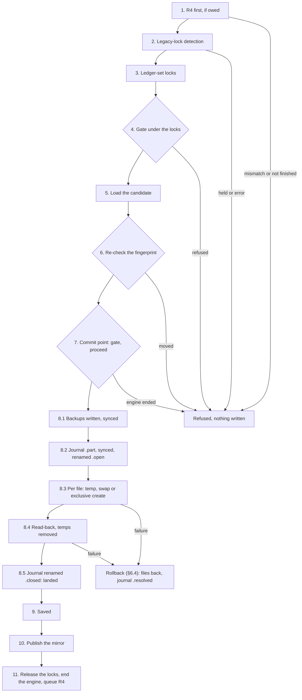
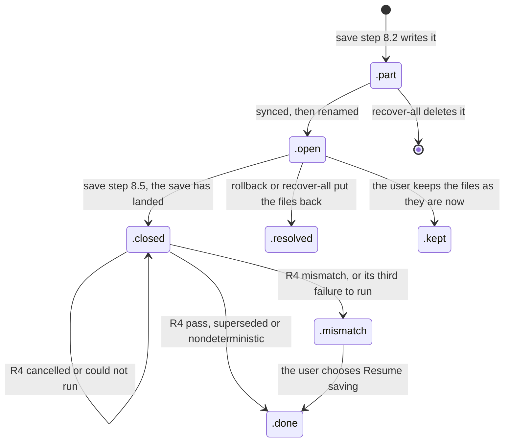

# Engine jobs and saves: one engine, one job at a time

## Orientation
- **What this is:** draft 5 of the engine-jobs spec (2026-10-27): how the main sidecar runs ledger work on the ledger engine, how a save becomes durable, how Cancel, a crash, a quit and a workspace switch end each job, and how interrupted saves are recovered. It records the owner's return to **one engine doing one job at a time** (ADR-0064). Drafts 1 to 4 (parallel engines) and their reviews are in the owner's private archive (`m1a/scheduler-design/`); they are reference only, not the design of record. Status: **goes to code now** in the engine-jobs slice (BL-0109), under the single rule for designs checked by a formal model (PROCESS.md §3 "Designs checked by a formal model"; IMP-0045); the model's review against this spec and the owner's long runs go on beside it, and their findings become tests or backlog rows unless they are a High data-safety issue (BL-0110).
- **What exists:** the engine process, its protocol (S0035) and its supervision as a statechart with bounded restart (S0040, `app.platform.engine_supervision`, driven by `app.platform.adapters.engine_client.EngineClient`); the queue's decisions as a pure table and the engine lock (S0053, `app.platform.engine_jobs.queue`); §5.5's changes to the client and the engine (S0057: no time limits, our ends `Cancelled` and `Retired`, the engine's own process group drained before the reap by `app.platform.adapters.engine_group`, `close()` without waiting, the `-s -S -B -P` command and the bytecode directory, protocol version 2 with progress, `gate`/`proceed`, `committed` and `decision`). The scheduler shell that runs the queue against the client (S0058, `app.platform.engine_jobs.scheduler`: spawn on demand, the engine lock before every fresh engine, the engine unavailable, death by the engine's number, the codes of §11 for jobs that need no save, the job texts of §5.4 in `app.platform.engine_jobs.text`); the model's traces replayed through the queue table and the shell (S0059, `backend/tests/platform/test_engine_jobs_conformance.py` over `formal/tla/engine-jobs/traces/corpus.json`); the save's durable order (§6.1 step 8) over the engine's file-system port (S0060: `ledger_engine.fs.port` with a handle per directory, its macOS adapter `ledger_engine.fs.darwin`, `ledger_engine.ledger.writer.durable_commit`, `canonical_path` and `path_key` in `ledger_engine.ledger.paths`, the journal record in `ledger_engine.ledger.core.journal`; checked over the in-memory fake `engine/tests/fakes/memfs.py` with crash, I/O-error and power-loss injection at every effect); the restore shared by the rollback (§6.4) and recovery's per-journal try (§8.1 steps 1-4) (S0061: `ledger_engine.ledger.restore.restore` and `recover_journal`, the per-file judgement `ledger_engine.ledger.core.recovery.judge`, the rollback wired into `durable_commit`, the ledger-set locks' port `ledger_engine.fs.port.Locks`; every crash point of the save and of the rollback followed by recovery, a crash during recovery followed by recovery again); recover-all inside an engine (S0062: the listing, each try and the blocked screen's Keep, Delete the kept copy and Delete it as engine ops `recover_list`, `recover_try`, `recover_act` in `ledger_engine.ledger.recover_all` and `ledger_engine.protocol.recovery`, answered only by an engine that holds the engine lock; the sidecar's work, its report and the match to a workspace in `app.platform.engine_jobs.recovery`, §11's texts in `app.platform.engine_jobs.recovery_text`; the queue's Cancel per journal, a death and `not_tried` in `app.platform.engine_jobs.queue`; the boot's `recover_all` runs it); the save job end to end (S0063: §6.1 steps 1-7 and 9-11 in the engine, `ledger_engine.ledger.save` with the ops `save` and `save_outcome` in `ledger_engine.protocol.save`; the sidecar's work, §6.6's decision and §11's texts in `app.platform.engine_jobs.save` and `save_text`; the queue keeps a save whose engine died to read its outcome); the conformance replay on the save path (S0064: the model's saves replayed through `ledger_engine.ledger.save.run` over the in-memory file system, the model's files and records projected onto it, `engine/tests/ledger/test_save_conformance.py`; the corpus widened by branch, recover-all's branches walked by the queue replay; where the model differs, BL-0161, the replay stops and counts); R4, create and copy, the switch and the open that consumes the report are BL-0152 to BL-0154, and recover-all's tries replayed through the engine BL-0164.
- **Decisions it applies:** ADR-0064 (this design), ADR-0008 (write-safety contract; R4 after the reply), ADR-0010 (overlay load), ADR-0011 (no resident ledger), ADR-0012 (journal and recovery, as amended by ADR-0063), ADR-0013 (atomic swap), ADR-0015 (mirror publish), ADR-0054 (engine process; decision 4 as amended by ADR-0064), ADR-0062 (single instance; legacy-lock detection), ADR-0063 (one open workspace; the switch; recover-all-before-open).
- **Invariants:** INV-01 and INV-22 (every write passes the contract and fails closed), INV-10 (no resident ledger; bounded caches), INV-11 (the queue hangs off `UserContainer`), INV-20 (performance absolutes), INV-28 (`WORKSPACE_NOT_OPEN`), INV-29, INV-30 (recovery is the one write on open), INV-31 (only the open workspace runs jobs), INV-32 (recover every unfinished save before any workspace opens).
- **Requirement tags:** every mechanism below names what it serves, in brackets: an invariant, an ADR clause, or the owner's words. "Owner A" is the owner's design of 2026-10-27 quoted in ADR-0064: "one engine process, one job at a time; a FIFO queue where a job the user is waiting for goes ahead of background work; Cancel ends that job's engine and is not counted as a crash; a crash is noticed by the process exiting, with S0040's bounded restart; no automatic killing of slow jobs; one load at a time bounds memory; the save reports 'saved' after commit + read-back; the R4 re-check runs right after and gates only the next save".
- **Status of this text:** draft 5 with the fixes of its first two golden reviews (review 5: 1 High, 8 Medium; owner, 2026-10-27: "I agree with all the recommendations. Proceed on that basis."; review 6: 1 High, 8 Medium; owner, 2026-10-27: "I agree with the four simpler policies and two decisions that you proposed."; review 7: 0 High, 7 Medium). After review 7 the owner chose to end the review loop (owner, 2026-10-27: "Let's do B. That still enables us to get to a watertight spec and implementation, right? Just that instead of uncovering issues by review, we will uncover them through a formal model checker? And we'll also get an insight into how long that model checking takes?"; PROCESS.md §3, IMP-0038): a targeted review of the sections review 7 changed, then the convergence audit, then the TLA+ model of §13. "Review 6 P1-P4, D1, D2" below name the policies and decisions of that answer. **Simplification B** (owner, 2026-10-28: "Agreed with B, back always recovers first, and the read core next"; ADR-0064 and ADR-0063 amendments of that date): the engine lock (§5.1) keeps an engine of an earlier session from running beside the new session, which removes every case of an orphaned engine writing beside recovery, a save or a copy (targeted review 5's M-1 to M-3; the `in_use` reason and model interpretation I19 are gone); and Back always runs recover-all before it opens the previous workspace (§9.1). **Retry recovers first** (owner, 2026-10-29: "...to keeping the per-file locks as a second line and having retry recover first."; the line "Retry too" in ADR-0063's amendment "Back always recovers first", and the Unchanged line of ADR-0064's engine-lock amendment): Retry, like Back, runs recover-all before the open on every screen that offers it (§8.1, §9.1 step 6, §9.2), and the ledger-set locks stay as a second line behind the engine lock (§8.1 step 1).
- **Traps:** a job that writes (save, create, copy) is never ended by us past its commit point, except by "Quit anyway" (§4). The R4 gate is a file on disk, never a flag in memory (§6.5). `-I` must not be used to start the engine: it ignores `PYTHONHASHSEED` (§5.1). A file a save creates gets the same `path_key` before and after it exists (§6.3). On macOS `killpg(pgid, 0)` answers `EPERM` for a group whose only member is a zombie and also while a member is still exiting with its files open: "no live member" is read from the group's process listing instead (§5.2). A recover-all that is cancelled never lets a workspace open over a journal it did not try (§8). No ledger work of a new start runs until every engine of the earlier session has ended (the engine lock, §5.1).
- **Main tests:** §14. The model obligations: §13.

## 1. Terms

- **Job:** one unit of engine work, for the open workspace or app-scoped (for no workspace). States: `queued → running → ended(outcome)`.
- **Waited-for job:** a user request is waiting for its result (an HTTP request in flight, the open, the switch, the boot). **Background job:** nobody waits: R4, and a save the app started itself (prices). [Owner A]
- **Runs user code:** the job loads the ledger with plugins (`insert_pythonpath`, plugin modules): open, rebuild, preview, save, BQL, the R4 load, and the load check of a `create` or `copy`. Parse-only work (planning, R4's confirm, facts from options) and recovery run none.
- **Commit point:** for a save, the moment it asks to start its first durable write (§6.1 step 7): before it, the save has written nothing. For a `create` or `copy`, the moment it asks to write the workspace manifest, its last write (§8.2): before it, the new folder is not a workspace. After the commit point the job finishes or is resolved from disk.
- **Closed record:** the file a save's journal becomes when the save has landed (§6.5). It says "saved" and that an R4 is owed, and it pauses the next save of that workspace until R4 ends.
- **`canonical_path` and `path_key`:** §6.3.
- **Fingerprint:** ADR-0008 step 4's full extended fingerprint with a SHA-256 per file, keyed by `path_key`: every loaded file and glob match, each glob's match list, the absent paths the ledger names, the documents-root listings, and the source files of plugins imported from outside the engine's own packages (a plugin edited after a save makes its R4 superseded, never a false mismatch).
- **Reopen:** a switch from the open workspace to itself (§9.1): it closes the workspace, recovers every journal, and opens it again.
- **R4:** the re-check after a save (§6.7); the label is kept for historical reasons.

## 2. Jobs

| Job | Does | Who waits | User code | Cancel (§4) |
|---|---|---|---|---|
| `open` | the open's mirror build when the fingerprint differs from the published generation (ADR-0015), and the ledger facts the open needs | waited-for (switch, boot) | yes | yes; the open stops and offers Retry (and Back after a switch) |
| `rebuild` | a mirror build after the focus check saw an outside change, or after a save whose publish failed | waited-for (writes are refused while the mirror is stale, ADR-0015) | yes | yes; the workspace stays `WARMING` on the old generation, with **Update now** to queue it again |
| `preview` | plan, then the contract's step-3 overlay load (ARCHITECTURE §9.2 steps 1-3) | waited-for | yes | yes; nothing to undo |
| `save` | a confirmed plan: §6.1 | waited-for; background when the app started it (prices) | yes | before the commit point: yes; after: no, it finishes |
| `r4` | the re-check of the last save (§6.7) | background; run inside a save that finds it owed | yes (its load), then none (its confirm) | yes; the closed record stays, and the next save runs it first |
| `bql` | a BQL query over one transient load (ADR-0011) | waited-for | yes | yes |
| `recover_all` | §8, while no workspace is open | waited-for (start, switch, Reopen) | no | yes, per journal: the journal it is on counts as blocking, and recovery goes on with the next one (§8) |
| `create`, `copy` | app-scoped: create or adopt a workspace, a test copy, "New workspace from settings of…" (ADR-0063 decision 1); they write the new folder directly and its manifest last (§8.2) | waited-for | yes (the copy's "loads the same" check, the create's seeding) | before their commit point (the manifest write): yes, leaving a folder that is not a workspace; after: they finish |

- Price fetching itself is network work in the sidecar, outside the queue; only its save is a job. [ADR-0054 decision 1]
- Every job is idempotent at its start: a `rebuild` whose fingerprint equals the published generation does nothing; an `r4` whose closed record is gone does nothing. So the queue never merges jobs; it only caps how many of a kind may wait (§3). [Owner A: one job at a time, nothing more]
- Any work that reads or writes ledger files on behalf of a job (copy reads included) runs inside that job, so it never overlaps a save. [ADR-0012 Q29: writes serialized with reads of the same files]
- Outside the queue, the sidecar's cheap probe, `assess_workspace` and the focus check read files without writing them; a file that moves under them is caught by the job that follows (§7, the gate). [ADR-0063 decision 1 step 2; ADR-0037]

## 3. The queue

- **One queue, one scheduler thread and one engine per `UserContainer`** (on desktop, one per app; in hosted mode, per user container). The queue is in the sidecar; the scheduler is a pure table `queue.transition(state, event) -> (state, effects)` (§12). [INV-11; owner A; the owner's replayable-decisions requirement]
- **The ordering rule:** when the engine is free, the scheduler starts the oldest queued waited-for job; if there is none, the oldest background job. A running job is never interrupted to start another; it ends by finishing, by Cancel (§4), by a crash, or by "Quit anyway". [Owner A: "a FIFO queue where a job the user is waiting for goes ahead of background work"]
- **During a switch, a Reopen and the boot,** from the moment the current workspace has closed (at boot, from the start) until the switch or boot has ended or shows its failed or blocked screen (its own work is then done; the user acts there), only its own jobs start (`recover_all`, then the target's `open`). Other jobs, app-scoped ones included, wait behind them. [ADR-0063 decision 2: "app-scoped work waits for recovery"; INV-31; model finding F4: a screen that waits for the user must not hold app-scoped jobs]
- **A job for a workspace that is not open is never queued:** its request gets `WORKSPACE_NOT_OPEN` (INV-28). [INV-28, INV-31]
- **Bound:** at most `max_queued` jobs (a setting, generous by default). A request beyond it gets `ENGINE_QUEUE_FULL` and is not queued. The app keeps at most one queued `r4` and one queued background save per workspace. [INV-10: every in-memory structure is bounded]
- **Memory:** one engine runs one load at a time, so peak memory is one load's peak plus the sidecar. There is no admission or memory check. [Owner A: "one load at a time bounds memory"; ADR-0011's purpose for the semaphore]

## 4. Cancel

Cancel is the user's way to stop waiting, and the only way a slow job ends early. [Owner A: "Cancel ends that job's engine and is not counted as a crash"; "no automatic killing of slow jobs"]

| The job is | Cancel does | The user sees |
|---|---|---|
| queued | removes it; nothing ran | nothing more, or "Cancelled." |
| queued behind another running job | removes it; for the running job, the one rule below | as the rule says |
| running, not a writing job, or a writing job before its commit point | ends the engine (§5.2); the outcome is `cancelled`, not a stop | for a save: "Your request is cancelled." (`JOB_CANCELLED`; nothing was written, but no re-hash runs, so "Your ledger is unchanged." is not said) |
| a writing job past its commit point | nothing: the job finishes | "Finishing your change…", then its outcome |
| `recover_all` | before it has listed the journals: ends it and marks nothing; the switch or boot ends on its cancelled screen (§8.1). After the listing: ends the engine; the journal being recovered counts as blocking, and recovery goes on with the next journal in a new engine (§8) | the open goes on when every journal is recovered or blocking; workspaces and copies using a blocking journal's files get `RECOVERY_BLOCKED` with Retry and "Keep the files as they are now" |

- **Every job that writes has the same commit-point step:** a save, a `create` and a `copy`. **The commit point is decided in one table step** (owner, 2026-10-26: "Cancel on a save that has started writing files shows 'Finishing your change…' and lets it complete", `design/inbox/answered/20261026-engine-concurrency-and-cancel.md`; ADR-0063 decision 1 leaves the rest to this spec). The engine sends `gate` and waits. In one step the scheduler either ends the engine (a Cancel is pending: outcome `cancelled`, disk unchanged) or marks the job past the commit point and sends `proceed`. A Cancel that arrives after that step is answered "too late" and changes nothing. [INV-01; ADR-0063 decision 1 step 4]
- **The one rule for a job someone else is running** (quick check 9; every wait has an exit). When a waiting user presses Cancel on a queued job:
  - **Another job's Cancel ends the running job only when nobody waits for it, the user did not confirm it, and it has not reached its commit point:** an R4 load; a background save (prices) before its commit point; a preview, rebuild, BQL or open build whose requester has gone (its request aborted or its window closed). Such a job loses nothing (§2): an R4 stays owed on disk, prices are fetched again later, a read is asked for again.
  - **Otherwise the waiting user cannot end the running job:** any job past its commit point, or a save, `create` or `copy` the user confirmed (closing is not a cancel, ADR-0063 decision 1 step 3). The waiting job shows the usual "Waiting for: <label>…" and, after the display delay, "Still working…" with Cancel, never quit advice on a timer, since the job ahead may only be slow (a confirmed save at 54k takes seconds). When the user presses Cancel, their own request is cancelled and they read "Your request is cancelled. The earlier ledger work cannot be stopped from here; if it never finishes, quit and reopen Finzytrack." Quit anyway (§9.3) then ends the running job, with its journal, manifest-last rule and next-start note.
  - **A process that did not die after we signalled it** (a retire's drain, or a job a Cancel already ended), and **an engine of an earlier session that still holds the engine lock** (§5.1), are the cases shown on the timer: after the display delay the app shows "Finzytrack cannot stop the earlier ledger work. Quit and reopen Finzytrack." (§5.2), in the waiting job's place or, if no job waits, as a notice, since nothing there is merely slow.
  - A job whose own requester is present is that requester's to cancel; the waiting user's Cancel removes only their own job.
  [ADR-0063 decision 1: "every wait has an exit" and "closing is not a cancel"; review 7 M1; targeted review 8 N1, N2; quick check 9 F1, F2, F6; model 2 mutants `cancel_ends_writing_job`, `no_quit_message_for_writing`, `r4_only`, `advice_on_timer`]
- **A client that goes away** (a tab closed, a request aborted) cancels its queued or running preview, rebuild or BQL. It never cancels a save: confirming is the user's decision, and closing is not a cancel. [ADR-0063 decision 1 step 3]
- **"Quit anyway"** (§9.3) is the one case where we end a writing job past its commit point; the journal makes a save safe and the next start recovers it; a `create` or `copy` cut during its manifest write leaves no manifest, or a complete one. [ADR-0063 decision 1 step 4]

## 5. The engine process

### 5.1 One engine at a time, fresh after user code

- **At most one engine process exists at any moment** (per user container, §3), and it runs at most one job. A new engine is spawned when a job needs one, only after the previous one is reaped and its process group has no live member (§5.2). A quit is the one exception: it does not wait (§9.3); the next start waits instead (the engine lock, below). [Owner A; memory bound]
- **The engine lock** keeps this true across a crash and a restart. One lock file, `app_local_data/locks/engine.lock`, never deleted. Every engine, after its handshake and before any ledger work, takes it with a whole-file `flock`, waiting, and holds it for its whole life. It opens it before any ledger-set lock and in the same way, so its process group holds it as it holds those (§5.2): a process that holds one of an engine's ledger-set locks also holds its engine lock. Within a session the lock is free whenever an engine starts, since the previous engine's group has no live member. **At start, before its first engine, the sidecar takes the lock itself, waiting, and releases it at once** (each engine must hold it on its own, so that an engine of a crashed session keeps holding it). An engine of the earlier session (left by a crash, by Quit anyway or by a quit; its watchdog or our signal ends it, normally within 0.25 s, §5.2) still holds it, so the new session's first ledger work waits until that engine has finished or died. Whatever it did before it ended is a save cut at a later step, which recovery already handles (§8.1). While the sidecar waits, jobs stay queued (the boot's own job can be cancelled, §9.2), and after the display delay the app shows "Finzytrack cannot stop the earlier ledger work. Quit and reopen Finzytrack." whether or not a job waits (§5.2): an earlier engine still alive by then is stuck. [owner, 2026-10-28: "Agreed with B, back always recovers first, and the read core next" (simplification B; ADR-0064 amendment); targeted review 5 M-1 to M-3: no orphaned engine writes beside recovery, a save or a copy]
- **An engine that ran user code is ended after its job**, after its final reply; the next job gets a fresh engine. A plugin can leave threads, patches to Beancount or memory behind; none of it may reach the next job's checks. An engine that ran only parse-only work or recovery may serve the next job. [owner, 2026-10-26, decision (5): "a fresh engine process per heavy job"; INV-10]
- **Spawn:** flags `-s -S -B -P -X pycache_prefix=<bytecode directory>`, never `-I`: `-I` implies `-E`, which ignores `PYTHONHASHSEED` (checked with Python 3.13: two runs under `-I` with `PYTHONHASHSEED=0` gave different `hash('abc')`, two under `-s -S -B -P` the same). Environment: the parent's, minus `FT_*` and every `PYTHON*` variable, plus `PYTHONHASHSEED=0`; plugins keep `PATH`, `HOME`, `LANG` and `TZ`. The packaged bootstrap adds only the engine's site-packages (ARCHITECTURE §2.0); the development form uses the same bootstrap with the virtual environment's site-packages, since `-S` keeps a venv's packages off the path (the development command's former `-I` module form would not import under `-S`; both forms run the bootstrap since S0057). [ADR-0054 decision 5 (the engine's own closure only); R4's digests must not depend on hash order (§6.7); INV-30 (`-B`: no `__pycache__` written into a user's folder)]
- **Bytecode directory:** private to the engine build, always in app-local data (`app_local_data/engine/bytecode/<build>/`, never inside the packaged install, which may be read-only), filled once per build with the bytecode of the engine's interpreter library, site-packages and code, read-only afterwards. A user's plugin is compiled from its source on every load and never cached. Without it each fresh start costs about 0.24 s instead of 0.05-0.10 s (review 4 spike N, owner's Mac). **If an engine fails to start** while using the directory, the directory is deleted and the engine is started once without it; the next fill rebuilds it. A damaged `.pyc` under `pycache_prefix` raises instead of falling back to the source (review 6 spike), so this keeps one bad file from stopping every engine; a start that fails again without the directory is an ordinary `start_failed`. [ADR-0008's speed targets, given a fresh engine per job; review 6 P3]

### 5.2 Ending an engine

- **The reason is recorded before the signal**, and a recorded reason wins over the exit status: `cancel`, `retire` (after a job that ran user code), `quit_anyway`, `close`. [S0040: only real failures count as stops]
- **Each engine leads its own process group** (POSIX; a Job Object nested in the shell's, with kill-on-close, on Windows). Our end signals the whole group, so a plugin's child processes go too and cannot keep the ledger-set locks: a `flock` lock is shared with every child that inherited its descriptor. [ADR-0012 Q29/Q30: locks released when the job ends]
- **The engine ends its own group when its parent is gone** (usually within the watchdog's 0.25 s; a plugin's C code that holds Python's interpreter lock can delay the watchdog thread, and then the end-of-input exit covers it, and the next start waits for it at the engine lock, §5.1, §15). Its group is not the sidecar's, so a group signal the shell sends to the sidecar no longer reaches it. On POSIX the parent-death watchdog and the end-of-input exit therefore signal the engine's whole group (`killpg(0, SIGKILL)`, the engine included) instead of only exiting the engine; on Windows the Job Object's kill-on-close does it when the sidecar's handle closes. So a plugin's child cannot outlive a dead sidecar holding a ledger lock, and an orphan is gone within the watchdog's 0.25 s unless it is stuck on a disk (§15). [ADR-0012 Q30; ADR-0063 Consequences (the orphan); review 5 M8]
- **Drain before the reap, never a group signal after it:** wait for the leader with `waitid(P_PID, pid, WEXITED | WNOWAIT)` so it stays an unreaped zombie and its group id cannot be reused; signal the group until it has **no live member**; then `wait4(pid)` for the status, `ru_maxrss` and CPU. After the reap no signal is sent to that group: its id may already belong to another program. [review 4 M5; never harm a foreign process]
- **"No live member", per OS** (so that no member still holds a file, and with it a `flock` lock): macOS: no process but the held leader is listed in the group (libproc `proc_listpids(PROC_PGRP_ONLY)`); a failed listing counts as a live member. Not `killpg(pgid, 0)`'s answer: with the leader held as a zombie and nothing else left it answers `EPERM` (review 5 spike, Darwin 25.6), but it answers `EPERM` too while a SIGKILLed member is still exiting with its files open (found in S0057: the member's lock was still held at that answer in 36 of 40 runs). Linux: no process in `/proc` has that group id in a state other than `Z` (a zombie still answers `killpg(pgid, 0)` there). Windows: the Job Object's active process count is 0. [review 5 M3]
- **CPU of a job** is the engine's own plus its reaped children's, read with `RUSAGE_CHILDREN` in the leader before it exits (Linux `cutime`/`cstime`; Windows the Job Object total), and logged with the job (§12). A plugin child the engine never waited for is not counted, so on POSIX it is a lower bound. It decides nothing; it is the measurement INV-20's performance suite and BL-0082 need. [INV-20; review 4 M1: macOS process listings miss short-lived children]
- **A process that cannot be ended** (stuck in the kernel on a dead disk or share) keeps the engine slot and its locks until it ends; no new engine starts meanwhile, so no other job runs, recover-all included. **Whenever the slot is held by a process we have already signalled that has not ended** (after a Cancel, a retire's drain, or the end of a job whose requester is gone), the app shows, after the display delay of §5.4, "Finzytrack cannot stop the earlier ledger work. Quit and reopen Finzytrack.", whether or not a job is waiting: in the waiting job's place if there is one, otherwise as a notice in the window, which stays until the process ends (model finding N3: a user who cancelled their own waiting request would otherwise get no explanation of a slot held for ever). The delay only changes the text, as in §5.4; the text does not guess the cause. A running job the waiting user merely cannot end (§4) gets no such text on a timer: the advice comes only as the answer to that user's Cancel. Quitting never waits for it (§9.3). [ADR-0063 decision 1: every wait has an exit; review 7 M1; targeted review 8 L2] On the next start the stuck process still holds the engine lock: the new session's first engine never starts, so no ledger work runs (recover-all, every open, create and copy included) until that process ends, and the app shows the same advice (§5.1). [honest limit, review 6 P4 as amended by simplification B; §15]

### 5.3 Crash and bounded restart

- **A crash is noticed by the engine's exit**: the reader sees the output end (`Ended`), or the reap sees the exit. Nothing polls or times the engine. [Owner A]
- **Each engine has its own number** for its whole life: every spawn takes a new one, and an engine that serves the next job after parse-only work (§5.1) keeps it. The shell reports a death by that number. A report about the engine in the slot ends it as `crashed`, even when a job was started on it after it died and before the report arrived (that job is lost like any crashed job); a report about an earlier engine, already ended and drained (§5.2), changes nothing. Naming the engine by its last job would mistake the first case for the second and leave the slot held by a dead engine. [S0053 verifier R2-F1]
- **How an engine ended:**

| Observation | Outcome | Counted as a stop (S0040 bound) |
|---|---|---|
| final reply, then our `retire` or `close` | `answered` | no |
| ended by us with `cancel` or `quit_anyway` | `cancelled` | no |
| a signal or exit we did not cause; SIGKILL (often the OS, for memory) is `killed_by_system` | `crashed` | yes |
| a reply that breaks the protocol before the commit point | `violation` | yes |
| a reply that breaks the protocol after the commit point | close the engine's input, read and discard every further byte, wait for the exit, resolve from disk (§6.6) | yes, at the exit |
| the start fails (spawn, or a refused handshake) | `start_failed` | yes |
| another protocol version | `incompatible` | no; never retried |

- **Bounded restart** stays as S0040 built it: the next job starts a new engine after 0.5 s, 2 s, then 8 s by recent stops; three stops in 300 s make the engine `Unavailable` until the oldest leaves the window, or **Try again**. [Owner A: "S0040's bounded restart"]
- **The crashed job is not run again by itself.** A read job ends with `ENGINE_STOPPED` and Try again; a save's outcome is resolved from disk (§6.6); an `r4` leaves its closed record, so the next save runs it first. Queued jobs stay queued and run on the next engine. [S0035: a request is never resent; a crash is often repeatable]
- **The protocol-violation rule after the commit point** exists because the engine may be in the middle of a replace: ending it then needs a recovery, while letting it run lets the save finish or roll itself back. The sidecar closes the engine's input at once: the engine finishes the request in hand and exits at the end of its input, so the exit does come (without it the engine would wait for a next request after its final reply). Discarding the output keeps the pipe from filling and blocking the engine. Meanwhile the user sees "Finishing your change…"; if the engine never exits, Quit anyway (§9.3) and the switch's Stay remain. [INV-01; review 3 F5]

### 5.4 No time limits; "Still working…"

- **No engine job has a time limit.** A slow job and a hung one look the same from outside; ending either is the user's decision. [Owner A: "no automatic killing of slow jobs"; the owner's rule against fixed time budgets]
- **What the user sees:** at once, the job's phase with Cancel where §4 allows it ("Starting the ledger engine…", "Reading your ledger…", "Checking your change…", "Saving…", "Updating your views…", "Checking your last change…"); when it is queued, "Waiting for: <the running job's phase>". After a short display delay (a UI constant, default 2 s) the text becomes "Still working…" with the same actions. The delay only changes the text; it ends nothing. [Owner A: "after a while a long job shows 'Still working…' with Cancel"]
- The engine reports its phase in progress messages on the protocol; a phase change is shown, never judged. [ADR-0039: a long operation shows progress]

### 5.5 What changes in the built code

The engine-jobs slice changes S0035/S0040/S0042's code as follows (each with a test, §14). **Built in S0057** (the first five bullets; the shell of S0058 drives them); **built in S0058**: the last three (the sidecar's wait for the engine lock is the scheduler's, before every fresh engine; spawn on demand; what the user sees for E2, E3, E5, E7 as job texts, rendered by BL-0092):
- `EngineClient.call` takes no timeout; the time limits on a request and on the handshake leave the statechart and the client, with the bounds derived from them; `Cancelled` (our end with reason `cancel` or `quit_anyway`, not a stop) and `Retired` join it. A start that never completes is ended by the waiting job's Cancel (`EngineClient.end`, from any thread).
- `close()` runs after the quiesce (§9.3): it signals the engine's group once and returns without waiting for a call in flight or for the reap.
- The engine is spawned as the leader of its own process group (`start_new_session`), and its parent-death watchdog and end-of-input exit signal that whole group (§5.2), when it leads one; before S0057 `watch_parent` called `os._exit`, which ended only the engine.
- The engine command drops `-I` for `-s -S -B -P` with the environment of §5.1 (`EngineCommand.for_packaged` and the development form, the same bootstrap), and the bytecode directory of §5.1.
- The protocol gains progress messages, `gate`/`proceed`, `committed` (§6.1), and a `decision` object in replies (§12); version 2. S0042's writer thread stays: it lets Cancel end an engine in the middle of a large request.
- The engine lock (§5.1): every engine takes `app_local_data/locks/engine.lock` before any ledger work and holds it for its life; the sidecar waits for it at start, before its first engine, with the advice after the display delay; since S0058 the scheduler waits again before every later fresh engine (a reuse needs none), so a plugin's child that left a group holding the lock delays the next engine with the advice (§15), and a failed wait never lets an engine start.
- The engine is spawned when a job needs one (§5.1), not at boot (until S0058 `app.platform.engine_boot` started it at boot, in parallel with the bind, S0038). At start the first job is the boot's `recover_all`, so an engine still starts early (convergence audit C29; BL-0109).
- Failure-modes rows E2, E3, E5 and E7 change with it (hang and slow become Cancel; the engine's group ends with it when the sidecar dies; close follows the quiesce): S0057 changed them as far as the client and the engine go; S0058 gives the texts of what the user sees (`app.platform.engine_jobs.text`); the UI that shows them is BL-0092.

## 6. The save

### 6.1 Steps

Steps 2-11 run in one fresh engine (§5.1); step 1 uses its own engines first (§6.7). Python's garbage collector is paused for the job (ADR-0008 amendment).
1. **R4 first, if owed.** If this workspace has a closed record (re-read from disk), the save first runs that `r4` (§6.7) inside this job. A `pass`, `superseded` or `nondeterministic` outcome lets the save go on. A `mismatch` refuses it with `WRITES_PAUSED {check_failed}`; an R4 that could not finish (its engine stopped) refuses it with `WRITES_PAUSED {check_pending}`, nothing written; after the third such failure of the same R4 it becomes `check_failed` (§6.7). A Cancel during this step cancels the save. [ADR-0008 amendment: R4 "completes before the next write"]
2. **Legacy-lock detection** (ADR-0062 decision 2, as written there): every `data/.write.lock` of a known, not-retired legacy install whose config names a file of this ledger set, deduplicated by `path_key`, tried once each without waiting, before any ledger-set lock. Free: held until the save ends. Absent: go on. Held, or any other outcome: refused with `LEGACY_APP_SAVING`, nothing written, not a stop. With one engine, two of our own jobs never try the same lock. [ADR-0062; INV-26; INV-22]
3. **Ledger-set locks:** one lock file per `path_key` in `app_local_data/locks/<sha256(path_key)>`, for every file of the workspace's ledger set (Q29), the files the save creates and the absent paths, taken in `path_key` order, waiting (the user sees "Waiting for your ledger files…" with Cancel). Lock files are never deleted. With the engine lock (§5.1) no other process of ours holds one while an engine runs, so the wait ends at once; the locks stay as ADR-0012 decides them, a second line should the engine lock ever be bypassed. [ADR-0012 Q29; ADR-0063 Consequences, as amended by simplification B: the engine lock, not these locks, excludes an engine of an earlier session]
4. **Gate, under the locks:** the disk's fingerprint equals the plan's; the published mirror's equals the plan's; this workspace has no `.open` journal, no closed record and no `.mismatch` record (matched as §6.5 says), each re-read from disk. Refusals: a moved fingerprint → `LEDGER_EXTERNALLY_CHANGED` (re-plan through a fresh mirror, ADR-0026); a stale mirror → `WORKSPACE_NOT_READY {WARMING}`; a `.open` journal → `WRITES_PAUSED {unfinished_save}`; a `.mismatch` → `WRITES_PAUSED {check_failed}`. [ADR-0008 step 4; the R4 gate survives a crash (model mutant `gate_in_memory`)]
5. **Load:** the contract's step 3 on the candidate, the commit's one full load (ADR-0011), under the locks.
6. **Re-check, under the locks:** the disk's full fingerprint again, now that the load has run (the load takes seconds at 54k, and the disk may have moved meanwhile). Moved → refused with `LEDGER_EXTERNALLY_CHANGED`, nothing written. The locks keep our own writers out, but an editor or a sync client does not take them: without this check an outside edit to an include the save does not write, made during the load, would land beside our change in a combination nothing checked. The re-check passes only when the disk's fingerprint equals both the plan's and the fingerprint of the bytes the load itself parsed (`Loaded.fingerprint`, as §7's reads do): the load takes seconds, so an outside edit read by the load and reverted to the plan's bytes before this step would otherwise pass, and the commit, the closed record and the mirror would build on bytes no longer on disk; an edit made and reverted after the load changes nothing the save uses and passes (the content-hash fingerprint, ADR-0015 amendment). [ADR-0013: "re-check the fingerprint immediately before each replace, under the lock"; review 5 M1; model 2 mutant `no_recheck`; the owner's TLC run `L_save_deep`, 2026-10-30, BL-0161]
7. **Commit point:** the engine sends `gate`; §4's one table step answers `proceed` or ends the engine.
8. **Durable order** (every sync is `durable_sync`, §6.2). Before its first effect the save refuses, writing nothing, a target it cannot write safely: a replaced file that is not a regular file, is locked, has a second hard link, may not be moved away or whose extended attributes cannot be read; a folder it writes in, or makes a folder in, on a volume without the swap, that does not let us add entries or remove them (`access(2)`: write and search, `_RMFILE_OK`), or that carries an **ACL deny entry, whoever it names**, unless new entries do not inherit that entry and it denies only what protects the folder itself (`delete`, `writeextattr`, `writeattr`, `writesecurity`, `chown`): owner, 2026-10-30, "Allowlist (Recommended)", then "Any subject (Recommended)" (ADR-0013 amendments of that date; macOS's own `group:everyone deny delete` and `deny writeextattr` on the home folder, Desktop, Documents and Downloads pass). Every other deny entry is refused, an inheritable one of any bit included, since every entry the save made there would inherit it and its own staging file could then not be renamed, removed or `stat`ed (S0061 red team round 6, F1-F3; verifier F1); whom an entry names is never asked (S0061 r7: macOS's `owner` and `group` subjects apply to us although a membership lookup says they do not). The journal folder and the backups folder pass the same folder rule before the save writes anything in them (S0061 r7; the refusal names that folder, no ledger file):
   1. backups written, each file synced, and their directory synced; before its backup is read, each file the save replaces is itself synced (`F_FULLFSYNC` on a read-only descriptor), so what an editor wrote into it without a sync is durable before the swap displaces it, and a power loss can never tear the displaced old object into bytes "another program" never wrote (S0061 red team round 4, F2; one more sync per replaced file);
   2. the journal written as `local/<key>/journal/<session>-<job>.part` and synced, renamed `.open`, then its directory synced, so an `.open` journal is never torn (a power loss can keep a new directory entry before its data; a `.part` is only ever removed by recovery, since no replace has happened yet). It names every file the save replaces or creates by `canonical_path` and `path_key`, with pre and post hashes, backup and temp names, the directories it creates, and every field of the future closed record (post fingerprint, adopted and parse digests, engine build, workspace registry key and lineage id);
   3. per file, children first and the root last: the new bytes written beside it under the **staging name** `.<name>.ft-<session>-<job>.new` and synced, renamed exclusively to the temp name `.<name>.ft-<session>-<job>.tmp` (an entry already there is never replaced: the save stops), and the directory synced, so the temp's name is durable before the replace (owner, 2026-10-30: "Staging name (Recommended)": a write cut off by a crash or torn by a power loss is then only ever at the staging name, which no swap touches, and the temp name only ever holds our synced bytes or the object the swap displaced; S0061 round 2: an editor's in-place write through the file's name while the replace is not yet durable always keeps a durable name); then a **replace by atomic swap** (ADR-0013), or for a file the save creates an **exclusive create** (`RENAME_EXCL` / `RENAME_NOREPLACE`) that fails if a file appeared; what the swap displaced checked (§6.4: every swap does this; an outside save goes to its kept name); the file's mode preserved, and a symlinked file written at its real path (ADR-0008 step 5); the directory synced. A directory the save creates is made here and its parent synced;
   4. read-back: every written file equals its post bytes; then our temp files (they now hold the displaced pre bytes, which the backups also hold) are removed and their directories synced, so a crash after the close leaves nothing of ours in the folder;
   5. **journal close:** a rename of `.open` into `.closed` (the handle closed first, for Windows), then its directory synced. **The save has landed exactly when the closed record is durable.**
   [ADR-0008 step 5; ADR-0012 fsync order and F-4; review 4 H2 and L3; review 5 M2. Model mutants killed: `no_backup_sync`, `no_journal_sync`, `no_temp_fsync`, `report_before_close_sync`, `plain_create`, `temps_after_close`, `direct_open`]
9. **"Saved":** the engine sends `committed`; the sidecar records the outcome and answers the user's request: **saved**. [Owner A: "the save reports 'saved' after commit + read-back"]
10. **Publish:** the mirror generation is built from the step-5 load result, still in memory, and published if, under the locks, the disk's fingerprint equals the post fingerprint and no `.open` journal exists (§7). The views update when it lands. A refused or failed publish queues a `rebuild` and leaves the save saved. [ADR-0015; ADR-0008 amendment: the 5 s target includes the mirror update]
11. **Release** the locks (and a held legacy lock), send the final reply, end the engine (`retire`), queue the `r4` as background work. [§5.1]

**Built in S0063** (`ledger_engine.ledger.save.run`; the sidecar's work `app.platform.engine_jobs.save.save_work`). Step 1 is the records check: until R4 exists (BL-0152) a closed record refuses `WRITES_PAUSED {check_pending}`, so a save is refused until the owed R4 of the one before it has run; nothing in the product saves yet (no preview, BL-0106). Step 2 tries every legacy lock the plan names; the sidecar names none until M3 knows the legacy installs (BL-0026); the try is `flock` as portalocker 3.2.0 makes it on POSIX (ADR-0062's 2026-10-31 amendment). Step 3's wait shows `waiting_for_files` only when a lock is not free at once. Step 4's records are re-read under the locks; a journal folder that cannot be listed, or a gating record that cannot be read, refuses as `unfinished_save` (fail closed). Step 5 is `overlay.load` of the candidate; a refused load ends the save `INTERNAL` until the contract's own refusal (BL-0106), and judging the load's errors against the plan's is the contract's too. Step 4's mirror check compares the plan's mirror digest with the plan's fingerprint, both sent before the locks were taken; it reads the published generation under the locks once a mirror is published (BL-0113, BL-0125). An I/O error taking a ledger-set lock, or one the load meets (an include it cannot read), ends the save "not saved" naming the file, with the re-hash. Step 6 compares the disk with the plan's fingerprint and with `ledger_set.as_before(Loaded.fingerprint)`: the load's record with each file the save writes at its pre state. Before step 8, every folder from the app's machine-local folder down to the journal and backups folders has its parent synced, whether it was made now or was already there (an earlier engine may have died between a `mkdir` and its sync; S0063 round 1, verifier F1; measured: a median 0.06 ms for four such syncs when nothing is pending). Step 10 is not built (BL-0113): the answer says `published: false`, and no rebuild is queued yet (BL-0152). The closed record's adopted and parse digests are `not_computed` until R4 defines them (BL-0152). Every refusal of steps 1-6 writes nothing but lock files, and says "unchanged" only after the files the save would write were hashed again.

The order of the steps above (a picture of this list; the list decides):

### 6.2 `durable_sync`

macOS `fcntl(F_FULLFSYNC)` (it falls back to `fsync` only where the volume refuses it, logged once per volume); Linux `fsync`; Windows `FlushFileBuffers`, and `MOVEFILE_WRITE_THROUGH` on renames. Cost on the owner's Mac: about 4.5 ms per sync, about 11-12 syncs for a one-file save (about 50 ms), 3-4 more per further file (review 4 spike I). A directory sync with nothing to flush costs nothing. [owner, 2026-10-27: "I agree with your recommendations for all three questions" (F_FULLFSYNC among them); `fsync` on macOS does not reach the platter]

### 6.3 Paths

- Built in S0060: `ledger_engine.ledger.paths.canonical_path` and `path_key` (values and folding in `ledger_engine.ledger.core.paths`), resolved through `FileSystem.resolve`; the path guard is `ledger_engine.ledger.writer`'s handle check, one descriptor per folder. The guard compares a folder's path now with the recorded one as the volume compares names (`ledger_engine.fs.port.same_path`, S0061): after NFD, since every macOS volume treats two normalizations as one name and HFS+ answers NFD for a folder made under an NFC name; case stays exact (a case-only rename counts as moved: fails closed).
- **A file's canonical path is its folder's canonical path joined with the entry's stored name**, read from the folder's listing, and the object found is checked by `(st_dev, st_ino)` to be the one the path named; never `F_GETPATH` on the file itself, which for a file with several hard links answers whichever name was looked up last (S0060 red team finding 1). A dangling link counts as absent: its own name is the first missing component, and a save that would create a file there refuses before writing anything. Every swap checks that the displaced entry is that same object, holding the pre bytes.
- **Hard links** (owner, 2026-10-29: "Refuse to save it (Recommended)"; ADR-0013 amendment of 2026-10-29): a ledger file the save would replace that has more than one hard link refuses the save before anything is written, naming the file. Reads are not affected.
- **`canonical_path(p)`:** the absolute path with every symlink resolved and each existing component in the volume's stored spelling (macOS `F_GETPATH` on a descriptor opened with `O_EVTONLY`, so a cloud placeholder is not downloaded; Windows `GetFinalPathNameByHandleW(FILE_NAME_NORMALIZED)`; Linux `realpath`). It is used to open files and in messages.
- **`path_key(p)`:** the canonical spelling of the deepest existing ancestor, joined with the remaining components as written, then every component folded by its volume's rule: macOS NFD always, plus `str.casefold()` when the volume is case-insensitive (`pathconf(_PC_CASE_SENSITIVE)` = 0); Windows ordinal upper-case unless the directory is case-sensitive; Linux none, except in a case-folding directory or on a folding mount (vfat, exfat, cifs `nocase`, ntfs3). **The key of a path does not depend on whether the file exists:** an absent `Prices.beancount` and the same file after a save created it, under any spelling the volume treats as equal, have one key. Where Python's folding differs from a volume's, two names can only fold into one key, never split. It is the identity of every lock, fingerprint entry, journal match (`RECOVERY_BLOCKED`, ADR-0063) and registry deduplication. [ADR-0063 decision 2 ("the scheduler spec draft 5 defines it"); review 4 H1]
- **Path guard for writes:** the save writes exactly the canonical paths its journal names, and recovery writes a recorded path only while it still resolves to that canonical path; otherwise the save rolls back, and the journal counts as unrecoverable. The check and the write go through one descriptor of the parent directory (`renameatx_np` on macOS, `renameat2` on Linux), so the directory cannot be swapped for a link between them; Windows is designed with BL-0087. [ADR-0063 decision 2; INV-32; model mutant `no_path_guard`]

### 6.4 Rollback inside the engine

- **Any failure after the first replace** (an exception, a full disk, a read-back mismatch, a path that moved) rolls back at once from the journal, as recovery does (§8.1 steps 2-4): **first the checks of step 2, the temp rule included** (a temp beside a file that holds the post bytes, holding other bytes, is a displaced outside save: it is moved to its kept name and the journal stops, unfinished), then files restored and synced, then the journal renamed `.resolved {not_saved}`. [model finding F2: without step 2 the rollback would delete an outside save the swap had just displaced] If the rollback fails (an I/O error included), the journal stays `.open`: this workspace's engine jobs are refused with `WRITES_PAUSED {unfinished_save}` and the user is offered **Reopen** (§6.6); the workspace does not enter `RECOVERING` (ADR-0012 amendment of 2026-10-27, review 6 D1). [ADR-0012 in-process rollback; ADR-0063 decision 2, "the open workspace's own failed rollback"] Built in S0061: `ledger_engine.ledger.writer.durable_commit` runs `ledger_engine.ledger.restore.restore` on its own record at once, from the `.open` rename on (§6.1 step 8.2); anything at a path the save was creating is left as it is and the journal stops (the created-path bullet below), only the folders the save made may be removed, and after a failed close a `.closed` record is renamed back to `.open` and synced before any file is restored, so no power loss shows "saved" over restored files.
- **Every swap hashes what it displaced, in the save, the rollback and recovery alike, and nothing is ever swapped back** (owner, 2026-10-29: "Yes", approving the kept-name design; ADR-0013 amendment of that date; it replaced the swap-back after the S0061 data-safety red team round 1, H1 and H2, whose second outside save in that window landed in a temp a later try deleted). What a swap displaced is **ours** when it is a regular file byte-identical to bytes we already hold: the pre bytes (the backup holds them) or the post bytes we wrote; deleting it loses nothing. With a second hard link the save stops (the owner's hard-link rule; the rollback puts the pre bytes back). **Anything else is an outside save**: it is renamed at once, exclusively, to the file's **kept name** beside it, `<name>.kept-<session>-<job>` (then `-2`, `-3` and on if taken; the save's record name, since job numbers restart each session, S0061 verifier r2 F1; a hash stands in for a name past 255 bytes), the folder is synced, and the save or the try stops. Whatever now stands at the file stays: in a save, Finzytrack's version, with the editor's beside it as the kept copy. The same holds at clean-up: a temp about to be removed that holds outside bytes is renamed to the kept name instead. Nothing of ours ever deletes a kept name; a journal stops while a kept copy of it exists beside any of its files (§8.1 step 2: `kept_copy`), and once the user has deleted it, the next try can resolve. [ADR-0013; review 5 M6; model 2 mutant `no_displaced_check`]
- **The temp rule** (owner, 2026-10-30: "Staging name (Recommended)"; ADR-0012 and ADR-0064 amendments of that date; it replaced the refined rule of 2026-10-29, "empty, a prefix of the bytes written into it, or equal to the pre or the post bytes", which replaced review 6 P1's "otherwise recovery deletes it, whatever it holds"). Every write of ours, the save's and the restore's, goes first to a **staging name** (`.<name>.ft-<session>-<job>.new`, a restore's `.<name>.ft-restore-<session>-<job>.new`), is synced, and is renamed exclusively to its temp name (`.<name>.ft-<session>-<job>.tmp`, a restore's `.<name>.ft-restore-<session>-<job>.tmp`), the rename synced before any swap. No swap ever touches a staging name, so **a regular file at a staging name is our own write and is deleted whatever it holds**: a temp cut off at any point while it was written (a crash, Quit anyway) or torn by a power loss in any shape is ours and blocks nothing. A temp name only ever holds our synced bytes or the object a swap displaced, into which a program that held the file open may have written: there, **equal to the pre or the post bytes is ours; anything else is an outside save, whatever the file beside it holds** (an empty file and a prefix included): it is moved to its kept name and the journal stops (`kept_copy`) until the user has deleted it. Anything that is not a regular file at any of these names is not ours either. Rollback and recovery write their restore copies from the backup this way and sync every folder the journal names after (§8.1 step 3). [ADR-0013; review 6 H1; model mutants `no_temp_check`, `old_temp_rule`; BL-0161 for the model]
- **A file the save creates is never removed by an undo** (owner, 2026-10-30: "Never remove it (Recommended)"; ADR-0012 amendment of that date; it replaced the created-path proof of S0061 red team round 2 H1 and round 4 F1, which round 5 F1 got past: the rollback deleted another program's file holding our exact post bytes). When the rollback or recovery finds nothing at a path the save was creating, our names beside it are removed by the temp rule and the journal resolves. When anything stands there (a file of any kind, whatever it holds, our own post bytes included: a sync client or an import may have put the same bytes there), it is never removed, renamed or moved: the other files are undone, every folder the journal names is synced, our names beside the path are removed by the temp rule, and the journal stops (`created_path_taken`, §11) until the user deletes the file and presses Retry, or keeps the files as they are now. So a failure or a crash after the save placed its new file asks the user once; before that point the undo stays silent. A folder another program made where the save makes one (its `mkdir` answered `EEXIST`) is never removed by the rollback.
- **A read error while undoing** (the file, a name of ours, the backup, what a swap displaced; a `stat`, a listing or a folder's open that answers an error counts the same, "no such entry" keeping its meaning) ends that try `failed` with nothing moved (owner, 2026-10-30: "Yes to both (Recommended)"; S0061 red team round 4 O1, round 5 F3: a transient error made a kept copy of our own bytes, and every later try stopped on it); the outcome names the file and the error (§11). At the save's own swap check, a read error is an I/O error: the save fails and rolls back, and nothing goes to a kept name.
- A full disk before the journal is durable is not a rollback: nothing was replaced; "not saved, unchanged".
- **A failure after the `.open` journal is durable and before the first replace** (a full disk while writing a temp, for example) follows the rollback path: nothing was replaced, so every file is at pre; the save's temps are deleted, the journal is renamed `.resolved {not_saved}` and its directory synced, and the user reads "Your change was not saved." ("Your ledger is unchanged." by §11's rule) (fidelity review 3, L10).

### 6.5 Records on disk

All live in `local/<key>/journal/`, never in the workspace folder (INV-27, INV-30). One save, one name `<session>-<job>`: §6.6 tells a dead save's outcome by that name alone, so no two saves may share it. The sidecar makes the job part new and random for every save it runs (a request sent twice is two saves with two names), never taken from the caller; the engine refuses, before step 1 and writing nothing, a plan whose name already has a record of any state, an R4 count or a backups folder in this key (S0063 round 1, verifier F2). **A workspace's records** are those in any `local/*/journal/` whose registry key or lineage id is the workspace's (each record carries both, §6.1 step 8.2), as ADR-0063 matches journals; so forgetting a folder and adding it again under a new key cannot skip an owed R4 or lift a pause. [ADR-0008 amendment; review 6 M5; model mutant `gate_by_key`]

| Suffix | Means | Who reads it |
|---|---|---|
| `.part` | a journal being written; no replace has happened | recover-all removes it |
| `.open` | the save may be half-applied | recover-all (§8); the gate (refuses); every load of this workspace (refuses, §7) |
| `.closed` | saved; R4 owed | the gate (the save runs R4 first); the open (queues R4); the outcome check (§6.6) |
| `.done` | R4 passed, was superseded, or found the ledger's plugins nondeterministic | history only |
| `.r4-attempts` | how many times this record's R4 failed to run (a count beside a `.closed` record) | R4 (§6.7) |
| `.mismatch` | R4 found a difference, or could not run three times; saving paused | the gate; the user acknowledges with **Resume saving**, which renames it `.done` |
| `.resolved` | recovery or rollback put the files back: not saved | the outcome check; history |
| `.kept` | the user chose "Keep the files as they are now" (ADR-0063); written only after the files the journal names were synced (§8.1) | history only |

- **Every rename between these states is followed by a sync of the journal directory** before anything acts on the new state or shows it (§6.1 step 8, §6.7, §8.1).
- **The gate is the files, never memory:** every gate check lists the directory again; the scheduler's view is a cache. [ADR-0008 amendment; model mutant `gate_in_memory`]
- The last 16 history records of each kind are kept per workspace; older ones are deleted. [INV-10]

### 6.6 The outcome after an engine death in the session

When a save's engine ends without its final reply, the sidecar first `durable_sync`s the job's journal directory, then decides the outcome from disk by a pure function (§12) of the records and file hashes, so it never tells an outcome from a record a power loss could still take back (a `.closed` rename, or an `.open` rename, made just before the engine died; model finding F1):
- the job's record is `.closed` or later → **saved** (R4 owed; a `rebuild` is queued if the publish did not land);
- `.resolved` → **not saved**, files put back;
- `.open` → **unfinished**: this workspace's engine jobs are refused with `WRITES_PAUSED {unfinished_save}`, reads continue from the published mirror (it never held the half-applied state), and the user reads "Finzytrack could not finish your change. Reopen the workspace so Finzytrack can check your files and undo the unfinished change." with **Reopen** (the same text as §11). Reopen runs the switch path to the same workspace, where recover-all restores the files, or, if another program has changed one, shows the `RECOVERY_BLOCKED` screen with both versions (§8.1, §9.1);
- no record → **not saved**; the targets are hashed again, and "Your ledger is unchanged" is said only if they equal the pre hashes (ADR-0012 F-2); otherwise "…and a file was changed by another program".

**Built in S0063:** the sidecar never reads a journal or a ledger file itself (S0062), so the queue keeps a save whose engine died (before or after its commit point: before it, the disk still says "not saved" and whether the files are unchanged) and the job reads the outcome in a fresh engine that runs no user code (`save_outcome`: the folder's sync, the record, the re-hash; `app.platform.engine_jobs.save.save_outcome` decides). With an `.open` record the answer names a file the save was creating that stands there now, so the Reopen text does not promise an undo. A refusal from the engine after its `gate` (an exception once it may have written) and a final reply of the wrong shape are read from disk the same way; only a refusal before the `gate` is `INTERNAL` (it wrote nothing). When no engine can be had for that read (the stop bound, a failed lock wait), the answer is `CHANGE_OUTCOME_UNKNOWN` if the engine had sent its `gate`, else `ENGINE_STOPPED` (it never got `proceed`, so it wrote nothing). The model tells the outcome at the crash; the replay maps it (BL-0151 slice 5).

There is no recovery inside a running session: ADR-0012 Q30 has a restarted engine refuse writes and ask the user to reopen, and Reopen does exactly that. This answers BL-0091's question on in-session recovery without an ADR amendment. [ADR-0012 Q30; INV-31; BL-0091]

### 6.7 R4

R4 checks that the overlay load's prediction (the adopted digest in the closed record) equals what a fresh Beancount load of the disk gives. It always runs after "saved" and gates only the next save, in every mode (desktop, dogfooding and a future hosted mode alike), and it is never switched off (ADR-0010 guardrail 3 as amended by ADR-0064; owner, 2026-10-27: "I agree with all the recommendations. Proceed on that basis."). [ADR-0008 amendment; ADR-0010 guardrail 3]
- **Digests:** the adopted digest is the SHA-256 of a canonical encoding of the load result (entries in Beancount's order, ties broken by canonical text; the error keys; the options plugins can read); the parse digest is the same over the parser's output. File names inside entries, errors and options are encoded as `path_key`s. [no false mismatch from spelling or hash order]
- **Steps:** (1) the disk's fingerprint equals the record's post fingerprint and no `.open` journal exists; otherwise `superseded`. If only the engine build differs from the record's (the app was updated after the save), the prediction cannot be compared, since the old overlay is gone: R4 runs step 2 with the new build, then step 3's fingerprint check (moved → `superseded`, nothing published), and **publishes that `load_file` result** as the mirror under §7's conditions (under the locks, no `.open` journal), so what the user sees and the error baseline come from the real loader; the record becomes `.done {superseded_build}`. [review 7 M3: the simplest of the three options; it needs no link between the updater and records of workspaces that are not open, which INV-31 forbids running jobs for] (2) In a fresh engine, a full `load_file` of the disk and its digest. This load is Beancount's real loader, never the overlay's replica (which could not catch the replica's own drift), and never `loader.load_file` itself, which reads, deletes and writes a pickle cache (`.<root>.picklecache`) beside the ledger (ADR-0040, L1-09): it is an uncached `beancount_port` wrapper over Beancount's internal loader, which only the reconciliation job may call (BL-0118). "`load_file`" in this section names that load. (3) The fingerprint again: moved → `superseded`; digest equal → `pass`. (4) Digest different, fingerprint unchanged → **confirm**: that engine ends, and a fresh engine that runs no user code parses the disk with Beancount's parser and with the overlay's replica on the same bytes. Then the fingerprint once more: moved since step 3 → `superseded`, never a false mismatch from an edit made during the confirm (model observation O1). Otherwise: both parse digests equal each other and the record's → `nondeterministic` (the plugins vary run to run): a notice, the `load_file` result is published, saving is not paused (owner, 2026-10-26, answer 4 on review 2: "non-deterministic plugins do not block saving"). Anything else → `mismatch`: the record becomes `.mismatch`, saving is paused, the backup is shown, the `load_file` result is published (ADR-0010).
- **Outcomes `pass`, `superseded`, `nondeterministic`** rename the record `.done`. A Cancel leaves it `.closed`; nothing is shown, and the next save runs it first (§6.1 step 1). A failure to run (its engine crashed or failed to start) also leaves it `.closed` and adds one to its `.r4-attempts` count (written and synced). **After the third failure of the same R4** (a count, not a time) it counts as "could not check": the record becomes `.mismatch {could_not_check}`, the backup is shown, and **Resume saving** is offered with a confirmation, as for a mismatch. The gate is lifted only by that explicit action. **Every rename of the record** (`.closed` → `.done`, `.closed` → `.mismatch` or `.mismatch {could_not_check}`, and Resume saving's `.mismatch` → `.done`) **is followed by a `durable_sync` of the journal directory before the outcome is acted on or shown**, so a power loss cannot turn a pause back into `.closed` that a later R4 might lift without Resume saving (fidelity review 2, M5). [review 6 D2; ADR-0008 amendment of 2026-10-27]
- **When:** queued as background work right after a save; at an open, if the workspace has a closed record; inside a save that finds one. A switch does not wait for it: the record stays for the next open. [ADR-0063 decision 1 step 3: owed work "stays durably recorded for its next open"]
- **Locks are not taken across R4's load**; the fingerprint checks before and after the load give the same guarantee: no other engine of ours runs meanwhile, an engine of an earlier session included (§5.1), and an outside program takes no locks anyway.

## 7. Loads that read the ledger

`open`, `rebuild`, `preview`, `bql` and R4's load read the files without locks and record the fingerprint of the bytes they read. Before returning a result or publishing, the job re-computes the fingerprint and checks that this workspace has no `.open` journal; for a publish, under the locks. This replaces the "snapshot reads take the locks" of ADR-0012's F-6 tightening (an agent-level item, ADR-0064 decision 9): with one job at a time no save of ours runs beside a load, and the check after the load is what catches an outside program, which takes no locks anyway.
- A moved fingerprint discards the result and runs the job again, at most 3 times in a row; then `LEDGER_CHANGING`: "Another program keeps changing your ledger. Finzytrack will update when it stops." with Try again. [ADR-0015: publish only the current state; ADR-0013: outside programs are detected]
- A `.open` journal refuses the job with `WRITES_PAUSED {unfinished_save}` (§6.6). [ADR-0012 F-6: reads refuse while a journal is open]
- Generation ids, the pointer swap and GC are ADR-0015's.

## 8. Recovery and recover-all-before-open

### 8.1 Journals

**When:** at start before the first open, at every switch and Reopen after the current workspace has closed, while no workspace is open. It is the switch's (or boot's) `recover_all` job. [INV-32; ADR-0063 decision 2; INV-31]

**What:** every `local/*/journal/*.open`, found by listing `local/` after a `durable_sync` of each journal directory (so what it reads, and what the quit note is answered from, §9.3, survives a power loss; model finding F1), whichever workspace it belongs to and whether or not its registry row still exists. A `.part` journal is deleted: no replace happens before a journal is `.open` (§6.1 step 8.2), so it names nothing that needs undoing and never blocks. Each `.open` journal is tried on its own, in an engine that has run no user code. Before its record is read or renamed, the journal folder passes the save's folder rule (§6.1 step 8: write and search, `_RMFILE_OK`, the ACL rule), else the try stops with `permission` naming that folder and writes nothing (S0061 round 7: red team F3, verifier F1); a record that cannot be read fails the try (`failed`) naming the record (verifier round 7 F2):
1. take the locks of the files it names without waiting. Every engine of an earlier session has ended before recover-all starts (the engine lock, §5.1), so no process of ours holds one and nothing changes a journal between the listing and its try; a lock held anyway (the engine lock bypassed) leaves the journal untouched and blocking, reason `failed` [ADR-0012 Q30; simplification B, which replaced the `in_use` reason and the re-read of model interpretation I19];
2. check every file it names: the path guard (§6.3); the file holds its pre or post bytes (pre "absent" for a created file; anything at a created path is `taken`: never touched, §6.4); every name of ours beside it passes the temp rule (§6.4: a staging file whatever it holds, a temp equal to the pre or post bytes); a backup needed for a restore holds the pre bytes (ADR-0012 F-1). each name of ours that step 3 would remove may be removed (its deletion allowed, no lock flag: S0061 red team round 5, F2); every folder step 3 would write in (to remove names of ours, make a restore temp, or remove a folder the save made) passes the save's folder checks of §6.1 step 8 (`_RMFILE_OK` and the ACL rule, whoever an entry names: an entry may have appeared since the save, verifier round 6 F2; owner, 2026-10-30, "Any subject (Recommended)"), and a folder the save made that would be removed has no lock flag (red team round 6, overflow 3); else `permission`, nothing written, and once the entry is removed Retry works, since nothing of ours inherited it (an entry added during the save itself may have been inherited: §15). At a created path a `stat` that shows an entry is enough for `taken`: its bytes are never read (verifier round 6 F4); a created path that is empty again after step 3 (the user deleted it meanwhile) is checked once more from step 2 and may resolve (F5). Any failure, or a file that cannot be reached: the journal stays and counts as unrecoverable; except an error a check answers (a read or a `stat` of the file, a name of ours or the backup, a folder's listing or open; "no such entry" keeps its meaning, absent or missing): that try writes nothing and ends `failed`, naming the file, the entry that failed when it is not the file (a name of ours, the backup, a folder: verifier round 6 F3; the folder when it denies us looking names up in it, a direct `deny search`: verifier round 7 F2) and the error, so the next try reads it again (S0061 red team round 4 O1, round 5 F3 and overflow 1: it was taken for an outside save, a foreign file or a bad backup, and our own bytes became a kept copy);
3. every folder the journal names synced first (a swap a crashed save or try left unsynced is then durable before anything it displaced is removed: S0061 round 4, found by re-running the red team's restore probe: an editor's in-place save through the file's name, then a power loss that dropped the swap and kept our removal, lost it); restore, root first (ADR-0012 F-5): a file holding post bytes gets its pre bytes back from its backup, the same way a save writes (§6.1 step 8.3): the pre bytes are written from the backup under the restore staging name `.<name>.ft-restore-<session>-<job>.new` and synced, renamed exclusively to the restore temp `.<name>.ft-restore-<session>-<job>.tmp`, and the directory synced, so **its data and its entry are durable before the swap** (S0061 round 3: an editor's in-place write right after the swap then always keeps a durable name), then swapped into place and the directory synced before what the swap displaced is removed; each checking what it displaced (§6.4: our own bytes are removed; an outside save is moved to its kept name and the journal stops); the save's temps and staging files and our restore temps and restore staging files beside every file are deleted only by the temp rule (§6.4; anything else goes to its kept name and the journal stops), a replaced file's save temp (its old object, at the pre bytes) only after that file's pre bytes are back (S0061 red team round 5, overflow 2: a backup that rotted in between would otherwise cost the last copy); then every folder the journal names is synced (fidelity review 2, H1: without the temp's own sync a power loss could leave a torn file in place under a journal already `.resolved`). If anything stands at a created path, the try stops here (`created_path_taken`, §6.4, §11): the other files durably at pre, the journal `.open`. Otherwise each directory the save created is removed if it is empty, deepest first, and their parents synced. An I/O error during a restore stops that journal: it stays `.open`, with each file whole at pre or post, and counts as blocking (reason `failed`);
4. **only then** rename the journal `.resolved {not_saved}` and sync its directory. A recovery cut before this step runs again from the start and finds the files already at pre: it is idempotent. [review 4 H2; model mutant `resolve_before_restores_synced`]

Built in S0061 (steps 1-4, without the listing): `ledger_engine.ledger.restore.recover_journal`. **Built in S0062** (the listing, the order, Cancel per journal, a death, `not_tried`, "Afterwards" without the quit notes): the listing (`ledger_engine.ledger.recover_all.list_journals`) and each try run **inside an engine** that holds the engine lock (§5.1): the engine refuses these ops otherwise (`engine.no_engine_lock`), so no engine of an earlier session caught between its handshake and its `flock` can run beside them, and the sidecar never reads a journal or a ledger file itself. A journal folder that cannot be synced, opened or listed blocks every open (it may hold an `.open` record nobody can see); a `.part` whose removal fails is left (it never blocks). A record that cannot be read is not tried: it blocks as `stopped` (`unreadable`). A crash before the listing lists again in a fresh engine (model `rc_spawn`, `rc_init`). A recover-all that ends before its listing (Cancel, no engine for it, a refusal) has listed nothing, and every open is then blocked until a Retry lists (agent, S0062: the sidecar cannot read the records' file lists without an engine, and ADR-0063 blocks every open for a journal whose file list cannot be read; this replaces the model's `DispatchUnavail` listing in the sidecar). The work's report and its match to a workspace: `app.platform.engine_jobs.recovery` (`Report`, `blocking_for`). Details it decides: `.resolved` carries no reason, since `not_saved` is the only one; the restore temp's `<job>` is the save's job (every try names it from the record alone, so a leftover is found without a listing); the save's temps are checked again right before their removal (an outside write into one after the checks goes to its kept name and stops the journal; since S0061 round 5 a temp beside a file at post is removed after that file is restored, which the staging name's equality rule makes safe); "every changed directory is synced" is every folder the record names, since an earlier try cut off by a crash may have left its own swaps and removals unsynced; a file to restore with a second hard link, a lock flag, unreadable extended attributes or a permission that would block the swap stops the journal (`stopped`), before anything is written, and so does a folder the save made that could not be removed, or a leftover restore temp that is not a file or sits in a folder that does not allow its removal (S0061 round 1: verifier V1, V2; red team L1, L4). Step 2 also stops a journal while a **kept copy** of it exists beside any of its files (`kept_copy`, §6.4), and a temp holding an outside save beside a file at post is renamed to its kept name before the stop, so a later revert of the file cannot expose it to the temp rule (red team M1).

A journal's life, from §6.1 step 8, §6.4, §6.5, §6.7 and this section (every rename is followed by a sync of the journal directory, §6.5):

**Every journal ends recovered or blocking; none is skipped.** [INV-32: no workspace opens over an unfinished save; review 5 H1 and M5]
- **Cancel before recover-all has listed the journals** marks nothing: the switch or boot ends on its cancelled screen ("Switch cancelled." / "Opening cancelled.", the same screen as cancelling its queued job, §9.1, §9.2), and Retry runs recover-all again. Restarting it at once instead would let a user who keeps pressing Cancel restart it for ever while a queued create never runs (model interpretation I14).
- **Cancel** during a journal ends the engine; that journal counts as blocking (reason `cancelled`), and recovery goes on with the next journal in a new engine, so the journals after it are still tried. If the engine is stuck in the kernel on a dead disk, Cancel cannot end it and no new engine can start: the user is told to quit and reopen Finzytrack (§5.2, review 6 P4).
- **An engine crash** during a journal makes that journal blocking (reason `failed`) and counts as a stop (§5.3); recovery goes on with the next journal after the backoff.
- **When the engine cannot run** (`Unavailable` after the stop bound, `Incompatible`), every journal not yet tried counts as blocking (reason `not_tried`). Workspaces and copies that use none of their files open normally, reading their published mirrors (failure-modes E6).
- The open of the target starts only after every journal has been recovered or marked blocking. Retry runs `recover_all` again for every journal still `.open`, then the open by the same path, on every screen that offers it: cancelled, failed and blocked (§9.1 step 6, §9.2) [owner, 2026-10-29: "having retry recover first"].

**Afterwards**, at the end of every recover-all (the boot's, a Retry's, a switch's), any quit note whose journal is now resolved, kept or blocking is answered (§9.3; fidelity review 3, L1); and, by ADR-0063 decision 2 as written: a one-line notice names each workspace whose save was undone ("Finzytrack undid an interrupted save in *Personal*."); a blocking journal blocks every open of a workspace whose ledger set uses a file it names by `path_key`, its own workspace included and its folder opened by Locate or "Open folder…" (matched by the registry key and lineage id the journal records), and every copy that would read such a file: `RECOVERY_BLOCKED {path, workspace, reason}` with Retry, Stay or Back, and "Keep the files as they are now", which writes nothing to the ledger files (a kept copy stays where it is: the Keep confirmation and the blocked screen say that it must be deleted or moved before the ledger is used, and offer **Delete the kept copy** once the user has looked at it, which removes only a kept copy the journal derives; owner, 2026-10-29: "Offer to delete it (Recommended)"; built in S0062 as `recover_all.delete_kept`, exact up to NFD (`journal.derives_kept_name`) and only while its bytes equal those the screen showed; the screen is BL-0092): it first `durable_sync`s every file and folder the journal names, so "now" is what a power loss keeps (a restore cut by an error may have left an exchange not yet synced), then renames the journal `.kept`, syncs its directory, and is logged (model finding N1). For reasons `cancelled`, `failed` and `not_tried`, its confirmation says that Finzytrack has not tried, or not finished, undoing the save and that Retry may still undo it (review 7 L6). A journal whose file list cannot be read blocks every open and every copy. Forget keeps journals. [INV-32; ADR-0063 decision 2; model mutants `recover_target_only`, `cancel_stops_all`, `crash_unmarked`, `untried_unmarked`]

### 8.2 Create and copy

A `create` or `copy` (§2) writes a folder that is not a workspace yet. A folder is a workspace only once it holds the `.finzytrack/` manifest (ADR-0017), so the job writes the manifest **last**; a crash, a failure or a Cancel before that leaves a folder the user can delete, never a half-made workspace. [ADR-0008 (creation passes the contract, read-back included); ADR-0063 decision 1 (app-scoped work writes only the new, unregistered folder); review 6 P2]
1. **The target** must not exist, or must be an empty folder; a non-empty target is refused before anything is written: "This folder is not empty. Choose an empty folder or a new name."
2. **Plan and check without writing:** the copy reads its sources and is refused with `RECOVERY_BLOCKED` if **any `.open` journal** names one, blocking or the open workspace's own in-session one (a failed rollback, an engine death; ADR-0063 decision 2); the legacy-lock try and the Copy re-check of ADR-0062; every file of the new folder passes the write-safety contract's checks. [INV-32; review 7 M4; model 2 mutant `copy_checks_blocking_only`]
3. **Write the files directly into the target**, each file the job writes created exclusively (`O_CREAT | O_EXCL`) and each directory the job makes with a `mkdir` that fails if it exists (the target folder itself is exempt when the user chose an existing empty folder); each file synced, then each directory synced. **Only a collision with a name the job writes stops it**, before its commit point, leaving the other file as it is. Other names that appear meanwhile (a `.DS_Store` from Finder, a sync client's own file) are left alone and do not stop it. A foreign write over a file the job has already written, before the read-back, is caught by the read-back (step 4), which stops it; one after the read-back is an ordinary outside edit of the new workspace, which its open's fingerprint check sees (ADR-0015). [review 7 M5; targeted review 8 N3, L4; model 2 mutants `plain_file_write`, `listing_check`, `no_readback`]
4. **Read back** every file: it must equal its intended bytes (ADR-0008 step 6).
5. **The "loads the same" check** (a copy) or the seeding's load gate (a create) runs on the files in the target, so relative paths (`include`, `option "documents"`, plugin paths) resolve where they will live.
6. **Commit point:** the same `gate`/`proceed` step as a save (§4).
7. **The manifest last:** `.finzytrack/` is written as `.finzytrack.ft-<job>`, every file in it synced, renamed to `.finzytrack` with an exclusive rename, and the parent directory synced. If that rename fails because a `.finzytrack` appeared meanwhile (another program put one there after the commit point), the job removes its own `.finzytrack.ft-<job>`, registers nothing, and stops with "Not created. Another program put a Finzytrack workspace file into <folder> at the same moment. Check the folder before you use it."; the job's ledger files stay, and the foreign `.finzytrack` is left as it is. [model review 1, finding 5]
8. **Register** the new workspace (INV-29: after `assess_workspace` says `READY`).
- **A failure or Cancel at steps 2-6** ends the job with "Not created." and, when files were written, "The folder <name> holds an unfinished copy and is not a workspace." It adds "You can delete it." only when the folder, listed when the job stops, holds nothing but the job's own files; when another program put a file there too, it says "It also holds files Finzytrack did not write; check them before you delete anything." Nothing is recorded and nothing needs recovering. [targeted review 8 N3; model 2 mutant `delete_message_always`]
- **A crash between steps 7 and 8** leaves a complete workspace that is not in the list; "Open folder…" opens it like any workspace folder.
[model 2 mutants `manifest_first`, `no_refuse_nonempty`, `no_readback`]

## 9. The switch, Reopen, quit and boot

### 9.1 The switch (and Reopen)

ADR-0063 decision 1's steps, with this spec's jobs:
1. The leave guard (frontend), then the target is assessed read-only; a target that needs the user shows its screen with Stay, and nothing changes.
2. **Quiesce the current workspace A:** the open-workspace record gets `switching`, so new requests naming A get `WORKSPACE_NOT_OPEN {switching}` (INV-28). Queued jobs of A that lose nothing are dropped: previews, rebuilds, BQL, `r4` (its record stays on disk), background saves (prices fetch again later); their requests get `WORKSPACE_NOT_OPEN {switching}`. Queued **confirmed** saves of A stay and run. The running job: a save past its commit point finishes, and a confirmed save before it finishes too; a background save before its commit point and a read (preview, rebuild, BQL, R4) are ended (a `cancel`, not a stop; they lose nothing). An app-scoped `create` or `copy` is not A's job and runs on: before its commit point the user may cancel it, after it it finishes. [ADR-0063 decision 1 step 3: "closing is not a cancel"; owed R4 "stays durably recorded"]
3. The user reads "Just a moment… switching workspaces."; while A's saves finish, "Finishing your change before switching…". **Stay** cancels the switch until A has closed; A stays open and its dropped jobs are simply gone (their requests already ended). A save past its commit point is never ended by the switch. **After A has closed, the switch's own queued job is the user's to cancel:** while its `recover_all` or the target's `open` is still queued behind other work (a `create` or `copy` started earlier, or a process that has not ended), Cancel removes that queued job and the switch ends on its failed screen, "Switch cancelled.", with **Retry** and **Back to <previous workspace>** (step 6). If the work ahead is something the user cannot end, the one rule's answer and quit advice apply as usual (§4). [ADR-0063 decision 1: every wait has an exit; fidelity review 2, M4]
4. **A closes** when none of its jobs is queued or running: its container, caches and handles are released (INV-31); its folder is not written (INV-30).
5. `recover_all` (§8) runs while no workspace is open; app-scoped jobs wait (§3).
6. **The target opens** by the normal path: assessment again on the recovered files, the `open` job if the fingerprint differs, "last opened" recorded only on `READY`/`WARMING` (INV-29), and an `r4` queued if the target has a closed record. A failure after A closed offers **Back to A**, which opens A by the same path: Back is Retry with A as the target, so `recover_all` runs again (step 5), then A opens as in this step, after a cancelled, a failed and a blocked switch alike. **Retry** is the same with the switch's target: `recover_all` runs again, then the target opens as in this step, on the cancelled, the failed and the blocked screen alike, so a journal that has become recoverable since (a disk reconnected) is undone before the open. [owner, 2026-10-28: "back always recovers first"; owner, 2026-10-29: "having retry recover first"; ADR-0063 decision 1 step 6 and its amendment "Back always recovers first"; INV-32]
At no moment do two workspaces accept requests or run jobs. **Reopen** is this switch with A as its own target. [INV-31; ADR-0063]

### 9.2 Boot

The app-instance lock (ADR-0062), then `recover_all`, then the open of the last workspace (or the one asked for). **The boot ends** when that open succeeds, fails, or is blocked (`RECOVERY_BLOCKED`), or at once when there is no workspace to open; app-scoped requests wait only until then (§3). A boot whose open failed or was blocked shows that screen with **Retry** (`recover_all` again, then the open, as every Retry does, §9.1 step 6), **Open another workspace** (the workspace list, from which an open is an ordinary switch with no current workspace) and, when blocked, "Keep the files as they are now" (which syncs the files it keeps before dropping the journal, §8.1), after which the boot's open is tried again. While the boot's own `recover_all` or `open` is still queued behind other work, Cancel removes it and the boot ends on its failed screen, "Opening cancelled.", with Retry and Open another workspace (fidelity review 2, M4). There is no Stay or Back at boot: if opening another workspace from that list fails too, its screen again offers Retry and Open another workspace (targeted review 8 L3). [INV-32; ADR-0062 decision 3; ADR-0063 decision 1 (every wait has an exit); review 7 M6; model 2 mutants `boot_waits_for_success`, `boot_no_actions`]

### 9.3 Quit

1. The window's unsaved guard (failure-modes W7).
2. The same quiesce as §9.1 step 2, for the open workspace (if one is open), with no target. Creates and copies are app-scoped and the user confirmed them, so whether or not a workspace is open, a queued or running `create` or `copy` is kept and finishes, like a confirmed save, and counts as "Finishing" (fidelity review 3, L9).
3. While saves finish: "Finishing your last change…" with **Quit anyway**. Its confirmation names what is lost: "Quit now? The change being saved may be undone the next time Finzytrack starts. N more changes waiting to be saved will not be saved. Your ledger stays safe." Quit anyway removes queued saves, creates and copies (nothing written) and ends a running job, before or after its commit point (a save's journal covers it; the next start recovers it). Before ending a running save, `create` or `copy` it writes and syncs a note naming that job, one file per job (`local/quit-notes/<job>.json`), so a later Quit anyway never overwrites a note still waiting for its answer (model review 1, finding 15). For a `create` or `copy` the end of the next start's first recover-all checks the target for its manifest: present, "The workspace you were creating at <folder> was created."; absent, "Finzytrack did not finish creating <folder>. It is not a workspace." with §8.2's delete-or-check advice; then that note is deleted. For a save, the note is answered at the end of **any** recover-all (the boot's, a Retry's or Open another's after a cancelled boot, a switch's): the first recover-all that finds the note's journal resolved, kept or blocking reads the save's record and shows "Your last change before you quit was saved." (`.closed` or later), "Your last change before you quit was undone." (`.resolved`, or no journal), or, while the journal is still `.open` (blocking: its files are unreachable or changed by another program, or its recovery was cancelled or failed), "Your last change before you quit has not been undone yet." with the blocked screen. The note is deleted only once the record says saved or undone, or the user chose "Keep the files as they are now"; until then each start shows the third notice again, so the user knows whether to enter the change again (review 7 M2; model 1 mutant `quit_note_two_branches`). [OutcomeTruthful; review 6 M3; model mutant `quit_says_undone`] A quit during a switch's or the boot's `recover_all` asks instead "Quit now? Finzytrack will finish undoing interrupted saves the next time it starts." and ends it the same way; the next start runs it again (review 7 L10).
4. `close()` signals the engine's group once and the sidecar exits **without waiting for the reap**: an engine stuck on a dead disk cannot hold the quit. Its locks, the engine lock included, go when it finally ends; until then the next start waits for it before any ledger work and shows the advice (§5.1). [ADR-0063 decision 1 step 4: every wait has an exit; review 5 M4; simplification B]
An OS logout or shutdown that ends the engine past its commit point is a crash; the engine does not delay SIGTERM, and its parent-death watchdog ends its group even in the middle of a save (§5.2), since the journal makes every cut safe (this answers BL-0091's SIGTERM and parent-death questions). An installer never runs while a `.open` journal exists (ADR-0012). [failure-modes M7, S7; ADR-0063 decision 1 step 4]

## 10. What survives a crash at each step

"Engine" means only the engine died (the session goes on); "app" means the sidecar died too (the engine follows within 0.25 s on POSIX, at once on Windows) or the computer restarted; "power" is a power loss, after which only synced steps count.

| The save had reached | Ledger files | Record | Engine death in session | App crash or power loss, then the next start |
|---|---|---|---|---|
| before the commit point (planning, locks, gate, load, re-check) | unchanged | none | "Not saved. Your ledger is unchanged." (after re-hashing) | nothing to recover |
| backups written | unchanged | none | as above; backups are kept like any backup | nothing to recover |
| journal being written (`.part`), not yet `.open` | unchanged | `.part`, possibly torn by a power loss | as above | recover-all deletes the `.part`; nothing blocks |
| journal durable, no replace yet | unchanged | `.open` | "Could not finish your change", **Reopen**; recovery finds every file at pre | recover-all resolves it, notice |
| some files replaced | each file whole: pre or post | `.open` | as above; recovery restores pre | as above. After a power loss a replace whose directory was not yet synced is simply pre |
| all replaced and read back, close not yet durable | post | `.open` | as above: **not saved**, put back. The user was never told "saved" | as above |
| close durable (`committed`) | post | `.closed` | **saved**; a `rebuild` if the publish did not land; R4 owed | saved; R4 runs at the open, before any save |
| published | post | `.closed` | saved; R4 owed | as above |
| R4 ended | post | `.done` or `.mismatch` | as recorded | as recorded |

| A `create` or `copy` had reached | Target folder | Engine death in session | App crash or power loss |
|---|---|---|---|
| before writing (target checked, sources read) | untouched | "Not created." | nothing to recover |
| files written, read back, checked; no manifest | files without `.finzytrack/`: not a workspace | "Not created", and the folder can be deleted | the folder stays, not a workspace; nothing recovers it |
| manifest renamed into place, not registered | a complete workspace | the job registers it | not in the list; "Open folder…" opens it |

An engine that outlives its app has finished or died before the next start does any ledger work (the engine lock, §5.1), so the next start sees its save as cut at a later row of these tables. A crash during a recovery or a rollback leaves the journal `.open` with each file at pre or post, so the next recover-all finishes it; when the save had already placed a file it creates, that next recover-all leaves the file, undoes the rest and blocks with the created-path row of §11 (owner, 2026-10-30: "Never remove it (Recommended)"); a crash or Cancel of `recover_all` on one journal leaves that journal blocking and the others are still tried (§8.1). A crash with an outside save in flight leaves foreign bytes in the file, or in a temp (beside a file at pre or post), or in a kept copy: the journal stops (the next try first moves such a temp to its kept name, by the temp rule of §6.4) and the user sees both versions; a write of ours cut off or torn at a staging name is ours and is deleted. In every row the reported outcome matches the disk after the next start: a power loss never removes a save the user was told about, because "saved" is sent only after the close is durable, and the outcome check (§6.6) and the next start (§8.1, §9.3) read records only after syncing their directory.

## 11. Messages and codes

New codes join the registry of ARCHITECTURE §6.1; the existing ones keep their meaning. **"Your ledger is unchanged" is said only after the targets were hashed again and equal their pre bytes** (ADR-0008, ADR-0012 F-2), whatever the path: Cancel, refusal or engine death; otherwise the message says which file changed.

| Situation | Message (plain text the user reads) | Actions | Code or result |
|---|---|---|---|
| a job queued or running | its phase (§5.4), then "Still working…" | Cancel where §4 allows | — |
| save cancelled before its commit point | "Your request is cancelled." (no re-hash runs, so not "unchanged"; S0063 round 1) | — | `JOB_CANCELLED` |
| rebuild cancelled | "Your views may be out of date." | Update now | `JOB_CANCELLED` |
| Cancel after the commit point | "Finishing your change…", then "Your change is saved." | — | result `saved` |
| save landed | (the edit shows as saved) | — | result `saved` |
| a read job's engine stopped | "The ledger engine stopped while working on this. Your ledger files are safe." | Try again, Copy diagnostics | `ENGINE_STOPPED {crashed}` |
| stopped by the system | failure-modes E4's text | Try again, Copy diagnostics | `ENGINE_STOPPED {killed_by_system}` |
| bound reached | failure-modes E1's text | Try again, Copy diagnostics | `ENGINE_UNAVAILABLE` |
| a save's engine stopped, outcome found | "Your change was saved." / "Your change was not saved. Your ledger is unchanged." / "Your change was not saved, and <file> was changed by another program." / "Your change was not saved. Finzytrack could not check whether your ledger changed." (S0063: when the re-hash could not be done) | — / — / Review | result / `CHANGE_NOT_SAVED {engine_stopped}` |
| a save's engine stopped past its gate and no engine could read the outcome (the stop bound, a failed lock wait, an unreadable journal folder; S0063), or a `create` or `copy` cut past its commit point (until BL-0153) | "The ledger engine stopped while it was saving your change, so Finzytrack does not know yet whether it was saved." Next step: "Do not make the change again until you have checked whether it is in your ledger." | — (no Retry: the change may have landed) | `CHANGE_OUTCOME_UNKNOWN` |
| unfinished save in this session | "Finzytrack could not finish your change. Reopen the workspace so Finzytrack can check your files and undo the unfinished change." After the undo stopped at a file the save was creating (`created_path_taken`): "Finzytrack could not finish your change. Reopen the workspace so Finzytrack can check your files. It will ask you about <file>, which it was creating." (no undo promised; `recovery_text.reopen_after_created`) | Reopen | `WRITES_PAUSED {unfinished_save, file}` |
| a save waits for R4 | "Checking your last change first…" | Cancel | — |
| a save's R4 could not finish | "Finzytrack could not check your last change, so it did not save this one." ("Your ledger is unchanged." by the rule above) | Try again, Copy diagnostics | `WRITES_PAUSED {check_pending}` |
| the same R4 failed to run three times | "Finzytrack could not check your last change. Saving is paused. Your backup is here." | Show backup, Resume saving (with a confirmation), Copy diagnostics | `WRITES_PAUSED {check_failed}` |
| R4 mismatch | "Finzytrack's check of your last change found a difference. Saving is paused. Your backup is here." | Show backup, Resume saving, Copy diagnostics | `WRITES_PAUSED {check_failed}` |
| R4 nondeterministic | "Your ledger's plugins give a different result each time they run. Finzytrack updated your views from a fresh load." | Learn more | notice |
| ledger moved since the preview, or during the save's load | "Your ledger changed after this preview, so Finzytrack did not save your change. Review it again." (it may be Finzytrack's own price update, so it does not blame another program). Reads keep working and the workspace does not enter `RECOVERING` (ADR-0008 amendment, review 6 D1) | Review | `LEDGER_EXTERNALLY_CHANGED` |
| outside save during the commit | Before the first replace (a file not at its plan's bytes when its backup is read): §11's "ledger moved" text. At a swap (S0061 round 1: the outside save is moved to its kept name and the undo stops while it exists, so the journal stays `.open` and files may be at their new bytes): the unfinished save's Reopen text above, and Reopen's blocked screen shows both versions (the kept-copy row) (S0063: "did not save your change" would not be true until the undo) | Review / Reopen | `LEDGER_EXTERNALLY_CHANGED` / `WRITES_PAUSED {unfinished_save}` |
| the ledger keeps changing | "Another program keeps changing your ledger. Finzytrack will update when it stops." | Try again | `LEDGER_CHANGING` |
| legacy app saving | "The old Finzytrack app is saving. Quit the old Finzytrack first, then try again." (ADR-0062) | Try again | `LEGACY_APP_SAVING` |
| queue full | "Finzytrack is busy with other ledger work. Please try again in a moment." | Try again | `ENGINE_QUEUE_FULL` |
| a job waits behind work the waiting user cannot end (§4's one rule) | "Waiting for: <label>…", then "Still working…" | Cancel | — |
| the waiting user presses Cancel there | "Your request is cancelled. The earlier ledger work cannot be stopped from here; if it never finishes, quit and reopen Finzytrack." | Quit anyway | `JOB_CANCELLED` |
| the slot is held by a signalled process that has not ended, or an engine of an earlier session still holds the engine lock (§5.1), after the display delay (whether or not a job waits) | "Finzytrack cannot stop the earlier ledger work. Quit and reopen Finzytrack." (in the waiting job's place, or as a notice) | Quit anyway, Copy diagnostics | — |
| relaunch while a leftover sidecar still holds the app-instance lock | "Finzytrack is still closing from last time. Try again in a moment." | Try again | — |
| boot could not open its workspace | that workspace's screen (failed or blocked) | Retry, Open another workspace, and Keep the files as they are now when blocked | the open's code |
| switch or boot cancelled while its own job was queued | "Switch cancelled." / "Opening cancelled." | Retry, Back to <previous workspace> (switch) or Open another workspace (boot) | `JOB_CANCELLED` |
| switching | "Just a moment… switching workspaces." / "Finishing your change before switching…" | Stay (until A has closed) | — |
| recovery done | "Finzytrack undid an interrupted save in *Personal*." | — | notice |
| blocking journal: could not be undone | ADR-0063's text | Retry, Stay or Back, Keep the files as they are now | `RECOVERY_BLOCKED {path, workspace, reason: stopped}` |
| blocking journal: a kept copy (another program wrote the file while Finzytrack was saving it or undoing an unfinished save; §6.4) | "Another program changed <file> while Finzytrack was <saving your change \| undoing an unfinished change>. Finzytrack kept the other program's version as <kept copy> (its real name, which can end in `-2` or start with a code instead of the file's name). Compare the two files. To undo Finzytrack's unfinished change, delete the kept copy and press Retry. To keep the files as they are now, choose Keep the files as they are now, then delete or move the kept copy before you use the ledger." | Retry, Stay or Back, Keep the files as they are now, Show both, Delete the kept copy (after Show both) | `RECOVERY_BLOCKED {path, workspace, reason: stopped}` (cause `kept_copy`) |
| blocking journal: something stands at a path the save was creating (§6.4; owner, 2026-10-30: "Never remove it (Recommended)") | "Finzytrack was creating <file> when the save was interrupted. It cannot tell whether this file holds that unfinished change or another program's file, so it left it alone. Look at it; if you don't want it, delete it and press Retry, or choose Keep the files as they are now." | Show it, Delete it (after Show it), Retry, Stay or Back, Keep the files as they are now | `RECOVERY_BLOCKED {path, workspace, reason: stopped}` (cause `created_path_taken`) |
| blocking journal: recovery cancelled, failed, or not tried because the engine is not working | "accounts.beancount has an unfinished save from *Personal* that Finzytrack has not undone yet." For `failed` with a file and an error (S0061 round 5: an error a check answered, a read or a `stat`, a permanent one included, such as a file nobody may read), the screen also names that file, the entry that failed when it is not the file (a hidden file of ours, the backup, a folder, the journal record: S0061 rounds 6-7), and says what the system answered, so a cause Retry cannot fix is visible (the wording: `recovery_text.blocked_screen`, S0062, with the read-only-drive text for `EROFS` and the ACL way out for `EACCES`/`EPERM`) | Retry, Stay or Back, Keep the files as they are now | `RECOVERY_BLOCKED {path, workspace, reason: cancelled \| failed \| not_tried}` (for `failed`: the file and the error number when known) |
| a ledger file has a second hard link (ADR-0013 amendment of 2026-10-29) | "Finzytrack did not save your change. <file> has a second name on disk (a hard link). Remove the extra link, or replace the file with a copy, then try again." | Try again | `CHANGE_NOT_SAVED {hard_linked}` |
| a ledger file is locked (`uchg`) | "Finzytrack did not save your change. <file> is locked. Unlock it (Finder: Get Info), then try again." | Try again | `CHANGE_NOT_SAVED {locked}` |
| the system would not allow the save (a read-only ledger folder, an ACL that denies deleting the file or entries of its folder, or the file's extended attributes cannot be read) | "Finzytrack did not save your change. Your Mac does not allow changes to <file>. Check its permissions (Finder: Get Info), then try again." | Try again | `CHANGE_NOT_SAVED {permission}` (the app's journal or backups folder: the folder is named instead of a file) |
| a folder the save writes in, or the app's journal or backups folder, carries an ACL entry that blocks it (any deny entry, whoever it names, except macOS's own kind: owner, 2026-10-30, "Allowlist (Recommended)", "Any subject (Recommended)") | "Finzytrack did not save your change. The folder <folder> has a permission entry (ACL) that stops Finzytrack from saving safely: <entry>. Remove that entry, then try again." The outcome carries the folder (`entry`) and the entry in `chmod`'s words without its subject (`detail`, for example `deny delete_child,directory_inherit`; "an ACL we may not read" when the system will not show it); the same during an undo, as a `stopped` journal that Retry undoes once the entry is gone (the undo's wording: `recovery_text`, S0062; the save's: `save_text`, S0063) | Try again (Retry for an undo) | `CHANGE_NOT_SAVED {permission, folder, acl_entry}`; an undo: `RECOVERY_BLOCKED {path, workspace, reason: stopped}` (cause `permission`) |
| the ledger is on a drive without safe saving (exFAT, FAT, HFS+, some network shares) | "Finzytrack did not save your change. This drive does not support safe saving yet. Move the ledger to your Mac's disk to save changes." | — | `CHANGE_NOT_SAVED {volume_no_swap}`; BL-0160 replaces the refusal with a fallback |
| a ledger path is not a regular file (a folder, a FIFO) | "Finzytrack did not save your change. <file> is not a normal file." | Review | `CHANGE_NOT_SAVED {not_a_file}` |
| create or copy onto a non-empty folder | "This folder is not empty. Choose an empty folder or a new name." | Choose another folder | refused |
| create or copy stopped before its manifest | "Not created. The folder <name> holds an unfinished copy and is not a workspace." plus "You can delete it." (only the job's files) or "It also holds files Finzytrack did not write; check them before you delete anything." | Show folder | `JOB_CANCELLED` or the check's refusal |
| next start after Quit anyway during a save (a `create` or `copy`: §9.3's two texts) | "Your last change before you quit was saved." / "Your last change before you quit was undone." / "Your last change before you quit has not been undone yet." | — / — / the blocked screen's actions | notice |
| request for a workspace that is not open | ADR-0063's text | Switch back | `WORKSPACE_NOT_OPEN {open_workspace, switching}` |
| quitting during a save | "Finishing your last change…"; Quit anyway asks "Quit now? The change being saved may be undone the next time Finzytrack starts. N more changes waiting to be saved will not be saved. Your ledger stays safe." | Quit anyway | — |

## 12. The decision log

The owner's requirement (2026-10-26: "Yes, add it to the scheduler spec as a requirement. Let's make sure this logging system design is documented and implemented"): every scheduling decision can be rebuilt from a user's log, which holds no ledger content.
- **Pure tables:** `queue` (dispatch, Cancel, the commit-point step, quiesce), `switch` (§9), the engine supervision (S0040, amended by §5.5) and `save_outcome` (§6.6) run in the sidecar on the one scheduler thread; each is `(state, event) -> (state, effects)` with no clock, random value, environment or global (times arrive inside events) and carries a `table_version`. The engine's decisions are pure functions too: the gate's branch, the recovery check per file, R4's outcome, the legacy-lock outcome. Each engine reply that carries one adds `decision {table, version, inputs, output}`. [the owner's requirement]
- **Content-free lines** (S0039's redaction applies): `sched.input` before each table step (the event: job id and kind, waited-for or background, the workspace's id (never its path), outcome names, counts, which check failed, hash *equalities* such as "file 2 holds post"; never a path, file name, amount or hash value), `sched.decision` after it (effects and a digest of the state), `sched.checkpoint` (the tables' state) at start, every 1,000 inputs and first in each rotated log file. Engine decisions are logged as `sched.input` lines with table `engine.<name>` before the sidecar acts on them. The sidecar's own disk reads (records listed, outcome hashes compared) are events too. Ordered collections only.
- **Replay test in CI:** every scenario test of §14 is also a recording, replayed through the same tables with no divergence and no unexplained input, under three hash seeds; a Hypothesis walk checks `replay(record(walk)) == walk`.
- **Flight recorder:** a ring of the last 4,096 events or 1 MiB, written to the log on an error event and on `ENGINE_STOPPED`.
- **Volume:** with no liveness ticks, a job is a few lines (about 2-4 KB); a heavy day of about 200 jobs is under 1 MB.

## 13. What the TLA+ model must check

Built only from this spec, after the targeted review of review 7's changes and the convergence audit (owner, 2026-10-27, choosing B; PROCESS.md §3), and run by the owner as a plain script. Start from the private `tla/v3/`, cut to one engine. The run also measures how long model checking takes (the owner asked).

**World (small, every element below is required):**
- three workspaces: W1 and W2 share one file, W3 shares none; each has a lineage id and a registry key, and W1 can be forgotten and added again under a new key;
- a save in W1 that replaces one file and creates one, in a ledger set with one more include it does not write; per file the bytes on disk and, separately, what survives a power loss (a power loss may also keep directory entries made since the last sync, with their data torn if unsynced); backups, the save's temps (cut off at any point while written), restore temps (torn by a power loss until their data sync, §8.1 step 3), journal states (`.part`, `.open`, `.closed`, `.done`, `.mismatch`, `.resolved`, `.kept`) and the R4 attempt count;
- two or three journals left by crashed saves at boot, one of them on a disk that may be unreachable;
- the queue with waited-for and background jobs, one engine slot, the engine's process group (a member can be stuck in the kernel and never end), the engine lock (an engine of an earlier session may still hold it at the next start), the requester of each job (present or gone), and the engine build (it can change between a save and its R4);
- one `copy` of W2 (its sources may be named by a blocking journal or by the open workspace's in-session `.open` journal) and one `create` into an absent, an empty or a non-empty target, where meanwhile a file may appear under a name the job writes, or under another name, or overwrite a file the job has already written; the requester of a `create` or `copy` may go away before or after its commit point;
- the published mirror and what produced it (the save's overlay prediction, a rebuild's load, or R4's `load_file`), so `.done {superseded_build}` can be checked to publish the real load;
- the update quiesce and the installer;
- the boot, the switch, Reopen, the quit with its note and the next start.

**Actors:** the user (preview, save, BQL, Cancel, close a tab, switch, Stay, Reopen, quit, Quit anyway, Retry, Keep the files as they are now, Resume saving, open another workspace); the app (queue, switch, boot, outcome check, quit note); the engine (the job steps of §6-§8); the OS (engine crash, app crash, power loss, a process stuck in the kernel); an outside editor (writes any file, durably, at any time: during a load, between a check and a swap, during a rollback or a recovery, into a `create`'s target); a path changer (replaces a folder by a link after a crash); an engine of an earlier session that outlives its app and holds the engine lock until it ends (for ever when stuck). Its own steps after the crash need no actor: the engine lock puts them all before the new session's ledger work, where they equal a crash at a later step (§5.1, §10).

**Safety properties:**
- engine and queue: `AtMostOneEngine` (across a restart too: no engine of the new session while an engine of an earlier session holds the engine lock); `AtMostOneJobRunning`; `AtMostOneOpenWorkspace`; `OnlyOpenWorkspaceRunsJobs`; `WaitedForFirst`; `NoOwnEndAfterCommitPoint` (except Quit anyway); `CancelReachIsTheOneRule` (another job's Cancel ends a running job only when nobody waits for it, the user did not confirm it and it is before its commit point; it never ends a confirmed job or one past its commit point);
- outcomes: `CancelBeforeCommitLeavesDiskUnchanged`; `OutcomeTruthful` (every reported outcome matches the disk, also after the next start, including the quit note's three branches: saved, undone, not undone yet, and the note kept until saved, undone or kept); `SavedSurvivesPowerLoss`; `UnchangedOnlyAfterRehash`;
- write protocol: `BackupDurableBeforeReplace`; `JournalDurableBeforeFirstReplace`; `PartJournalNeverBlocks`; `CommittedCombinationChecked` (no outside edit made during the load lands beside a commit); `ExternalEditNeverSilentlyLost` (save, rollback and recovery swaps);
- recovery: `NoTornLedgerAfterRecovery`; `RecoveryNeverClobbersForeignBytes`; `RecoveryWritesOnlyRecordedPaths`; `CutTempNeverBlocks`; `EveryJournalRecoveredOrBlocking` before any open; `NoOpenOverUnresolvedJournal` (INV-32); `NoCopyOverOpenJournal` (any `.open` journal naming a source, blocking or in-session); `BlockedOnlyForCause` (foreign bytes, a moved or unreachable path, an unreadable journal, a recovery cancelled, failed or not tried);
- R4: `NoSaveWhileR4Owed`; `RecordsMatchByLineage` (forget and re-add keeps an owed R4 and a pause); `R4GateLiftedOnlyByUser` (`could_not_check` after three failed runs is lifted only by Resume saving); `BuildChangePublishesRealLoad` (an R4 superseded by an engine-build change publishes the new build's `load_file` result);
- create and copy: `NoManifestOverIncompleteFolder`; `NonEmptyTargetUntouched`; `DroppedFileNeverReplaced` (a colliding name stops the job and is kept); `OtherNamesDoNotStop` (a name the job does not write never stops it); `ForeignOverwriteCaughtByReadBack`; `DeleteAdviceOnlyForOwnFiles`;
- update: `InstallerNeverOverOpenJournal`.

**Liveness**, each stated so the model encodes it as written (weak fairness on engine and app steps, and on the OS ending a signalled process that is not stuck):
- `EveryBootEnds`: the boot reaches success, a failed screen or a blocked screen; app-scoped jobs then run.
- `EveryWaitedForJobEnds`: every waited-for job is answered, refused or cancelled.
- `EverySwitchEnds` (model interpretation I5, now the spec): every switch reaches the target open, or its failed or blocked screen (its own work is then done, §3; what the user does there is `EveryWaitHasAnExit`'s), or ends by Stay or Back.
- `EveryQuitEndsOrOffersQuitAnyway` (I6, now the spec): every quit ends, or Quit anyway is offered (its "Finishing…" stage covers any running save, `create` or `copy`, background saves included); Quit anyway, when taken, always ends the app. A process stuck in the kernel can hold a confirmed save for ever, so "every quit ends" alone is not a property of this design.
- `OwedR4BeforeNextSave`: an owed R4 runs, or is superseded, or is acknowledged by the user, before the next save lands.
- **`EngineCanAlwaysBeFreed`** (I9, now the spec), as an LTL property under weak fairness of the waiting user's Cancel, of a requester's Cancel of its own job, and of Quit anyway once the quit advice is shown: `(a waited-for job is queued) ~> (the engine slot is free, or the quit advice is shown, or the app has quit)`. The advice comes from §4's one rule: Cancel ends a job the rule allows; for a job it does not allow, the waiting user's Cancel cancels their own request and shows the advice; a signalled process that has not ended shows the advice after the display delay, whether or not a job still waits (§5.2), so the waiting user's own Cancel cannot leave a held slot unexplained. A tab closed by the waiting user, or a waiting request dropped by a switch, ends that user's wait, which `EveryWaitedForJobEnds` covers. The cases it must cover: a hung R4 load, a hung background save before and after its commit point, a hung read whose requester has gone, a hung confirmed save, `create` or `copy` with its requester present or gone, a retire that never finishes, a stuck process, and an engine of an earlier session stuck while it holds the engine lock at the next start.
- `NoAdviceOnTimerForSlowWork` (safety): the advice never appears on a timer while the running job is one the user merely cannot end.
- `EveryWaitHasAnExit`: in every state where the user waits, the user action that ends the wait (Cancel, Stay, Back, Retry, Quit anyway) is itself enabled in the model, with no counter or bound of the model's own in its guard. This includes a switch or boot whose own job (`recover_all` or the target's `open`) is queued behind other work: Cancel of that job is enabled (§9.1 step 3, §9.2).
- `OpeningHasItsJob` (safety, a stall check): whenever a switch or the boot is in its opening stage, its `recover_all` or its target's `open` is queued or running.

**Also safety:** `AppScopedWaitsForRecovery` (model review 1, finding 14): no `create` or `copy` **starts** while `recover_all` runs, or between a switch's close and its target's open or screen, matching §3 and §9.1 step 2: one started earlier runs on, and recover-all waits behind it, one job at a time (model finding N2).

**File-system assumptions** (model review 1, finding 6). The spec relies only on: a file's data is durable after its fsync; a directory entry made by a create, rename, exchange or delete is durable after that directory's sync, and a sync makes durable everything done before it in that file or folder; an exchange (`RENAME_SWAP`) or exclusive rename is one operation that a power loss keeps whole or drops whole. It does **not** assume that unsynced metadata operations in one folder reach the disk in the order they were made, or that an outside program's save is durable. The model checks its power loss with each unsynced operation kept or dropped independently (in at least one configuration); an outside save lost by a power loss before that program synced it is that program's loss, not a lost edit of ours.

**The model's former fix switch** (F1-F4 and O1 of `formal/tla/engine-jobs/MAPPING.md`) are now rules of this spec (§3, §6.4, §6.6, §6.7, §8.1, §9.3): the model encodes them as the spec, with no switch, and each finding's configuration becomes a mutant that must fail its property.

**Seeded bugs, each must fail its property:** the thirty-five mutants of the two executable models below, plus: dispatch by arrival only (`WaitedForFirst`); the switch drops a queued confirmed save (`OutcomeTruthful`); recovery while a workspace is open (`OnlyOpenWorkspaceRunsJobs`); a second engine spawned before the first is reaped (`AtMostOneEngine`); an engine-build supersede that publishes nothing (`BuildChangePublishesRealLoad`).

**Already checked by two small executable models** (session scratchpad, not committed).
- Model 1: the save of §6.1 with each temp also cut off part-way, the rollback of §6.4, recovery of one journal, the outcome check of §6.6, Quit anyway at every step with the next start's three notices, and forget plus re-add; crash of the engine or the app, power loss (also one that keeps directory entries before their data) and Quit anyway after every step; 5,055 scenarios, 0 violations; its mutants, each caught: `report_before_close_sync`, `no_journal_sync`, `no_backup_sync`, `no_temp_fsync`, `gate_in_memory`, `no_path_guard`, `recover_target_only`, `cancel_after_commit`, `resolve_before_restores_synced`, `no_temp_check`, `plain_create`, `temps_after_close`, `old_temp_rule`, `quit_says_undone`, `gate_by_key`, `quit_note_two_branches`.
- Model 2: recover-all over three journals with Cancel, crash, the stop bound and an outside write between check and swap on each, and copies of every workspace while those journals and an in-session journal are open; journal creation under a power loss that keeps directory entries; an outside edit at each point of the save's load; `create` with crash or power loss at every step into an absent, an empty or a non-empty folder, and with a file dropped into the target at every step; the boot's three endings; who may cancel what, by the one rule (an R4 load, a background save before or after its commit point, a preview, a confirmed save or `create` before or after its commit point, or a stuck process, with its requester present or gone, hung or not); a dropped file under a name the job writes or under another name; 340 scenarios, 0 violations; its mutants, each caught: `cancel_stops_all`, `crash_unmarked`, `untried_unmarked`, `no_displaced_check`, `direct_open`, `no_recheck`, `manifest_first`, `no_refuse_nonempty`, `copy_checks_blocking_only`, `plain_file_write`, `no_readback`, `boot_waits_for_success`, `boot_no_actions`, `cancel_ends_writing_job`, `no_quit_message_for_writing`, `r4_only`, `advice_on_timer`, `listing_check`, `delete_message_always`. Model 2 treats a restore swap and a created file's removal as one checked step, and models Cancel's reach as a table, not as interleavings: the TLA+ model must check `EngineCanAlwaysBeFreed` over interleavings.

**Not modelled:** Beancount semantics (the corpus and the Hypothesis model, ARCHITECTURE §8), digests beyond equal or not, OS rename atomicity beyond the stated swap and exclusive-create primitives.

## 14. Tests the slice must have

Unit tests run on macOS; the write path's OS parts on Linux and Windows from M1b (BL-0087).
- **Queue:** the exhaustive (state × event) test of `queue.transition` and `switch`; waited-for jobs start before older background jobs; a running job is never interrupted to start another; jobs of a workspace that is not open are refused with `WORKSPACE_NOT_OPEN`; `ENGINE_QUEUE_FULL` beyond `max_queued`; during a switch only its own jobs start, and a create requested meanwhile starts after the switch has ended.
- **Cancel:** a queued job is removed; a running read ends its engine and is not counted as a stop (three Cancels in a row leave the engine `Ready`, not `Unavailable`); a save cancelled before `gate` leaves every file and the journal directory byte-identical; a `create` or `copy` cancelled before its manifest leaves a folder without `.finzytrack/` and the message that it can be deleted; a Cancel arriving in the same step as `gate` wins, one arriving after `proceed` is "too late" and the save finishes; the one rule, one test per side: Cancel of a job queued behind a hung R4 load, behind a hung background save before its commit point, and behind a hung preview, rebuild or BQL whose tab was closed, frees the engine; behind a hung background save past its commit point, a hung user save past its commit point with its requester present, a hung confirmed save before its commit point whose tab was closed, and a hung confirmed `create` or `copy`, the waiting job shows "Waiting for…" then "Still working…" and no quit advice on the timer; Cancel cancels only the waiting request, leaves the running job running and shows "Your request is cancelled. The earlier ledger work cannot be stopped from here; if it never finishes, quit and reopen Finzytrack."; Quit anyway then ends it with the next-start note; a retire whose drain never finishes shows the timer advice; a signalled process that stays stuck after the waiting user cancelled their own request still shows the advice as a notice (N3); a client disconnect cancels a preview and never a save; a retire whose drain never finishes (a fake port with a stuck group member) shows "Quit and reopen Finzytrack" to the next waiting job.
- **Engine:** at most one engine process at a time (a second job waits for the reap); an engine that ran user code is replaced, one that only parsed is reused; the spawn has `-s -S -B -P`, no `-I`, `PYTHONHASHSEED=0` and no `FT_*`/other `PYTHON*` variable, and two engines give the same `hash()` of a string; a plugin's `__pycache__` is never written; a plugin's child process holding a ledger lock is ended with the engine and the lock is free; the sidecar ended hard while a plugin's child holds a ledger lock: the watchdog ends the engine's whole group within its interval and the lock is free; "no live member" with a zombie leader and a live grandchild (the drain goes on) and with only the zombie leader (macOS: only the leader listed in the group; Linux `/proc` state `Z`: the drain ends), and a member still exiting keeps the drain going; no group signal after the reap (a fake process port records every signal); `close()` and Quit anyway return while a fake port's reap never returns; a fake engine that Cancel cannot end shows "Quit and reopen Finzytrack" and starts no other engine; the engine lock: every engine takes it before its first ledger work and holds it until its group has no live member (a plugin's child included); a process of an earlier session holding it (a fake stuck engine left by a restart) keeps the new start's sidecar waiting before its first engine, no journal is read and no job runs meanwhile, the advice shows after the display delay whether or not a job waits, and once that process ends recover-all runs and recovers the save it was on from where it stopped; an engine that fails to start with the bytecode directory (a damaged `.pyc`) gets the directory deleted and starts once without it; the development and packaged commands both import the engine under `-S`; after a protocol violation past the commit point the engine's input is closed and the engine exits after the request in hand; each row of §5.3's table, with its stop count; a violation after the commit point is read and discarded until the exit.
- **Save, durable order:** fault injection at every step of §6.1 step 8 and a simulated power loss after every step, including one that keeps directory entries before their data (a torn `.part` is deleted and blocks nothing) (an in-memory file system with a separate durable layer), each followed by recover-all: the ledger is all pre or all post, and the outcome told matches; "saved" is sent only after the close's directory sync; an exclusive create refuses a file that appeared; a displaced outside save at the swap is kept and reported; a crash right after such a swap leaves the journal stopped with both versions; the path guard refuses a parent replaced by a link between the journal and the replace (macOS and Linux); an outside edit to an include the save does not write, made during the load, is refused at the re-check with nothing written; an outside write between a rollback's check and its swap is moved to the kept name and the journal stops; a write cut off at every offset under its staging name (crash, Quit anyway), or torn by a power loss in any shape (a prefix, zeros, the tail before the head), is deleted by recovery and blocks nothing, while a temp name holding anything but the pre or post bytes stops the journal beside a file at pre or post; the restored file keeps its mode.
- **Records and gate:** the gate re-reads the directory (a closed record written by another process, or left by a crashed session, pauses the save); the save runs an owed R4 first; `.mismatch` pauses saving until Resume saving; forget and add the folder again: the owed R4 still runs first and a `.mismatch` still pauses (records matched by lineage id); history is trimmed to 16.
- **R4:** each outcome (`pass`, `superseded` by an outside edit, by a plugin source edit and by a new engine build, `nondeterministic`, `mismatch`), the confirm in a fresh engine that runs no user code, a file-creating save ends `pass` (its created file's `path_key` is the same before and after); an R4 superseded by an engine-build change publishes the new build's `load_file` result; an R4 whose engine crashes three times becomes `could_not_check` with the backup and Resume saving behind a confirmation, and a Cancel does not count.
- **Outcome after an engine death:** each branch of §6.6 with the message, including "unchanged" only after the re-hash.
- **Paths:** a corpus per OS of case, NFC/NFD, a symlink, a symlinked directory and an absent path; the key of an absent path equals the key of the file after it is created under any spelling the volume treats as equal.
- **Recovery:** BL-0103's list (INV-32), plus: an ACL deny entry put on a ledger folder after a crash stops the try with `permission` before anything is written, and Retry resolves once it is removed; the ACL allowlist from its rule (each folder-self bit allowed when not inherited and refused when inherited, every other bit refused direct and inherited, an allow before a deny refused, macOS's own pair allowed: S0061 round 6, on APFS and over the fake; any deny entry refused whoever it names, macOS's `owner` and `group` subjects and another user's included, the journal and backups folders judged by the same rule before anything is written, and recovery checking the journal folder before it reads a record: round 7; an entry added to a ledger folder during a save loses nothing, and every Retry stops naming the hidden file of ours that inherited it until the entry is removed from that file: §15); recovery cut at every step and run again; a ledger-set lock held by a process outside the engine lock leaves its journal untouched and blocking with reason `failed`, and Keep's confirmation for `cancelled`, `failed` and `not_tried` says Retry may still undo it; with three journals, Cancel on the first: it blocks only the workspaces and copies using its files, the other two are still recovered, and a workspace using none of them opens; the same with an engine crash on the first, and with a journal that crashes recovery every time (it blocks, the stop bound is reached, the untried ones block with `not_tried`, and "Keep the files as they are now" is offered for each); an outside write between a recovery's check and its restore swap is moved to the kept name and the journal stops; anything at a path the save was creating (our own file after a crash or a failed rollback, another program's file, our exact post bytes included) is never removed, renamed or moved, the other files are undone and the journal stops, and nothing there resolves silently (owner, 2026-10-30); a read error at any check fails the try with nothing moved; a name of ours whose removal is denied stops the try before anything is written; an editor's in-place save through a file's name during a try, then a crash and a power loss, is never lost; a file another program puts at a created path after any crash of a try is never deleted.
- **Create and copy:** a copy is refused while any `.open` journal names a source file, the open workspace's own in-session journal included; a file dropped into the target at every step under a name the job writes stops the job and is left as it is; a `.DS_Store` dropped at every step does not stop it; a foreign write over a file already written is caught by the read-back; the "You can delete it" advice appears only when the folder holds nothing but the job's files; crash and power loss at every step of §8.2: a folder with `.finzytrack/` is always complete and read back, and a folder without it is never registered; a non-empty target is refused before any write and left byte-identical; a read-back mismatch or a failed "loads the same" check stops before the manifest; the check runs with relative paths resolved in the target.
- **Switch, quit, boot:** INV-28/INV-31's switch and quiesce tests (BL-0102); Cancel of a `recover_all` before it has listed the journals marks no journal and ends the switch (or boot) on its cancelled screen, Retry runs it again, and a `create` queued meanwhile then starts; a switch whose `recover_all` is queued behind a running `create`: Cancel removes it, the switch ends on "Switch cancelled." with Retry and Back, and Back reopens the previous workspace by the same path; Back after a cancelled, a failed and a blocked switch each runs recover-all before it opens the previous workspace (a journal that has become recoverable since is then recovered); Retry after a cancelled, a failed and a blocked switch or boot each runs recover-all before it opens the target, with the same journal; the same at boot with Open another workspace; a running save finishes across a switch and Stay keeps A open; Quit anyway during a save past its commit point, then the next start recovers it; Quit anyway's confirmation counts the queued saves it drops; after Quit anyway at every step of a save, the next start shows "was saved" exactly when the record is `.closed` or later, "was undone" when it is `.resolved` or there is no journal, and "has not been undone yet" while the journal is still `.open` (its folder is unreachable), keeping the note until the journal is resolved or kept; a quit during `recover_all` shows its own question; a boot whose open fails or is blocked ends, offers Retry, Open another workspace and (blocked) Keep, and a create requested during that boot then runs; boot runs recover-all before the first open.
- **Legacy lock:** ADR-0062's detection test (held, free, absent, an error refuses; locks deduplicated by `path_key`; the Copy re-check).
- **Model findings** (one test each): an engine death right after the close's rename, then a simulated power loss: the outcome told (after the directory sync) matches the disk, and the same after the `.part` → `.open` rename (F1); a rollback that meets a temp holding an outside save beside a file holding post keeps it and stops the journal (F2); the move of a displaced outside save to its kept name is followed by a directory sync before anything else (F3; it was the swap-back's sync until the kept-name design of 2026-10-29); a create requested while a switch shows its blocked screen starts (F4); an outside edit during R4's confirm ends `superseded`, not `mismatch` (O1); a power loss right after a restore swap, before any sync: the file holds pre or post, never torn (H1); a power loss right after R4 renames its record `.mismatch {could_not_check}`: the pause is still there after the restart, because the rename was synced before the pause was shown (M5); a `.finzytrack` that appears before the manifest rename leaves the foreign one, removes ours and registers nothing; two Quit anyways leave two notes, each answered at the next start; a boot whose recover-all is cancelled before its listing (I14), then Retry: the quit note is answered at the end of that Retry's recover-all (L1); a disk-full failure after the journal is durable and before the first replace leaves every file at pre, the journal `.resolved` and "not saved" (L10); a quit with no workspace open keeps a queued `create` and shows "Finishing…" with Quit anyway, which removes it (L9); "Keep the files as they are now" after a restore cut by an engine crash, then a simulated power loss: the ledger is as it was when the user chose Keep (N1).
- **Decision log:** the replay test of §12 over every scenario above; the flight recorder dumps on `ENGINE_STOPPED`.

## 15. Honest limits

- **Speed:** with R4 off the "saved" path, spike S4 measured 3.0 s p95 for a 54k ledger in 12 files; one 20 MB file took 8.7 s with R4 inline. S0063 measured the save job on the demo generator's 54k ledger (one 8.7 MB file, APFS, the owner's Mac; `engine/scripts/measure_save.py`): 1.31-1.37 s over 5 runs from the records check to the closed record (the commit's load 1.18-1.22 s, three fingerprint observations 10 ms, the durable order about 0.1 s: 11 folder syncs 43-70 ms, 3 synced creates 17-22 ms, the replaced file's `sync_file` 0-4 ms, renames and the swap under 1 ms); the publish is not built yet (the mirror build took 1.1 s at 54k in S0050); a recovery's restore of that save took 0.04-0.05 s (5 folder syncs, one synced create). The save at 54k on the real write path is measured again in M1b (BL-0112); a bounded cache of the edited file's parse is built only if that measurement misses ADR-0008's 5 s (ADR-0008's parse-cache amendment of 2026-10-27). A user action right after a save may wait for that save's R4 (about 2 s at 54k).
- **One job at a time:** a BQL query waits behind a running save or rebuild.
- **A zombie member on macOS** (a plugin's grandchild whose parent left the group with `setsid()` and never reaps it) is still listed in the group, so the drain of §5.2 does not end while that parent lives and the user sees "Finzytrack cannot stop the earlier ledger work. Quit and reopen Finzytrack."; its files are already closed. Linux does not count it. BL-0158 (deferred to a row by the bounded-round rule).
- **Lock-ignoring programs** (an editor, Fava, a sync client) are detected (ADR-0013), not excluded.
- **A process that cannot be ended** keeps the engine and its locks until the disk answers, across a quit and a restart too: it keeps the engine lock, so all ledger work of the next session waits for it, and the user is told "Finzytrack cannot stop the earlier ledger work. Quit and reopen Finzytrack." (§5.1, §5.2). Reopening helps only once the disk answers or the computer has restarted.
- **Files a plugin reads by itself** are not in the fingerprint or the ledger set: a change to one is not detected and shows only after the next load that publishes (a save or a rebuild), and a journal naming one does not block a workspace whose plugin reads it (ADR-0063).
- **An engine of an earlier session** (after a crash, Quit anyway or a quit) delays the new session's first ledger work until it has ended, normally within its watchdog's 0.25 s (§5.1); one stuck on a disk is the limit above.
- **An outside edit after the re-check of §6.1 step 6** to a file the save does not write is the same as an edit made right after the save: the publish check and the next load see it (§7).
- **Closing the app:** the shell waits for the sidecar to exit; if it has not after the display delay of §5.4 (a sidecar thread stuck on a dead share), the shell shows "Finzytrack is still closing." with **Quit now**, which signals the sidecar's process group (the engine is in its own group and already signalled; the journal covers every cut), and the shell exits at once without waiting. User-driven, not a time limit (failure-modes M7, S7; targeted review 8 N4).
- **A sidecar stuck in the kernel keeps the app-instance lock** (ADR-0062) until the disk answers, even after Quit now. A relaunch is then refused, as ADR-0062 decision 3 says; the new shell knows the holder is a leftover, not a running app, because the single-instance check found no other Finzytrack window, so it shows "Finzytrack is still closing from last time. Try again in a moment." instead of "already running" (quick check 9 F3). In headless mode the message stays "Finzytrack is already running."
- **A job's CPU** misses plugin children the engine never waited for (§5.2); it is a measurement only.
- **The watchdog's 0.25 s** can be longer when a plugin's C code holds Python's interpreter lock; the engine then ends at its end of input, and the next start waits for it at the engine lock (§5.1).
- **`path_key` can only merge names, never split them:** on a volume that keeps two names apart that Python's folding merges (a normalization-sensitive mount), the two files share one key. That means more locking and, at worst, a workspace blocked by a journal that names the other file; it fails closed (review 7 L7: not split into a list per key, to keep one identity).
- **A plugin that differs from the overlay the same way on every run** is classed `nondeterministic` by R4's confirm (the parse digests agree), so saving is not paused; only a parser difference pauses it (owner answer 4 of 2026-10-26).
- **A save right after a save** at 54k waits for the first save's R4 (about 2 s) and then takes its own time (S4: 3.0 s p95 in 12 files), so it can exceed ADR-0008's 5 s.
- **An engine stuck in the kernel** on a dead disk cannot be ended by Cancel and holds the one engine slot: the only way out is to quit and reopen Finzytrack (§5.2). Recovery cannot probe a dead disk without the same risk.
- **A plugin child that leaves the engine's process group** (`setsid`) is not ended with the engine and can keep a ledger lock, and the engine lock if it inherited it, until it exits; the next engine then waits for it, with the advice (§5.1).
- **An outside save left in a restore temp** (a crash right after a restore swap, or an I/O error on its move to the kept name): since the temp rule's refinement (2026-10-29) it is kept by the next try, not deleted; the limit that stood here (review 6 P1: "restore temps are deleted without a check") is closed.
- **Kept copies are visible files beside the ledger's** (owner, 2026-10-29: "Offer to delete it (Recommended)"): a ledger that includes a folder with a bare `*` glob would load a kept copy as ledger content once the user has chosen Keep; the screens tell the user to delete or move it first.
- **An outside save by rename with the same bytes** (S0061 red team round 2, L1): byte-identical to bytes we hold, it counts as ours, so its own extended attributes (Finder tags, a resource fork) and mode are not kept.
- **A file the save was creating, already in place when the save failed or crashed** (owner, 2026-10-30: "Never remove it (Recommended)"): Finzytrack cannot tell it from another program's file at that path, so the journal blocks until the user deletes it (and presses Retry) or keeps the files as they are now: the user is asked once after such a failure. A file whose bytes Finzytrack can never read (an outside entry at one of our names with mode 000, for example) keeps a try `failed` on every Retry until the user removes it or keeps the files; the screen names the file and the error.
- **A close whose sync fails, then a rollback whose reopening of the record fails too** (S0061): the save is told "could not finish", while the disk may keep the `.closed` record with every file at post. Recovery then has nothing to undo, and the change is in the ledger (R4 checks it as for any save); the user saw "unfinished", not "saved". Only a double failure of the journal folder's sync reaches it.
- **Volumes that refuse `F_FULLFSYNC`** fall back to `fsync`, logged once per volume: durability there is only what `fsync` gives. On such a drive a power loss can also tear a temp the save had already synced; recovery then finds bytes at a temp name that are neither the pre nor the post bytes, keeps them as a kept copy and stops (fails closed: the user deletes the kept copy after looking at it).
- **A file another program puts at one of our staging names** (`.<name>.ft-<session>-<job>.new`, `.<name>.ft-restore-<session>-<job>.new`) while a save runs or its journal is open is deleted by the rollback or by recovery, whatever it holds (owner, 2026-10-30: "Staging name (Recommended)"): no swap of ours ever puts a ledger file there, so only a program that picks that exact name can lose bytes this way. A save does not start while an entry stands at one.
- **Lock files** in `app_local_data/locks/` are never deleted: one empty file per ledger file ever saved.
- **Whole files over the protocol** (S0063): the save request carries each changed file's whole new text, and a request line is at most 16 MiB, so a ledger file much larger than that (a 20 MB single file) cannot be saved until the plan sends its edits instead (the contract's `apply_edits` in the engine, BL-0106). Nothing is written: the client refuses to send the line.
- **The save before R4 exists** (S0063): every landed save leaves a closed record, and until R4 runs it (BL-0152) the next save of that workspace is refused with "Finzytrack could not check your last change, so it did not save this one." Nothing in the product saves yet.
- **A legacy lock file that cannot be tried** (S0063 red team r1 L3: a folder, a FIFO, a link or an unreadable file at an old install's `data/.write.lock`) refuses every save with the "old Finzytrack app is saving" text, which does not name the file, and quitting the old app does not clear it: the user must remove or repair that file. It fails closed; no legacy lock is named until M3 (BL-0026), which words this case.
- **A journal folder that cannot be listed, or another key's record that cannot be read** (S0063 red team r1 L4), pauses saving with the Reopen text (`WRITES_PAUSED {unfinished_save}`), which does not name the folder or the record: fails closed, nothing written (the record's path is not passed on, because the Reopen text's file is the one a save was creating).
- **No engine to read a save's outcome** (S0063): when a save's engine died and no fresh engine can be had (the stop bound, a failed lock wait), the user reads that Finzytrack does not know yet whether the change was saved; Reopen (recover-all) reads the disk later.
- **A folder a `create` or `copy` left without a manifest** can still be opened with "Open folder…" as a plain ledger folder; the message tells the user it is unfinished.
- **Hard-linked ledger files cannot be saved** (owner, 2026-10-29): the save refuses them; remove the extra link or replace the file with a copy. Reads work as usual.
- **What the swap does not keep:** a replaced file keeps its mode and extended attributes (Finder tags), but loses its ACL (owner, 2026-10-29: "Keep xattrs, drop ACLs (Recommended)") and gets a new inode, the owner of the user running Finzytrack (their own files: no change) and no BSD flags (`chflags hidden` and the like are dropped). A locked file (`uchg`, append-only), and a file or folder whose permissions or ACL would block the swap or its clean-up, are refused instead, before anything is written (ADR-0013 amendment of 2026-10-29); so is a folder whose ACL carries a deny entry, whoever it names, other than macOS's own kind, since every file the save made there would inherit an inheritable one (S0061 rounds 5-7; the next line).
- **A ledger in a folder with an unusual ACL deny entry cannot be saved** (owner, 2026-10-30: "Allowlist (Recommended)", then "Any subject (Recommended)"): any deny entry, whoever it names (another user's on a shared Mac included), except a non-inherited one that protects only the folder itself (macOS's own on the home folder, Desktop, Documents and Downloads), refuses every save there, and stops an undo there, until the entry is removed (Terminal: `chmod -a` or `chmod -N`; the refusal names the folder and the entry). The same holds for the app's journal and backups folders. Checked on the owner's Mac on 2026-10-30: the Documents subfolders, iCloud Drive and the Google Drive root pass; Dropbox and OneDrive were not checked. A direct `deny search`, `list`, `readattr` or `readsecurity` on the folder stops even the resolution of the file: the save is refused as an I/O error instead, before anything is written, and that refusal does not name the folder (S0063: it reads "Your change was not saved." with "unchanged" only after the re-hash, which that same entry may prevent; nothing lost, the user sees the folder's entry only on the undo's screen).
- **An ACL entry added to a folder during a save can block Retry** (owner, 2026-10-30: "Any subject (Recommended)", then "Yes. And don't got digging yourself into holes like this one": unusual ACLs are handled by policy, not by more defences). The check of the folder comes before the save's first write; an entry another program adds in the moment after it (or one the rule misses) is inherited by what the save then makes there: a hidden file of ours (`.<name>.ft-<session>-<job>.new` and the like), the saved ledger file itself, or the journal record. Nothing is lost and nothing is told "saved" that is not: every ledger file is whole at its old or its new bytes. But the undo may then be unable to remove or read that file, so the workspace stays blocked and every Retry stops (`permission`) or fails (`failed`), naming that file (`entry`). What the user sees: the blocked screen names the folder's entry while it is there; after it is removed, the screen names the hidden file (or the ledger file, or the record). The way out: remove the entry from the folder and from that file (Terminal: `chmod -N <file>`; it works even when the entry also denies changing the ACL, because the file is the user's own: probed), then press Retry. The screen's wording: `recovery_text.blocked_screen` (S0062).
- **Deleting a kept copy or a file at a created path** (the blocked screen's Delete, S0062) removes it only while its bytes equal those the screen showed; a write by another program in the instant between that check and the removal is lost, as for our temps (POSIX has no "remove only if unchanged"). A kept copy whose name the volume spells otherwise than ours (another case on a case-sensitive volume) is not deleted by Finzytrack: the user deletes it.
- **Which of the two made a kept copy** that a try finds when it starts (the save's swap, or an earlier undo) is not on disk, so that screen says "while Finzytrack was saving or undoing a change"; a copy the try itself makes says "undoing" (S0062).
- **Keep on a read-only drive:** `F_FULLFSYNC` answers `EROFS` there (probed on APFS, S0062); Keep takes that as nothing pending and goes on, so a drive whose own cache still holds writes from before it became read-only could lose them in a power loss after Keep.
- **A recover-all that ends before its listing** (Cancel, the engine unavailable or incompatible, a start that failed, its first engine's included, a failed lock wait) blocks every open until a Retry lists the journals: without an engine the sidecar cannot read which files a journal names (S0062; fails closed, nothing lost; its first start: verifier r1 V1).
- **A journal folder reached through a link** (a key or journal folder in `local/` replaced by a link to another key's) stops a try `path_moved` and refuses every action, touching nothing; between that check and the try's own open of the folder a link swapped in stays possible. Only a process writing inside the app's machine-local folder could do it, and it would then reach only another of the app's own journals (S0062 red team r1 R1-1; the ops act only in the folder the engine lock lives under, R1-2).
- **Drives without safe saving** (exFAT, FAT, HFS+ (Mac OS Extended: no swap, probed in S0061), some network shares: no swap or no exclusive rename): a save there is refused before anything is written, with "This drive does not support safe saving yet. Move the ledger to your Mac's disk to save changes." Reading works. Owner, 2026-10-29: a fallback for such drives comes in its own slice after BL-0151's slice 4 (BL-0160).
- **An empty folder another program made at a path the save creates** (S0061 red team L2): recovery cannot tell it from the save's own, so it removes it if it is still empty (no bytes are lost); the rollback removes only the folders it made.
- **A write in the instant before our temp is removed** (S0060 red team round 2, L4; the restore's own clean-up too, S0061 red team L6 and round 3 overflow 3: a program holding the post file open writes into it between the displaced check and the removal of the restore temp, or into the old file between recovery's check of the save's temp and its removal): each temp is checked to still hold the pre bytes right before it is removed, but a program that held the old file open could still write into it in the instant between that check and the removal; that write is lost. POSIX has no "remove only if unchanged". The backup holds the pre bytes either way.
- **Read-back reads what the system holds for the file**, which may be its page cache rather than the disk; durability comes from the syncs before it (§6.2), not from the read-back. The closed record is not read back from disk either: "saved" is told after its rename and its folder's sync.
- **Long file names:** a temp or backup name that would pass 255 bytes uses 16 hex digits of the name's SHA-256 instead (`.<sha16>.ft-<session>-<job>.tmp` and `.new`, `<n>-<sha16>`, `<sha16>.kept-<session>-<job>`), so the backup folder then shows the hash, not the name; the journal still names the file.
- **An empty folder the save made** can be left after a failure that says "not saved" (the folder was made, a later step failed). The journal is `.open` then, and recovery removes the folder if it is still empty (§8.1 step 4).
- **Windows:** the swap, the path guard, the Job Object and `durable_sync` are designed for it and tested from M1b (BL-0087).

## 16. Open questions

None. The decisions this draft takes beyond the owner's words are marked "(agent)" in ADR-0064 and listed there.
